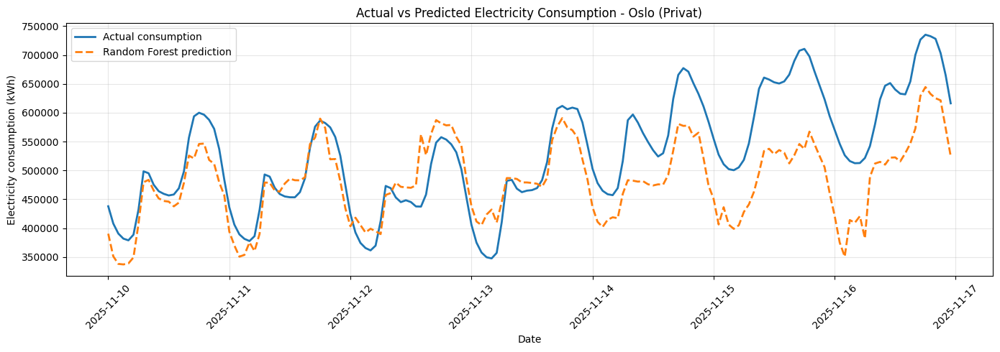
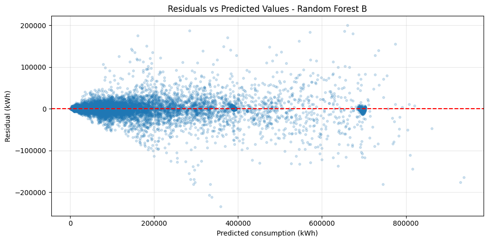
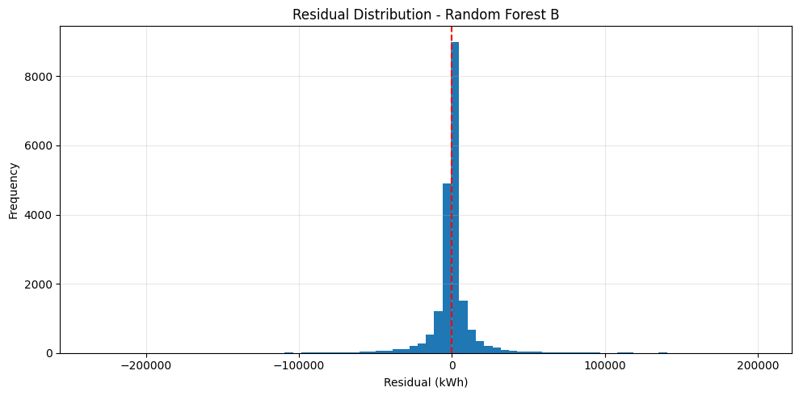
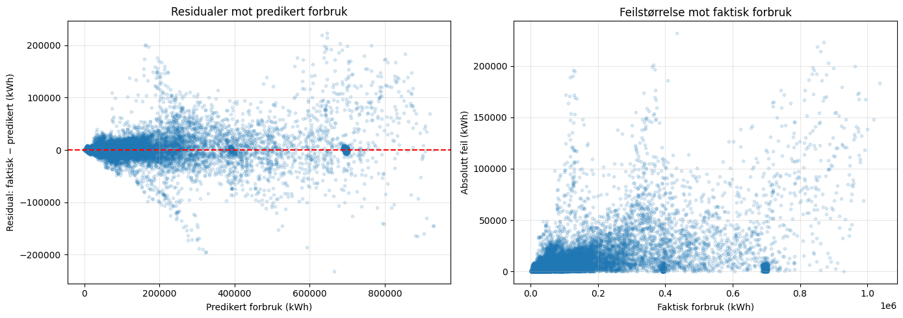
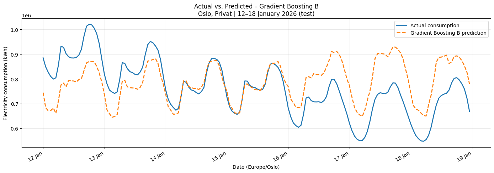
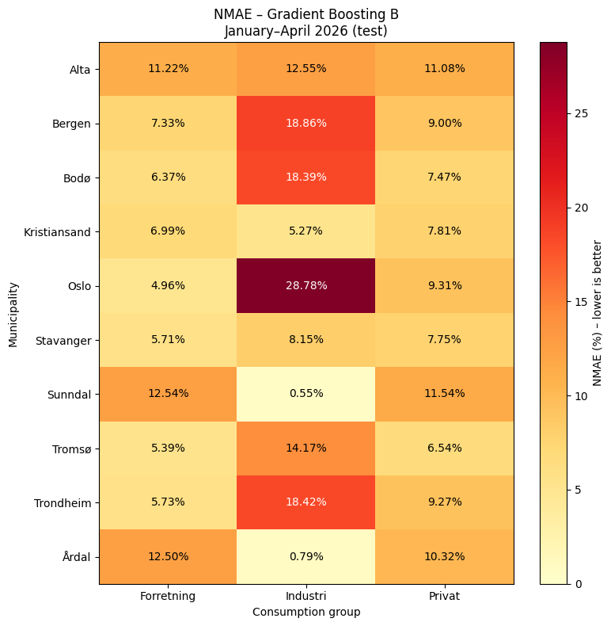
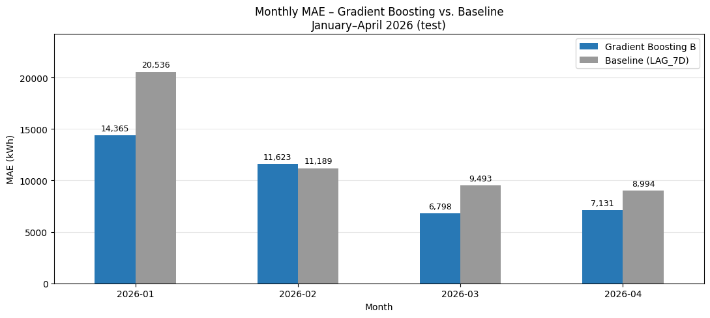
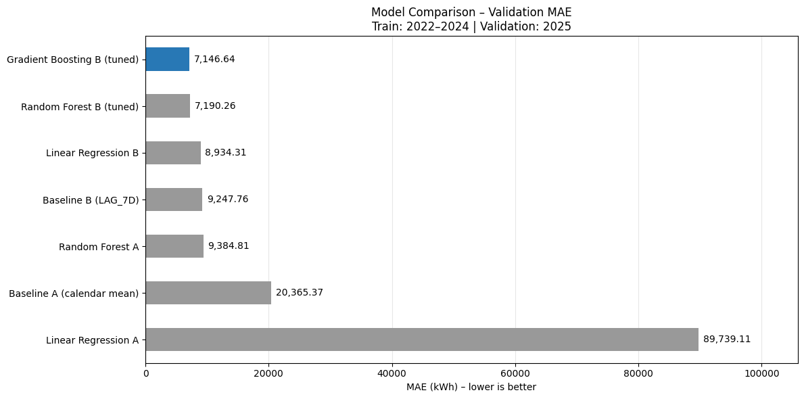

# Full dokumentasjon av feature engineering og strømforbruksprognoser

Dokumentert: 30. oktober 2026. Kilde: [03_Feature_engineering.ipynb](03_Feature_engineering.ipynb).

Denne rapporten beskriver arbeidet og de lagrede resultatene i den oppgitte notatboken. Notatboken er ikke kjørt på nytt under dokumenteringen. Tallene er hentet fra lagrede celleutdata; beregnede prosentvise sammenligninger nedenfor er merket som slike. Rapporten dokumenterer dagens oppsett, ikke en full endringshistorikk fra tidligere samtaler eller sikkerhetskopier. Alle celler, all kildekode, tekstutdata og lagrede figurer følger i vedlegget.

## Leserveiledning og kildegrunnlag

Dette er et detaljert arbeidsgrunnlag for rapportskriving og for en senere ChatGPT-samtale om prosjektet. Hovedteksten forklarer metode og tolkning; vedlegget bevarer hele den aktuelle notebooken som tekst og figurer. **Cellehenvisninger er nummerert fra 1 etter plassering i notebookfilen**, ikke etter Jupyters kjøringsnummer (`In [n]`). En henvisning til celle 78 betyr derfor den 78. cellen i filen.

| Hva du trenger | Hvor du finner det |
| --- | --- |
| Problemstilling, data, variabler og tidsoppsett | [Kapittel 1–6](#kapittel-1) og [15–17](#kapittel-15) |
| Modeller, feilmål, tuning og modellvalg | [Kapittel 7–10](#kapittel-7) og [18–19](#kapittel-18) |
| Sluttmodell, alle lokale testresultater og månedlig evaluering | [Kapittel 11–12](#kapittel-11) |
| Alle åtte figurer med forklaring | [Kapittel 13](#kapittel-13) |
| Begrensninger, reproduserbarhet og formuleringer til rapport | [Kapittel 14](#kapittel-14) og [20–23](#kapittel-20) |
| Kildekart, original kode og originale utdata | [Kapittel 23](#kapittel-23) og [cellevedlegget](#cellevedlegg) |

Opplysningene har tre ulike statuser:

1. **Lagret resultat:** Tall eller tekst finnes i notebookens lagrede utdata. Cellehenvisningen gjør opplysningen etterprøvbar.
2. **Avledet beregning/metodetolkning:** Regnet fra viste tall eller utledet av koden under dokumenteringen. Dette er merket som beregnet eller som tolkning og innebærer ingen ny modelltrening.
3. **Forutsetning eller uavklart forhold:** For eksempel at målinger faktisk er publisert innen én time. Slike forhold skal ikke senere omtales som bekreftede fakta.

Dokumentet bygger kun på den oppgitte notebooken, ikke på antakelser om tidligere notebooks, eksterne datakilder eller tidligere samtaler. CSV-filen er ikke analysert på nytt. Ingen modell er trent på nytt for dette dokumentet. Påstander om rådataenes kvalitet, årsaker til feil eller operativ ytelse krever derfor annen dokumentasjon enn denne filen alene.

**To særlig viktige presiseringer:** Valg av beste modell skjer etter MAE på 2025, og test gjelder januar–april 2026. Historikkens effekt på 21,66 % er en kontrollert A/B-sammenligning på validering; testforbedringen på omtrent 21,04 % er en annen sammenligning, mellom sluttmodell B og historisk baseline.

<a id="kapittel-1"></a>

## 1. Formål og problemstillinger

Arbeidet undersøker to spørsmål:

1. Hvor mye bedre kan vi predikere strømforbruk når vi bruker historisk forbruk i tillegg til kalenderinformasjon?
2. Hvilken modell gir de beste prognosene på nye data?

Målvariabelen er `VOLUM_KWH`. En observasjon gjelder et tidsintervall for en bestemt kombinasjon av kommune og forbruksgruppe. Feilmål i kWh gjelder disse observasjonene, ikke samlet feil for hele Norge eller en hel dag.

<a id="kapittel-2"></a>

## 2. Datagrunnlag

- Inputfil: `../data/consumption_selected.csv`, relativt til notatboken.
- CSV leses med semikolon som skilletegn og komma som desimaltegn.
- Opprinnelig antall rader i den lagrede kjøringen: **1 115 970**.
- Kommuner: Alta, Bergen, Bodø, Kristiansand, Oslo, Stavanger, Sunndal, Tromsø, Trondheim og Årdal.
- Forbruksgrupper: Forretning, Industri og Privat; totalt 30 kommune–gruppe-kombinasjoner.
- Kolonner som brukes omfatter `STARTTID`, `SLUTTID`, `YEAR`, `MONTH`, `HOUR`, `DAY_OF_WEEK`, `KOMMUNE`, `FORBRUKSGRUPPE` og `VOLUM_KWH`.
- De første registrerte datoene i kontrollutdataene er i februar 2022, og siste viste dato er 30. april 2026.

Datakildens opprinnelige innsamling og tidligere rensearbeid beskrives ikke fullstendig i denne notatboken. Denne rapporten tillegger derfor ikke datasettet en kilde eller kvalitetssikring som ikke er dokumentert her.

<a id="kapittel-3"></a>

## 3. Kalenderbaserte variabler

Time, måned og ukedag representeres med sinus og cosinus slik at sykliske verdier ligger nær hverandre også ved overgangen mellom perioder:

| Variabler | Beregning |
| --- | --- |
| `HOUR_SIN`, `HOUR_COS` | sin/cos av `2π × HOUR / 24` |
| `MONTH_SIN`, `MONTH_COS` | sin/cos av `2π × (MONTH − 1) / 12` |
| `DAY_SIN`, `DAY_COS` | sin/cos av `2π × DAY_OF_WEEK / 7` |
| `IS_WEEKEND` | 1 når `DAY_OF_WEEK >= 5`, ellers 0 |
| `KOMMUNE`, `FORBRUKSGRUPPE` | Kategoriske prediktorer |

Modellvariant A bruker disse ni kolonnene. Kalenderkolonnene `HOUR`, `MONTH` og `DAY_OF_WEEK` leses fra inputfilen; denne notatboken viser ikke en egen kontroll av hvordan de opprinnelig ble laget.

<a id="kapittel-4"></a>

## 4. Prognosetidspunkt og historiske variabler

Prognosen for måldag D utstedes **kl. 00.00 Europe/Oslo på D−1**. Dette er ikke en løpende prognose én time fram i tid. Historikken må være tilgjengelig ved dette felles prognosetidspunktet.

`STARTTID` parses som UTC og konverteres til `Europe/Oslo`. Derfra lages `DATE`, `LOCAL_HOUR` og `DATE_KEY`. Sistnevnte er lokal dato ved midnatt uten tidssone og brukes til kalenderbaserte koblinger.

| Variabel | Innhold |
| --- | --- |
| `LAG_3D` | Forbruk i samme lokale time på D−3, for samme kommune og gruppe |
| `LAG_7D` | Forbruk i samme lokale time på D−7, for samme kommune og gruppe |
| `MEAN_3D` | Gjennomsnitt av timeverdiene gjennom hele D−3, for samme kommune og gruppe |

`MEAN_3D` er **ikke et glidende gjennomsnitt over tre dager**. Det er døgnmiddelverdien for én bestemt dag tre kalenderdøgn tilbake.

Modellvariant B bruker de ni kalender- og kategorikolonnene pluss disse tre historiske variablene, totalt tolv inputkolonner før kategorikoding.

Forskyvningene gjøres på lokale kalenderdatoer, ikke som faste 72- og 168-timers forskyvninger av tidssonebevisste tidspunkter. Ved gjentatt lokal time under overgang til vintertid brukes gjennomsnitt av kildetimeverdiene. Koblingene bruker `validate="many_to_one"` for å unngå at radantallet øker ved slike gjentakelser. Ved manglende lokal kildetime omkring sommertid kan historikk mangle.

<a id="kapittel-5"></a>

## 5. Datakontroller og fjerning av manglende historikk

| Variabel | Manglende verdier | Andel |
| --- | ---: | ---: |
| `LAG_3D` | 2 310 | 0,21 % |
| `LAG_7D` | 5 190 | 0,47 % |
| `MEAN_3D` | 2 160 | 0,19 % |

Det er **0 duplikater** per kommune, forbruksgruppe og `TIMESTAMP`. Totalt mangler minst én historisk variabel på 5 340 rader. Tallene per variabel overlapper og skal ikke summeres som antall fjernede rader.

- 2022: 5 100 rader med minst én manglende historisk variabel.
- 2023, 2024, 2025 og 2026: 60 rader hvert år.
- Hver kommune har 534 slike rader.
- De første sju dagene, 1.–7. februar 2022, har 720 berørte rader per dag.
- De øvrige berørte datoene er 30. mars og 3. april 2022; 29. mars og 2. april 2023; 3. og 7. april 2024; 2. og 6. april 2025; 1. og 5. april 2026. Hver har 30 berørte rader.

Notatboken knytter manglene til oppstarten av historikken og sommertid. Alle rader med manglende historiske prediktorer fjernes med `dropna(subset=lag_features)`. Dette gir **1 110 630 komplette rader** og null manglende verdier i de tre historiske kolonnene. A og B bruker det samme reduserte datagrunnlaget, selv om A ikke trenger historikken.

<a id="kapittel-6"></a>

## 6. Kronologisk oppdeling

| Del | Datointervall etter filtrering | Antall rader | Bruk |
| --- | --- | ---: | --- |
| Trening | 08.02.2022–31.12.2024 | 761 580 | Tilpasning under modellutvikling |
| Validering | 01.01.2025–31.12.2025 | 262 740 | Modell- og hyperparametervalg |
| Test | 01.01.2026–30.04.2026 | 86 310 | Evaluering av valgt sluttmodell |

Koden deler på `YEAR`. Testsettet er altså januar–april 2026 i de foreliggende dataene, ikke hele 2026. Ingen tilfeldig train/test-splitt brukes. Den endelige modellen trenes på trening og validering samlet: **1 024 320 rader fra 2022–2025**.

Historiske input til senere prognosedager kan komme fra tidligere dager innenfor validerings- eller testperioden. Oppsettet representerer dermed gjentatte prognoser med tilgjengelig historikk gjennom perioden, ikke én prognose for hele året laget ved årsskiftet.

<a id="kapittel-7"></a>

## 7. Preprosessering og modeller

Lineær regresjon og Ridge bruker `StandardScaler` på numeriske variabler og `OneHotEncoder(handle_unknown="ignore")` på kommune og forbruksgruppe, samlet i `ColumnTransformer` og `Pipeline`. Ridge B bruker `alpha=1.0`.

Random Forest bruker numeriske variabler uten skalering og samme type kategorikoding. Startmodellene A og B bruker `n_estimators=100`, `max_depth=15`, `min_samples_leaf=5`, `max_features=1.0`, `random_state=42` og `n_jobs=-1`.

Gradient Boosting implementeres med `HistGradientBoostingRegressor`. Numeriske verdier passerer uten skalering. Kategoriene one-hot-kodes med `sparse_output=False`. Startmodell B bruker `max_iter=200`, `max_leaf_nodes=31`, `learning_rate=0.1`, `random_state=42` og **`early_stopping=False`**.

Tidlig stopping er eksplisitt deaktivert også under tuning og for sluttmodellen. Den lagrede kontrollen viser scikit-learn **1.8.0**, henholdsvis 200, 300 og 300 faktiske iterasjoner for startmodellen, beste B og sluttmodellen, ingen tidlig stopp og null interne valideringsscore. `validation_fraction=0.1` vises som parameter, men intern validering er ikke aktivert.

<a id="kapittel-8"></a>

## 8. Feilmål og baselines

- **MAE:** gjennomsnittlig absolutt prediksjonsfeil i kWh.
- **RMSE:** kvadratroten av gjennomsnittlig kvadrert feil; store feil teller mer.
- **R²:** 1 minus summen av kvadrerte feil delt på summen av kvadrerte avvik fra faktisk gjennomsnitt. Dette er ikke en prosentvis treffsikkerhet.
- **NMAE:** `100 × MAE / mean(abs(faktisk forbruk))`, beregnet innen den aktuelle kommunen eller kommune–gruppe-kombinasjonen. Dette er ikke MAPE.
- **Forbedring mot baseline:** `100 × (MAE_baseline − MAE_modell) / MAE_baseline`. Negative tall betyr at modellen har større MAE.

Baseline A bruker treningsgjennomsnitt for samme kommune, gruppe, ukedag og time. Alle valideringsrader får prediksjon. Baseline B er sesongnaiv: prediksjon lik `LAG_7D`.

<a id="kapittel-9"></a>

## 9. Resultater på validering i 2025

Alle tall nedenfor gjelder trening i 2022–2024 og evaluering i 2025. MAE og RMSE er i kWh. Avrundingen følger de lagrede utdataene.

| Modell | MAE | RMSE | R² |
| --- | ---: | ---: | ---: |
| Baseline A | 20 365,37 | 40 934,92 | Ikke vist |
| Baseline B (`LAG_7D`) | 9 247,763 | 21 594,196 | 0,983 |
| Lineær regresjon A | 89 739,109 | 133 348,111 | 0,339 |
| Lineær regresjon B | 8 934,311 | 18 831,553 | 0,987 |
| Ridge B | 8 934,362 | 18 831,533 | 0,987 |
| Random Forest A | 9 384,811 | 18 852,797 | 0,987 |
| Random Forest B, startmodell | 7 257,751 | 16 564,082 | 0,990 |
| Gradient Boosting B, startmodell | 7 369,746 | **16 121,807** | 0,990 |
| Random Forest B, beste undersøkte | 7 190,257 | 16 488,823 | 0,990 |
| Gradient Boosting B, beste undersøkte | **7 146,641** | 16 153,297 | 0,990 |

**MAE bestemmer modellvalget.** Gradient Boosting-startmodellen har RMSE 16 121,807, litt lavere enn valgt B-modells 16 153,297. Valgt modell er dermed best etter MAE blant oppsettene i tabellen, men har ikke lavest RMSE. R² med tre desimaler skiller heller ikke de beste modellene tydelig. Kilder: cellene 55 og 77.

Ridge gir nesten samme resultat som lineær regresjon B. Lineær regresjon A er betydelig svakere enn både kalenderbasert baseline og kalenderbasert Random Forest; den store A/B-forskjellen i lineær regresjon kan derfor ikke alene brukes som et generelt anslag på nytten av historikk. Notatboken fastslår ikke én dokumentert årsak til svakheten i lineær A.

Baseline B slår lineær B for Forretning (MAE 6 434,238 mot 7 669,841), mens lineær B er bedre for Industri og Privat. Random Forest B forbedrer MAE mot begge i alle tre forbruksgrupper. De fullstendige gruppetabellene følger i vedlegget.

Random Forest B forbedrer MAE mot Random Forest A i alle ti kommuner. Den lagrede forbedringen varierer fra 13,76 % i Bodø til 60,62 % i Årdal; Sunndal har 56,60 %.

### Fullstendige valideringsresultater per forbruksgruppe

Tabellen samler cellene 37 og 45. Alle målinger gjelder 2025, og Random Forest B er startmodellen med dybde 15 og minst 5 rader per blad. Disse er ikke gruppetall for den tunede Gradient Boosting-modellen.

| Gruppe | Modell | MAE (kWh) | RMSE (kWh) | R² |
| --- | --- | --- | --- | --- |
| Forretning | Baseline B | 6 434,238 | 14 639,308 | 0,984 |
| Forretning | Linear Regression A | 61 145,853 | 89 179,150 | 0,420 |
| Forretning | Linear Regression B | 7 669,841 | 15 751,917 | 0,982 |
| Forretning | Random Forest B, startmodell | 5 134,079 | 11 464,559 | 0,990 |
| Industri | Baseline B | 7 839,502 | 20 876,534 | 0,990 |
| Industri | Linear Regression A | 131 886,361 | 180 981,315 | 0,281 |
| Industri | Linear Regression B | 7 474,085 | 17 633,615 | 0,993 |
| Industri | Random Forest B, startmodell | 6 524,934 | 16 653,506 | 0,994 |
| Privat | Baseline B | 13 469,550 | 27 364,007 | 0,962 |
| Privat | Linear Regression A | 76 185,113 | 112 418,855 | 0,362 |
| Privat | Linear Regression B | 11 659,006 | 22 468,085 | 0,975 |
| Privat | Random Forest B, startmodell | 10 114,239 | 20 355,124 | 0,979 |

### Fullstendig Random Forest A/B-sammenligning per kommune

Kilde: celle 51. Begge er startmodeller med identiske Random Forest-innstillinger. MAE er beregnet over alle tre grupper i hver kommune i 2025. Dette er ikke en baseline-sammenligning og ikke testresultater.

| Kommune | MAE A (kWh) | MAE B (kWh) | Relativ MAE-reduksjon (%) |
| --- | --- | --- | --- |
| Årdal | 3 189,72 | 1 256,15 | 60,62 |
| Sunndal | 5 009,20 | 2 174,22 | 56,60 |
| Kristiansand | 6 896,02 | 4 377,49 | 36,52 |
| Stavanger | 7 351,90 | 5 302,02 | 27,88 |
| Trondheim | 13 213,21 | 10 681,75 | 19,16 |
| Bergen | 13 049,50 | 10 755,06 | 17,58 |
| Tromsø | 5 217,93 | 4 359,55 | 16,45 |
| Alta | 2 219,81 | 1 860,60 | 16,18 |
| Oslo | 34 367,68 | 28 936,09 | 15,80 |
| Bodø | 3 333,13 | 2 874,57 | 13,76 |

Tabellen viser forbedring i hver kommune, men sier ikke at historikk forbedrer hver enkelt time eller alle kommune–gruppe-kombinasjoner på validering. Slike finere A/B-resultater er ikke vist her.

### Hyperparametere som ble undersøkt

Random Forest B beholder 100 trær, `max_features=1.0`, `random_state=42` og `n_jobs=-1`:

| `max_depth` | `min_samples_leaf` | MAE |
| --- | ---: | ---: |
| 10 | 5 | 7 689,71 |
| 15 | 5 | 7 257,75 |
| 20 | 5 | 7 204,48 |
| 20 | 10 | **7 190,26** |
| `None` | 10 | 7 195,22 |

`NaN` i utskriftens dybdekolonne representerer her parameteren `None`, ikke et manglende forsøksresultat.

Gradient Boosting B bruker `early_stopping=False` og `random_state=42` i alle forsøk:

| `max_iter` | `learning_rate` | `max_leaf_nodes` | MAE |
| ---: | ---: | ---: | ---: |
| 100 | 0,1 | 31 | 7 560,29 |
| 200 | 0,1 | 31 | 7 369,75 |
| 300 | 0,1 | 31 | 7 265,20 |
| 300 | 0,05 | 31 | 7 434,87 |
| 300 | 0,1 | 63 | **7 146,64** |

Beste undersøkte Gradient Boosting B velges videre. Forskjellen i MAE mot beste Random Forest er omtrent 43,616 kWh, eller 0,61 % beregnet fra de viste valideringstallene. Resultatene viser best ytelse blant de undersøkte oppsettene, ikke et bevis på et globalt optimalt modellvalg eller statistisk signifikant forskjell.

### Kontrollert Gradient Boosting A/B-sammenligning

To separate modeller bruker samme innstillinger: 300 iterasjoner, læringsrate 0,1, 63 bladnoder, `random_state=42` og deaktivert tidlig stopping. Koden kontrollerer med `assert` at A, B og målvariabel bruker de samme radindeksene i trening og validering.

| Modell | MAE | RMSE | Faktiske iterasjoner |
| --- | ---: | ---: | ---: |
| Gradient Boosting A | 9 122,75 | 18 553,15 | 300 |
| Gradient Boosting B | 7 146,64 | 16 153,30 | 300 |

Den lagrede beregningen viser **1 976,10 kWh lavere MAE og 21,66 % relativ forbedring med historikk**. Reduksjonen beregnes fra uavrundede verdier; subtraksjon av viste, avrundede tall kan gi et avvik på siste desimal. Dette er den direkte A/B-sammenligningen for valgt modelloppsett på 2025-data.

<a id="kapittel-10"></a>

## 10. Kontroll av historiske verdier og tilgjengelighet

Et konkret eksempel er Årdal, Industri, 17. november 2025 kl. 18:

- Faktisk forbruk: 393 028,716 kWh.
- `LAG_3D`: 388 916,623 kWh; direkte oppslag for 14. november kl. 18 gir samme verdi.
- `LAG_7D`: 390 310,812 kWh.
- `MEAN_3D`: 388 785,15675 kWh.

For 1 000 tilfeldig valgte valideringsrader (`random_state=42`) kontrolleres `LAG_3D` og `LAG_7D` mot historiske oppslag: **0 avvik**. En separat kontroll av `MEAN_3D` på 1 000 rader gir også **0 avvik**. Sammenligningene bruker `np.isclose` med `rtol=1e-9` og `atol=1e-6`. Lag-kontrollen sammenligner bare når historiske rader finnes; middelkontrollen registrerer også manglende historikk som feil.

En enkel datokontroll på alle komplette rader gir null historiske datoer på eller etter prognosetidspunktet for både D−3 og D−7.

Den mer detaljerte tilgjengelighetskontrollen bruker `SLUTTID` og en **antatt publiseringsforsinkelse på én time**. Prognosetidspunktet lages som lokal midnatt på D−1 og konverteres til UTC. Ved gjentatt time brukes siste intervallslutt; for døgnmiddel brukes siste intervallslutt i hele kildedøgnet. Målinger uten `VOLUM_KWH` tas ikke med i denne kontrollens kildegrunnlag.

For hver av `LAG_3D`, `LAG_7D` og `MEAN_3D` viser den lagrede kontrollen:

- 0 manglende sluttider etter kobling.
- 0 antatte tilgjengelighetstidspunkter etter prognosetidspunktet.
- 0 antatte tilgjengelighetstidspunkter akkurat lik prognosetidspunktet.

**Faktisk publiseringstid er ikke bekreftet.** Kontrollene støtter tidsoppsettet under én-timesantakelsen; de beviser ikke at målingene faktisk var publisert i en operativ løsning. Tilgjengeligheten er fortsatt en eksplisitt forutsetning.

<a id="kapittel-11"></a>

## 11. Endelig modell og testresultater januar–april 2026

`final_model` er en klone av beste Gradient Boosting B og trenes på alle 1 024 320 radene fra trening og validering samlet. Testprediksjonene kommer fra denne modellen.

| Modell | MAE (kWh) | RMSE (kWh) | R² |
| --- | ---: | ---: | ---: |
| Historisk baseline (`LAG_7D`) | 12 620,646 | 28 642,545 | 0,977 |
| Endelig Gradient Boosting B | **9 965,047** | **22 689,697** | **0,9854** |

R² er vist med fire desimaler i den egne testutskriften; sammenligningstabellen viser 0,985. Beregnet fra de viste tallene gir modellen omtrent **21,04 % lavere MAE** og **20,78 % lavere RMSE** enn historisk baseline på hele testperioden.

Dette er en sammenligning av sluttmodellen mot baseline. Notatboken viser ikke tilsvarende testresultater for alle de andre modellene, og dokumenterer derfor ikke at Gradient Boosting slår hver enkelt av dem på testsettet.

### Test per forbruksgruppe

| Gruppe | MAE (kWh) | RMSE (kWh) | R² |
| --- | ---: | ---: | ---: |
| Forretning | 6 283,884 | 12 916,868 | 0,991 |
| Industri | 8 921,924 | 22 991,670 | 0,989 |
| Privat | 14 689,332 | 29 137,684 | 0,978 |

Privat har størst absolutt feil blant gruppene. Dette er en beskrivelse av de viste kWh-feilene, ikke en sammenligning av normalisert gruppefeil.

### Test per kommune

| Kommune | MAE (kWh) | RMSE (kWh) | R² | NMAE |
| --- | ---: | ---: | ---: | ---: |
| Oslo | 44 425,160 | 62 320,164 | 0,932 | 10,32 % |
| Bergen | 16 132,155 | 24 007,240 | 0,960 | 9,09 % |
| Trondheim | 13 036,557 | 18 175,087 | 0,938 | 9,79 % |
| Stavanger | 6 914,388 | 10 356,759 | 0,964 | 7,09 % |
| Kristiansand | 6 128,526 | 9 027,665 | 0,924 | 6,77 % |
| Tromsø | 4 078,987 | 5 740,058 | 0,976 | 6,83 % |
| Bodø | 3 147,359 | 4 536,659 | 0,969 | 8,10 % |
| Alta | 2 585,509 | 3 590,700 | 0,913 | 11,35 % |
| Sunndal | 1 784,614 | 8 440,357 | 0,999 | 0,76 % |
| Årdal | 1 417,215 | 5 596,050 | 0,999 | 1,06 % |

Oslo har størst absolutt MAE, mens Alta har høyest normalisert MAE. Kommuneaggregater kan skjule variasjon mellom grupper: Oslo Industri har NMAE 28,78 %, Bergen Industri 18,86 %, Trondheim Industri 18,42 % og Bodø Industri 18,39 %. Sunndal Industri og Årdal Industri har henholdsvis 0,55 % og 0,79 %. Hele tabellen med alle 30 kombinasjoner og deres gjennomsnittsforbruk er bevart i vedlegget.

### Test mot baseline per kommune og gruppe

Modellen har lavere MAE enn baseline i **29 av 30 kombinasjoner**. De fem største relative forbedringene er:

| Kommune og gruppe | MAE modell | MAE baseline | Forbedring |
| --- | ---: | ---: | ---: |
| Tromsø Privat | 6 579,57 | 9 889,47 | 33,47 % |
| Oslo Forretning | 23 374,39 | 34 172,97 | 31,60 % |
| Stavanger Privat | 12 068,32 | 17 456,11 | 30,86 % |
| Bodø Privat | 5 052,35 | 7 267,54 | 30,48 % |
| Stavanger Forretning | 5 792,27 | 8 283,04 | 30,07 % |

Unntaket er **Årdal Forretning**: modellens MAE er 409,18 kWh mot baseline 400,03 kWh, som gir **−2,29 % forbedring**. Sunndal Forretning har en liten positiv forbedring på 4,02 %. Alle kombinasjoner er tatt med i vedlegget.

### Komplett detaljtabell: normalisert testfeil for alle 30 kombinasjoner

Kilde: celle 94. «Gj.sn. absolutt forbruk» er `mean(abs(VOLUM_KWH))` per observasjon i den aktuelle kombinasjonen. NMAE bruker denne verdien som nevner. MAE og gjennomsnittsforbruk er i kWh; NMAE er i prosent. Dette er modellens feil, ikke endring mot baseline.

| Kommune | Forbruksgruppe | MAE (kWh) | Gj.sn. absolutt forbruk (kWh) | NMAE (%) |
| --- | --- | --- | --- | --- |
| Alta | Forretning | 2 439,77 | 21 754,16 | 11,22 |
| Alta | Industri | 1 343,87 | 10 711,58 | 12,55 |
| Alta | Privat | 3 972,88 | 35 858,26 | 11,08 |
| Bergen | Forretning | 13 799,96 | 188 381,15 | 7,33 |
| Bergen | Industri | 6 952,91 | 36 871,71 | 18,86 |
| Bergen | Privat | 27 643,60 | 307 202,13 | 9,00 |
| Bodø | Forretning | 2 443,42 | 38 372,99 | 6,37 |
| Bodø | Industri | 1 946,31 | 10 583,44 | 18,39 |
| Bodø | Privat | 5 052,35 | 67 641,45 | 7,47 |
| Kristiansand | Forretning | 4 040,72 | 57 810,88 | 6,99 |
| Kristiansand | Industri | 4 852,26 | 92 145,87 | 5,27 |
| Kristiansand | Privat | 9 492,60 | 121 490,01 | 7,81 |
| Oslo | Forretning | 23 374,39 | 471 414,14 | 4,96 |
| Oslo | Industri | 49 565,88 | 172 200,95 | 28,78 |
| Oslo | Privat | 60 335,21 | 648 007,20 | 9,31 |
| Stavanger | Forretning | 5 792,27 | 101 463,15 | 5,71 |
| Stavanger | Industri | 2 882,58 | 35 374,63 | 8,15 |
| Stavanger | Privat | 12 068,32 | 155 704,74 | 7,75 |
| Sunndal | Forretning | 541,86 | 4 320,52 | 12,54 |
| Sunndal | Industri | 3 835,82 | 695 438,77 | 0,55 |
| Sunndal | Privat | 976,17 | 8 461,55 | 11,54 |
| Tromsø | Forretning | 3 344,30 | 62 096,00 | 5,39 |
| Tromsø | Industri | 2 313,09 | 16 329,20 | 14,17 |
| Tromsø | Privat | 6 579,57 | 100 667,69 | 6,54 |
| Trondheim | Forretning | 6 652,97 | 116 136,18 | 5,73 |
| Trondheim | Industri | 12 437,56 | 67 517,94 | 18,42 |
| Trondheim | Privat | 20 019,13 | 216 019,61 | 9,27 |
| Årdal | Forretning | 409,18 | 3 274,26 | 12,50 |
| Årdal | Industri | 3 088,97 | 392 308,18 | 0,79 |
| Årdal | Privat | 753,50 | 7 298,65 | 10,32 |

### Komplett detaljtabell: sluttmodell mot historisk baseline

Kilde: celle 95. Samme testobservasjoner som ovenfor. Tabellen er ordnet etter kommune og gruppe for enkel sammenligning med NMAE-tabellen; originalutskriften i vedlegget er sortert etter forbedring. Positiv forbedring betyr lavere MAE enn baseline. Relativ forbedring beregnes med baseline-MAE som nevner, ikke med gjennomsnittsforbruket.

| Kommune | Forbruksgruppe | MAE modell (kWh) | MAE baseline (kWh) | Forbedring (%) |
| --- | --- | --- | --- | --- |
| Alta | Forretning | 2 439,77 | 2 868,32 | 14,94 |
| Alta | Industri | 1 343,87 | 1 708,46 | 21,34 |
| Alta | Privat | 3 972,88 | 5 090,96 | 21,96 |
| Bergen | Forretning | 13 799,96 | 17 767,67 | 22,33 |
| Bergen | Industri | 6 952,91 | 8 869,06 | 21,60 |
| Bergen | Privat | 27 643,60 | 37 515,74 | 26,31 |
| Bodø | Forretning | 2 443,42 | 3 274,58 | 25,38 |
| Bodø | Industri | 1 946,31 | 2 512,24 | 22,53 |
| Bodø | Privat | 5 052,35 | 7 267,54 | 30,48 |
| Kristiansand | Forretning | 4 040,72 | 5 396,88 | 25,13 |
| Kristiansand | Industri | 4 852,26 | 6 203,10 | 21,78 |
| Kristiansand | Privat | 9 492,60 | 13 215,53 | 28,17 |
| Oslo | Forretning | 23 374,39 | 34 172,97 | 31,60 |
| Oslo | Industri | 49 565,88 | 57 908,46 | 14,41 |
| Oslo | Privat | 60 335,21 | 65 743,29 | 8,23 |
| Stavanger | Forretning | 5 792,27 | 8 283,04 | 30,07 |
| Stavanger | Industri | 2 882,58 | 3 368,97 | 14,44 |
| Stavanger | Privat | 12 068,32 | 17 456,11 | 30,86 |
| Sunndal | Forretning | 541,86 | 564,57 | 4,02 |
| Sunndal | Industri | 3 835,82 | 4 377,51 | 12,37 |
| Sunndal | Privat | 976,17 | 1 210,75 | 19,37 |
| Tromsø | Forretning | 3 344,30 | 4 773,44 | 29,94 |
| Tromsø | Industri | 2 313,09 | 2 894,17 | 20,08 |
| Tromsø | Privat | 6 579,57 | 9 889,47 | 33,47 |
| Trondheim | Forretning | 6 652,97 | 9 249,33 | 28,07 |
| Trondheim | Industri | 12 437,56 | 14 729,34 | 15,56 |
| Trondheim | Privat | 20 019,13 | 27 443,67 | 27,05 |
| Årdal | Forretning | 409,18 | 400,03 | -2,29 |
| Årdal | Industri | 3 088,97 | 3 545,85 | 12,88 |
| Årdal | Privat | 753,50 | 918,35 | 17,95 |

Det er fullt mulig å ha lav NMAE og liten forbedring mot baseline samtidig: Årdal Industri har NMAE 0,79 % og forbedrer baseline med 12,88 %. Tilsvarende er Oslo Industri forbedret med 14,41 %, selv om NMAE fremdeles er 28,78 %. De to prosentmålene svarer på ulike spørsmål.

### Gjennomsnittlig absolutt forbruk bak kommunenes NMAE

Kilde: celle 92. Dette tillegget bevarer nevneren bak kommunetallene i hovedtabellen. Gjennomsnittet gjelder kommuneobservasjoner på tvers av grupper, og er ikke kommunens summerte døgn- eller timeforbruk.

| Kommune | MAE (kWh) | Gj.sn. absolutt forbruk (kWh) | NMAE (%) |
| --- | --- | --- | --- |
| Alta | 2 585,51 | 22 774,67 | 11,35 |
| Oslo | 44 425,16 | 430 540,76 | 10,32 |
| Trondheim | 13 036,56 | 133 224,58 | 9,79 |
| Bergen | 16 132,16 | 177 484,99 | 9,09 |
| Bodø | 3 147,36 | 38 865,96 | 8,10 |
| Stavanger | 6 914,39 | 97 514,17 | 7,09 |
| Tromsø | 4 078,99 | 59 697,63 | 6,83 |
| Kristiansand | 6 128,53 | 90 482,25 | 6,77 |
| Årdal | 1 417,22 | 134 293,70 | 1,06 |
| Sunndal | 1 784,61 | 236 073,61 | 0,76 |

<a id="kapittel-12"></a>

## 12. Månedlig evaluering

Validering bruker den beste modellen trent på 2022–2024. Test bruker sluttmodellen trent på 2022–2025. Disse periodene og modelltilpasningene må holdes atskilt.

| Måned | Antall | MAE modell | MAE baseline | Forbedring |
| --- | ---: | ---: | ---: | ---: |
| 2025-01 | 22 320 | 12 586,63 | 18 464,30 | 31,83 % |
| 2025-02 | 20 160 | 10 923,65 | 12 962,47 | 15,73 % |
| 2025-03 | 22 290 | 8 395,91 | 11 449,74 | 26,67 % |
| 2025-04 | 21 540 | 8 043,23 | 10 377,90 | 22,50 % |
| 2025-05 | 22 320 | 6 210,70 | 7 576,22 | 18,02 % |
| 2025-06 | 21 600 | 4 071,79 | 5 238,10 | 22,27 % |
| 2025-07 | 22 320 | 2 918,92 | 3 730,41 | 21,75 % |
| 2025-08 | 22 320 | 3 621,72 | 4 671,55 | 22,47 % |
| 2025-09 | 21 600 | 4 083,49 | 5 318,77 | 23,22 % |
| 2025-10 | 22 350 | 5 530,47 | 7 241,24 | 23,63 % |
| 2025-11 | 21 600 | 10 431,10 | 13 833,97 | 24,60 % |
| 2025-12 | 22 320 | 9 250,73 | 10 404,99 | 11,09 % |

Modellen forbedrer baseline i alle tolv valideringsmåneder. Størst relativ forbedring er i januar og minst i desember.

| Testmåned | Antall | MAE modell | MAE baseline | Forbedring |
| --- | ---: | ---: | ---: | ---: |
| 2026-01 | 22 320 | 14 365,48 | 20 536,47 | 30,05 % |
| 2026-02 | 20 160 | 11 623,28 | 11 189,46 | **−3,88 %** |
| 2026-03 | 22 290 | 6 797,85 | 9 493,33 | 28,39 % |
| 2026-04 | 21 540 | 7 130,75 | 8 993,87 | 20,72 % |

Modellen taper mot baseline i februar 2026, selv om den samlet er bedre i testperioden. Notatboken dokumenterer ikke årsaken. Gjennomsnittet av månedlige forbedringsprosenter er ikke det samme som forbedringen i samlet MAE.

<a id="kapittel-13"></a>

## 13. Residualanalyser og figurer

Residual defineres som `faktisk − predikert`. Positiv residual betyr underprediksjon; negativ betyr overprediksjon.

For Random Forest B på validering er residualenes gjennomsnitt −181,443548 kWh, standardavvik 16 563,119610, minimum −486 087,623353, første kvartil −2 658,740177, median −57,986675, tredje kvartil 2 341,508222 og maksimum 335 423,547447. Antall residualer er 262 740.

For sluttmodellens testprediksjoner:

- Gjennomsnittlig residual: **1 725,04 kWh**.
- Median: **−45,26 kWh**.
- Andel underprediksjoner: **49,38 %**.
- Andel overprediksjoner: **50,62 %**.

Medianen er nær null, mens positiv gjennomsnittsresidual viser netto underprediksjon målt i kWh. Nesten like mange under- og overprediksjoner innebærer derfor ikke like store feil i de to retningene.

| Kvartilintervall for faktisk forbruk (kWh) | Antall | Gjennomsnittsforbruk | Gjennomsnittlig residual | MAE |
| --- | ---: | ---: | ---: | ---: |
| (1 552,825; 21 510,306] | 21 578 | 9 171,59 | −378,91 | 1 260,56 |
| (21 510,306; 71 851,88] | 21 577 | 43 463,16 | −1 140,27 | 4 783,63 |
| (71 851,88; 161 094,674] | 21 577 | 106 197,16 | −1 465,84 | 9 519,86 |
| (161 094,674; 1 073 136,78] | 21 578 | 409 542,80 | 9 884,90 | 24 295,87 |

Største forbrukskvartil har størst absolutt MAE og positiv gjennomsnittsresidual, mens de tre lavere kvartilene har negativ gjennomsnittsresidual. Dette er observerte mønstre, ikke en dokumentert årsaksforklaring.

Alle åtte lagrede PNG-figurer er eksportert direkte fra notebooken uten ny plotting. Nedenfor vises de sammen med utvalg, modelltilpasning og tolkningsgrenser. Originalene er også lenket ved kildecellene i vedlegget.

### Figur 1. Random Forest B: faktisk og predikert forbruk i validering



**Kilde og utvalg:** Celle 59, `pred_rf_B` fra startmodellen, Oslo Privat, lokal dato fra og med 10. til før 17. november 2025, sortert etter `TIMESTAMP`. Heltrukket linje viser faktisk forbruk og stiplet linje prognosen. Begge er i kWh per observasjon. Figuren illustrerer kurveform for én kombinasjon i én uke og erstatter ikke feilmål for hele valideringsåret. Den viser ikke sluttmodellen.

### Figur 2. Random Forest B: residual mot predikert forbruk



**Kilde og utvalg:** Første figur i celle 63, opptil 20 000 tilfeldig valgte valideringsrader, `random_state=42`. X-aksen er predikert kWh, y-aksen er faktisk minus predikert kWh. Den røde nulllinjen skiller underprediksjon over linjen fra overprediksjon under linjen. Se etter systematiske mønstre og endret feilspredning ved høyt forbruk. Diagrammet alene tester ikke uavhengighet, normalfordeling eller statistisk signifikans.

### Figur 3. Random Forest B: residualfordeling



**Kilde og utvalg:** Andre figur i celle 63, samme tilfeldige utvalg som figur 2, 80 histogramintervaller. X-aksen er residual i kWh og y-aksen antall punkter i hvert intervall. De eksakte deskriptive tallene ovenfor kommer fra samtlige 262 740 valideringsrader i celle 61; histogrammet bygger på utvalget. Et smalt sentrum utelukker ikke store feil i halene.

### Figur 4. Sluttmodell: residualer og absolutt feil på test



**Kilde og utvalg:** Celle 84, opptil 20 000 testobservasjoner med `random_state=42`. Venstre panel har predikert kWh på x-aksen og residual i kWh på y-aksen. Høyre panel har faktisk kWh på x-aksen og absolutt feil i kWh på y-aksen. De utskrevne residualmålene og kvartiltabellen beregnes på hele testsettet. Kvartilene er laget med `pd.qcut(..., q=4, duplicates="drop")` på faktisk forbruk, på tvers av kommuner og grupper; de er ikke tidskvartaler.

### Figur 5. Sluttmodell: faktisk og predikert forbruk i testuken



**Kilde og utvalg:** Celle 98, `test_eval` med `pred_test`, Oslo Privat, lokal dato fra og med 12. til før 19. januar 2026. X-aksen formateres eksplisitt i `Europe/Oslo`. Heltrukket blå linje er faktisk forbruk og stiplet oransje linje er sluttmodellens prediksjon. Aksemarkeringen `1e6` betyr at y-verdiene skal multipliseres med én million kWh.

**Visuell observasjon:** I dette utsnittet ligger prognosen under faktisk forbruk tidlig i uken og over faktisk forbruk i de siste dagene. Dette viser at feilretningen kan skifte over kort tid. Det er ikke grunnlag for å konkludere med årsaken, eller at denne uken representerer hele testperioden. Ingen særskilt uke-MAE er skrevet ut i notebooken.

### Figur 6. Sluttmodell: NMAE for alle kommune–gruppe-kombinasjoner



**Kilde og beregning:** Celle 100, pivotering av `detailed_results` fra celle 94. Rader er kommuner, kolonner er Forretning, Industri og Privat. Hver rute viser NMAE for januar–april 2026. Fargeskalaen starter ved 0; mørkere rød betyr høyere relativ feil. Lavere verdi er bedre.

**Tolkning:** Oslo Industri skiller seg ut med 28,78 %, mens Sunndal Industri og Årdal Industri ligger på 0,55 % og 0,79 %. Kommunenes samlede NMAE kan skjule betydelig gruppevariasjon. Fargene viser normalisert feil og kan ikke brukes til å lese av hvilken kombinasjon som bidrar mest til total absolutt kWh-feil. Dette er heller ikke et kart over forbedring mot baseline.

### Figur 7. Sluttmodell og baseline: MAE per testmåned



**Kilde og beregning:** Celle 102, kun `Periode == "Uavhengig test"` fra månedstabellen i celle 96. Blå stolper viser sluttmodellen, grå viser `LAG_7D`. Lavere er bedre. Tall over stolpene er avrundet til hele kWh; kapittel 12 bevarer to desimaler.

**Tolkning:** Modellen har lavere MAE i januar, mars og april, men høyere MAE i februar. Samlet forbedring skal beregnes fra alle testobservasjoner, ikke fra gjennomsnittet av fire månedlige forbedringsprosenter. De fire månedene inneholder ulikt antall rader.

### Figur 8. Modellutvalg: MAE på validering



**Kilde og beregning:** Celle 104, sju oppsett sortert etter MAE. Beste undersøkte Random Forest B og Gradient Boosting B brukes i figuren. Ridge B, Gradient Boosting-startmodellen og den kontrollerte Gradient Boosting A-modellen er ikke med i dette plottet; flere resultater finnes i kapittel 9. Alle viste modeller bruker 2025 som evaluering, ikke testsettet.

**Tolkning og presentasjonsbegrensning:** Gradient Boosting B har lavest MAE blant de viste modellene. Den svært høye feilen til lineær A gjør at forskjellene mellom de beste modellene blir små visuelt på denne akseskalaen. Bruk de numeriske tabellene for en presis sammenligning. Figuren dokumenterer ikke statistisk signifikans eller at forskjellen på om lag 43,62 kWh mot tunet Random Forest vil gjenta seg på andre perioder.

<a id="kapittel-14"></a>

## 14. Hva resultatene støtter, og hva som gjenstår

Historisk forbruk gir en dokumentert forbedring utover kalenderinformasjon. For Gradient Boosting med identiske modellinnstillinger gir historikken 21,66 % lavere validerings-MAE. Den beste undersøkte Gradient Boosting B-modellen har lavest MAE blant de undersøkte modellene på validering. Etter ny trening på 2022–2025 slår den historisk baseline samlet i januar–april 2026, men forbedringen varierer mellom måneder og kommune–gruppe-kombinasjoner.

Ved videre arbeid må følgende begrensninger bevares:

- Faktisk publiseringstid for målinger er uavklart; én times forsinkelse er en antakelse.
- Lag- og middelkontrollene på 1 000 rader er stikkprøver. Tilgjengelighetskontrollen bruker hele det komplette modellgrunnlaget, under sin eksplisitte antakelse.
- Testperioden dekker fire måneder og gir ikke en full års- eller sommerevaluering for 2026.
- Validering brukes gjentatte ganger til modellvalg; testresultatene må holdes adskilt fra dette.
- Testsettet er nå analysert i detalj. Nye modellvalg basert på disse testfunnene vil kreve et nytt urørt evalueringsgrunnlag for en ny uavhengig sluttevaluering.
- Ingen konfidensintervaller, statistisk sammenligning, værvariabler eller analyse av variabelbetydning er vist i denne notatboken.
- Notatboken viser ikke lagring av ferdigtrent modell til disk eller et ferdig operativt prognosesystem.
- Denne rapporten bekrefter innholdet i lagrede utdata, ikke en ny ende-til-ende-kjøring eller uavhengig verifisering av rådata.

<a id="kapittel-15"></a>

## 15. Presis problemdefinisjon og forsøksdesign

### 15.1 Hva modellen faktisk predikerer

La `g` være en bestemt kombinasjon av kommune og forbruksgruppe, `D` en lokal måldato og `h` en lokal time. Målet er å predikere observert `VOLUM_KWH` for en slik rad. Det trenes **én felles modell per modellvariant på tvers av alle kommuner og grupper**, med kommune og forbruksgruppe som input. Notebooken trener ikke 30 separate modeller. Observasjonene er aggregerte kommune–gruppe-intervaller, ikke individuelle husholdninger eller enkeltmålere.

Det predikeres numerisk forbruk som en regresjonsoppgave. Koden summerer ikke prognosene til daglig energiforbruk, beregner ikke nettbelastning i MW og produserer ikke sannsynlighetsfordelinger eller prognoseintervaller. Enheten i mål og feil er kWh per rad. En timeverdi i kWh beskriver energi i intervallet; den skal ikke uten videre omtales som effekt i kW.

### 15.2 Informasjonssettet ved utstedelse

For alle timer på måldag D er det felles utstedelsestidspunktet lokal midnatt på D−1. Under vanlige døgn uten klokkeomstilling ligger starten på første måltime omtrent 24 timer fram og starten på siste måltime omtrent 47 timer fram, med siste intervallslutt omtrent 48 timer fram. Dette er en avledning av tidsdefinisjonen, ikke en egen målt ytelse per prognosehorisont. Sommertid og vintertid kan endre antall faktiske timer.

Det er derfor avgjørende å skille mellom:

| Tidspunkt/begrep | Betydning i forsøket |
| --- | --- |
| Utstedelsestid | Kl. 00.00 lokal tid på D−1 |
| Måldag | Lokal kalenderdato D |
| Måltime | En rad identifisert av faktisk `TIMESTAMP`, med lokal time som koblingsnøkkel for historikk |
| Historisk kildedag | D−3 eller D−7 |
| Målingens slutt | `SLUTTID`, brukt i tilgjengelighetskontrollen |
| Antatt tilgjengelighet | Siste relevante `SLUTTID` pluss én time |
| Faktisk publisering | Ikke dokumentert i notebooken |

**Illustrasjon med datoene fra celle 57:** For måldag 17. november 2025 utstedes prognosen 16. november kl. 00.00. `LAG_3D` og `MEAN_3D` bruker 14. november; `LAG_7D` bruker 10. november. For måltimen kl. 18 brukes kl. 18 på de to historiske datoene. Hele døgnmiddelverdien for 14. november er den samme inputverdien for alle målradene i samme kommune–gruppe på 17. november. Datoene for utstedelse og D−7 i denne forklaringen er avledet fra kodens regler; tallverdiene i kapittel 10 er lagret i celle 57.

### 15.3 Tre ulike sammenligninger

| Sammenligning | Hva holdes likt? | Hva varierer? | Hva kan besvares? |
| --- | --- | --- | --- |
| A mot B i samme modellfamilie | Treningsrader, valideringsrader og målvariabel; i de kontrollerte forsøkene også modellinnstillinger | Om de tre historiske inputene er med | Nytten av denne samlede historikkpakken i det aktuelle oppsettet |
| Modellfamilier og tuning på 2025 | Treningsår og valideringsår | Modelltype og undersøkte parametere | Hvilket undersøkt oppsett som har lavest validerings-MAE |
| Sluttmodell mot baseline på 2026 | De samme testobservasjonene | Lært B-modell mot direkte `LAG_7D` | Merverdien utover en enkel historisk prognose i testperioden |

A er et **variabelsett**, ikke navnet på én bestemt algoritme. Baseline A er dessuten en egen oppslagstabell og er ikke lineær regresjon A. Tilsvarende er baseline B ikke det samme som maskinlæringsmodell B. Bruk fulle modellnavn i rapporten for å unngå å blande disse.

Den kontrollerte Gradient Boosting A/B-sammenligningen bruker B-valgte hyperparametere også for A. Den isolerer effekten av å legge til historikk ved disse faste innstillingene. Den dokumenterer ikke en separat optimalisering av beste mulige A-modell. Random Forest A/B bruker de opprinnelige, identiske Random Forest-innstillingene; den tunede B-modellen skal ikke brukes som om den hadde identisk kapasitet med startmodell A.

<a id="kapittel-16"></a>

## 16. Variabelordbok og dataflyt

### 16.1 Inndata, mål og hjelpetider

| Navn i koden | Rolle | Definisjon og bruk | Direkte modellinput? |
| --- | --- | --- | --- |
| `VOLUM_KWH` | Mål/historisk måling | Verdien som skal predikeres; brukes også til å konstruere historiske input | Mål, ikke samme rads input |
| `KOMMUNE` | Kategori og gruppenøkkel | En av de ti kommunene | Ja, A og B |
| `FORBRUKSGRUPPE` | Kategori og gruppenøkkel | Forretning, Industri eller Privat | Ja, A og B |
| `STARTTID` | Rå tidskolonne | Parses med `pd.to_datetime(..., utc=True)` | Nei |
| `SLUTTID` | Intervallslutt | Parses som UTC ved tilgjengelighetskontroll | Nei |
| `YEAR` | Oppdeling | Velger trening `<= 2024`, validering `== 2025`, test `== 2026` | Nei |
| `MONTH` | Kalendergrunnlag | Brukes til månedens sinus/cosinus | Nei, kun avledede kolonner |
| `HOUR` | Kalendergrunnlag | Brukes til timens sinus/cosinus og kalenderbaseline | Nei, kun avledede kolonner i lærte modeller |
| `DAY_OF_WEEK` | Kalendergrunnlag | Brukes til ukedagskoding, helg og kalenderbaseline | Nei, kun avledede kolonner i lærte modeller |
| `TIMESTAMP` | Tidssonebevisst tid | `STARTTID` konvertert til `Europe/Oslo`; brukes til sortering og tidsutsnitt | Nei |
| `DATE` | Lokal dato | `TIMESTAMP.dt.date`, blant annet til døgnmiddel | Nei |
| `LOCAL_HOUR` | Lokal time | `TIMESTAMP.dt.hour`, brukt i historikkoppslag | Nei |
| `DATE_KEY` | Lokal datonøkkel | Tidssone fjernet etter konvertering; normalisert til lokal midnatt | Nei |
| `DAILY_MEAN` | Mellomresultat | Gjennomsnitt av `VOLUM_KWH` per kommune, gruppe og lokal dato | Nei, forskyves til `MEAN_3D` |
| `FORECAST_TIME` | Kontrolltid | Lokal midnatt på D−1, konvertert til UTC i detaljkontrollen | Nei |
| `MEASUREMENT_END` | Kontrolltid | `SLUTTID` som tidssonebevisst UTC | Nei |

`HOUR` og `LOCAL_HOUR` er to forskjellige kolonner i koden. Den første kommer fra CSV og brukes i kalenderfeatures; den andre beregnes fra lokal `TIMESTAMP` og brukes i lagene. Notebooken viser ingen eksplisitt kontroll av at de samsvarer. Det samme gjelder at `YEAR`, `MONTH` og `DAY_OF_WEEK` samsvarer med lokal `TIMESTAMP`. Dette er et åpent kontrollpunkt, ikke et påvist feilfunn.

### 16.2 Alle modellinput og rekkefølgen i variabellistene

| Nr. i B | Kolonne | Område/enhet etter konstruksjon | A | B |
| --- | --- | --- | --- | --- |
| 1 | `HOUR_SIN` | Omtrent −1 til 1 | Ja | Ja |
| 2 | `HOUR_COS` | Omtrent −1 til 1 | Ja | Ja |
| 3 | `MONTH_SIN` | Omtrent −1 til 1 | Ja | Ja |
| 4 | `MONTH_COS` | Omtrent −1 til 1 | Ja | Ja |
| 5 | `DAY_SIN` | Omtrent −1 til 1 | Ja | Ja |
| 6 | `DAY_COS` | Omtrent −1 til 1 | Ja | Ja |
| 7 | `IS_WEEKEND` | 0 eller 1 | Ja | Ja |
| 8 | `KOMMUNE` | Kategori | Ja | Ja |
| 9 | `FORBRUKSGRUPPE` | Kategori | Ja | Ja |
| 10 | `LAG_3D` | kWh | Nei | Ja |
| 11 | `LAG_7D` | kWh | Nei | Ja |
| 12 | `MEAN_3D` | kWh, gjennomsnittlig timeverdi på kildedøgnet | Nei | Ja |

`numerical_A` har sju kolonner, `numerical_B` ti og `categorical_features` to. Før transformasjon er antall input ni og tolv. Med alle ti kommune- og tre gruppekategoriene til stede ved tilpasning gir one-hot-kodingen normalt 13 kategorikolonner, og dermed 20/23 transformerte kolonner for A/B. Dette siste er beregnet ut fra kategoriene og `OneHotEncoder` uten angitt `drop`; notebooken skriver ikke ut den ferdige designmatrisens dimensjoner eller encoderens kategoriliste.

Ingen av modellene bruker rå `YEAR` som trendvariabel. Det inngår heller ingen eksplisitt kommune–gruppe-kombinasjonskategori, værdata, temperatur, pris, helligdagskalender, bevegelige høytider, befolkningsdata eller framtidskjente prognoser for disse. Det brukes ikke målskalering eller log-transformasjon av forbruket.

### 16.3 Dataobjekter og levetid

| Objekt | Innhold og betydning |
| --- | --- |
| `df` | Innlest tabell med kalender- og historikkvariabler; brukes som historisk kilde |
| `daily`, `previous`, `history` | Midlertidige aggregater/koblingstabeller; navnene gjenbrukes i senere celler |
| `df_model` | `df` etter fjerning av alle rader med minst én manglende historisk feature |
| `train`, `validation`, `test` | De tre kronologiske delmengdene |
| `features_A`, `features_B`, `target` | De eksplisitte inputlistene og målkolonnen |
| `X_train_A/B`, `X_val_A/B`, `X_test_A/B` | Inputtabeller i respektive perioder og varianter |
| `y_train`, `y_val`, `y_test` | Målserie med samme radrekkefølge som tilsvarende input |
| `evaluation` | Valideringsgrunnlag med baseline, lineære prediksjoner og Random Forest B |
| `municipality_eval` | Validering med Random Forest A/B-prediksjoner for kommunevis sammenligning |
| `residual_df` | Random Forest B-residualer på 2025 |
| `X_train_final`, `y_train_final` | Sammenføyd trening og validering for sluttmodell |
| `test_eval` | Hele testgrunnlaget med sluttmodellens `PREDICTED` |
| `gb_residuals` | Testobservasjoner med residual, absolutt feil og forbrukskvartil |
| `monthly_results` | Månedlige resultater, merket Validering eller Uavhengig test |
| `detailed_results` | NMAE og gjennomsnittsforbruk for 30 testkombinasjoner |
| `baseline_comparison` | Testmodell mot `LAG_7D` for de samme kombinasjonene |

Dette er objekter i en kjørende Python-kjerne. De er ikke lagret som separate datafiler av notebooken. Navn som `results`, `mae_A`, `mae_B`, `history` og `sample_check` gjenbrukes. Ved rapportarbeid skal resultater derfor knyttes til celle og periode, ikke bare til et variabelnavn som kan ha fått nytt innhold.

<a id="kapittel-17"></a>

## 17. Historikkonstruksjonen trinn for trinn

### 17.1 Tidskonvertering og kalenderkobling

1. `STARTTID` leses som UTC og konverteres til norsk tid. `utc=True` forutsetter at tidssonefrie inputverdier, dersom slike finnes, skal tolkes som UTC; notebooken dokumenterer ikke separat råformatets tidssemantikk.
2. Lokal dato og lokal time hentes ut. `DATE_KEY` lages ved å fjerne tidssonen fra den allerede konverterte lokale tiden og sette klokkeslettet til midnatt.
3. Døgnmiddel beregnes fra originalt `VOLUM_KWH` per kommune, gruppe og lokal dato.
4. Kildetabellens dato økes med tre kalenderdager før kobling mot målrader. En kilde fra dato D−3 får dermed koblingsdato D.
5. For hvert av lagene tre og sju dager økes historikktabellens datonøkkel tilsvarende. Det grupperes på kommune, gruppe, datonøkkel og lokal time, og eventuelle flere kildeverdier i samme lokale time erstattes med gjennomsnittet.
6. Tre venstrekoblinger (`how="left"`) legger til features uten å bevisst fjerne målrader. `validate="many_to_one"` krever høyst én kildeverdi per koblingsnøkkel.
7. Manglende historikk kartlegges før alle ufullstendige rader fjernes.

At kildedatoene flyttes **fram** i en oppslagstabell betyr ikke at framtidige målinger brukes. Det gjør at en historisk måling fra D−3 får samme koblingsnøkkel som målrad D. Det brukes ingen radbasert `shift(72)` eller `shift(168)`; slike radforskyvninger ville også vært problematiske i en tabell som inneholder 30 ulike serier.

Historikken bygges før datasplitt, men hver historikkverdi hentes etter den faste kalenderregelen. **Det er ikke i seg selv lekkasje å konstruere fortidsbaserte features før splitt.** Vurderingen avhenger av hvilke målinger som bidrar og om de var tilgjengelige ved utstedelse. Globale gjennomsnitt over framtidige målverdier ville vært noe annet; slike gjennomsnitt brukes ikke som disse tre historiske inputene.

### 17.2 Formelle featuredefinisjoner

La `R(g,d,h)` være mengden opprinnelige rader for kombinasjon `g`, lokal dato `d` og lokal time `h`. Da er definisjonene, for tilgjengelige verdier:

```text
LAG_3D(g,D,h) = mean(VOLUM_KWH for r in R(g,D−3,h))
LAG_7D(g,D,h) = mean(VOLUM_KWH for r in R(g,D−7,h))
MEAN_3D(g,D)  = mean(VOLUM_KWH for alle opprinnelige rader med g og dato D−3)
```

`mean` følger pandas' behandling av manglende verdier, som normalt utelates fra gjennomsnittet. Notebooken krever ikke eksplisitt et bestemt antall gyldige timeverdier før `DAILY_MEAN` beregnes. Et delvis observert døgn kan derfor i prinsippet få et døgnmiddel. Dette er en egenskap ved koden; dokumentasjonen har ikke fastslått at slike deldøgn forekommer.

### 17.3 Sommertid og vintertid

| Situasjon | Konsekvens i koden |
| --- | --- |
| Vanlig dag | Normalt én kildeobservasjon per lokal time og kombinasjon |
| Overgang til sommertid | En lokal time kan mangle; et senere mål som etterspør denne timen D−3 eller D−7 får manglende lag |
| Overgang til vintertid i kildedøgnet | De to faktiske intervallene i gjentatt lokal time gjennomsnittsberegnes ved timeoppslag |
| Overgang til vintertid på måldøgnet | De to målrader med samme lokale time kan få samme lagverdi; faktisk `TIMESTAMP` skiller radene |
| Døgnmiddel ved klokkeomstilling | Gjennomsnitt av kildedøgnets rader; normalt 23 eller 25 timeintervaller hvis døgnet er komplett |

Døgnmiddel er et middel av intervallverdier, ikke døgnsum og ikke et likt vektet middel av 24 mulige lokale timenavn. På en komplett vintertidsdag inngår begge gjentatte intervaller i døgnmiddelet. Tilgjengelighetskontrollen bruker den seneste intervallslutten for alle verdier som kan inngå i hvert oppslag.

Manglende lag tre og sju dager etter vårens klokkeomstilling forklarer hvorfor de berørte datoene i kapittel 5 ligger i slutten av mars/begynnelsen av april og ikke nødvendigvis på selve omstillingsdagen. Dette er kodens metodiske forklaring og notebookens egen tolkning, ikke en separat gransking av rådataleveransen.

### 17.4 Radfrafall og konsekvens for sammenligning

Beregnet fra lagrede antall fjernes `5 340 / 1 115 970 × 100 = 0,4785 %` av radene, og omtrent 99,5215 % beholdes. Frafallet er ikke en tilfeldig imputering: observasjonene fjernes helt. Det brukes ingen fylling med null, interpolasjon eller lært imputeringsmodell.

A og B evalueres dermed på de samme komplette radene. Dette gir en sammenlignbar A/B-test, men sier ikke hva kalenderbasert A ville oppnådd på alle opprinnelige rader, eller hva en operativ løsning skal gjøre når historikk mangler. En slik reserveprognose er ikke implementert.

Null duplikater gjelder den kontrollerte nøkkelen kommune, gruppe og faktisk `TIMESTAMP`. Det innebærer ikke at lokal `DATE_KEY` og `LOCAL_HOUR` alltid er unik; gjentatt vintertid er nettopp et tilfelle der de lokale nøklene kan gjentas.

### 17.5 Kontrollen av tilgjengelighet: rekkevidde og grenser

| Kontroll | Omfang | Lagret utfall | Hva den ikke bekrefter |
| --- | --- | --- | --- |
| Duplikater på faktisk tidspunkt | Alle 1 115 970 rader etter featurekobling, celle 10 | 0 | Unik lokal time eller korrekt rådatakilde |
| Manglende historikk etter filtrering | 1 110 630 rader, celle 15 | 0 i hver av tre features | Fravær av mangler i alle andre kolonner |
| Direkte lagoppslag | 1 000 tilfeldig valgte valideringsrader, opptil to lagkontroller per rad, celle 65 | 0 registrerte avvik | En uttømmende verdi-for-verdi-kontroll av hele datasettet |
| Direkte døgnmiddeloppslag | 1 000 tilfeldig valgte valideringsrader, celle 67 | 0 registrerte avvik | At kildedøgnet alltid er komplett eller verdiene publisert |
| Historisk dato før utstedelsesdato | Alle komplette rader, celle 69 | 0 ugyldige D−3 og D−7 | Time- og publiseringspresis tilgjengelighet |
| Intervallslutt + én time | Alle komplette rader og alle tre historikkvariabler, celle 71 | 0 manglende, sene eller eksakt samtidige tilgjengelighetstider | Faktiske publiserings- eller revisjonstidspunkter |

I celle 65 telles bare avvik når et historisk oppslag finnes. Det lagres ikke et separat antall sammenligninger som faktisk ble utført; man skal derfor ikke omtale dette som «2 000 bekreftede oppslag». Celle 67 behandler manglende historikk som feil. Begge bruker de samme 1 000 uttrukne radene når inputrekkefølge og `random_state=42` er de samme.

Selv en bestått kontroll av `SLUTTID` pluss antatt forsinkelse kan ikke utelukke at CSV-verdier er korrigert senere. Notebooken bruker ingen historiske publiseringsversjoner eller registrerte mottakstider. En operativ vurdering trenger både publiseringstid og eventuelle revisjoner, dersom slike forekommer. Dette er en avgrensning av hva testen beviser, ikke en påstand om at data faktisk er revidert.

<a id="kapittel-18"></a>

## 18. Modellmekanikk, preprosessering og parametere

### 18.1 Hvorfor syklisk representasjon brukes

Sinus/cosinus representerer hver kalenderverdi som et punkt på en sirkel. Dermed ligger time 23 nær time 0 og desember nær januar i representasjonen. To kolonner trengs fordi samme sinusverdi kan forekomme på flere steder i syklusen. Januar bruker vinkel null gjennom `MONTH−1`, mens time og ukedag brukes uten dette fratrekket.

For lineær regresjon gir hvert sinus/cosinus-par en jevn periodisk komponent i den lineære modellen. Det legges ikke inn eksplisitte produktledd mellom time, kommune og gruppe, og det lages ikke separate timekurver per kombinasjon i den lineære spesifikasjonen. Tremodellene kan splitte på kombinasjoner av variabler og dermed representere mer komplekse sammenhenger. Dette er en metodetolkning av modelloppsettet, **ikke en bevist årsaksforklaring på lineær A sitt svake resultat**.

`IS_WEEKEND` følger forutsetningen at `DAY_OF_WEEK >= 5` representerer lørdag/søndag. Notebooken bygger på denne konvensjonen fra CSV og validerer den ikke separat. Helg gir ingen eksplisitt markering av helligdager eller ferie.

### 18.2 Pipeline og transformasjoner

| Modellfamilie | Numeriske kolonner | Kategorier | Mål |
| --- | --- | --- | --- |
| Lineær regresjon A/B | `StandardScaler()` | `OneHotEncoder(handle_unknown="ignore")` | Original kWh |
| Ridge B | Samme skalering som lineær B | Samme type one-hot-koding | Original kWh |
| Random Forest A/B og tuning | `passthrough` | One-hot-koding med ukjente kategorier ignorert | Original kWh |
| HistGradientBoosting A/B og tuning | `passthrough` | One-hot-koding med `sparse_output=False` | Original kWh |

`ColumnTransformer` behandler numeriske og kategoriske kolonner separat. `Pipeline.fit` tilpasser preprosessering på modellens treningsdata og trener deretter regresjonen. Validering og test går gjennom `.predict` med de tilpassede transformasjonene. Under utvikling tilpasses dermed ikke skaleringsparametere på 2025 eller 2026. Ved sluttrening tilpasses preprosesseringen på 2022–2025 gjennom en ny klone.

`StandardScaler()` bruker sentrering og skalering etter variasjon i treningsdataene; det er ikke min–maks-skalering. Numeriske råverdier kan derfor få andre områder enn i variabelordboken etter denne transformasjonen. `OneHotEncoder` representerer kategoriene med indikatorer. `handle_unknown="ignore"` lar prediksjon gjennomføres for nye kategorier ved å gi null i den aktuelle kategoriens indikatorblokk; det dokumenterer ikke god ytelse i nye kommuner eller nye grupper. Kategoriene behandles separat og kodes ikke som én 30-nivås kombinasjon.

For HistGradientBoosting sikrer `sparse_output=False` tett output fra encoderen. Selv om algoritmen kan ha andre måter å behandle kategorier på, bruker denne notebooken eksplisitt one-hot-koding. Innstillinger som ikke er angitt i koden følger bibliotekets standardverdier. Dokumentet forsøker ikke å rekonstruere alle slike standardverdier eller hente dem fra et annet lokalt miljø.

### 18.3 Eksplisitte parametere for alle lærte oppsett

| Oppsett | Parametere angitt i notebooken |
| --- | --- |
| Lineær A og B | `LinearRegression()` uten eksplisitte endringer av standardparametere |
| Ridge B | `alpha=1.0` |
| Random Forest A og B, start | `n_estimators=100`, `max_depth=15`, `min_samples_leaf=5`, `max_features=1.0`, `random_state=42`, `n_jobs=-1` |
| Beste undersøkte Random Forest B | `n_estimators=100`, `max_depth=20`, `min_samples_leaf=10`, `max_features=1.0`, `random_state=42`, `n_jobs=-1` |
| Gradient Boosting B, start | `max_iter=200`, `learning_rate=0.1`, `max_leaf_nodes=31`, `early_stopping=False`, `random_state=42` |
| Beste undersøkte Gradient Boosting B | `max_iter=300`, `learning_rate=0.1`, `max_leaf_nodes=63`, `early_stopping=False`, `random_state=42` |
| Kontrollert Gradient Boosting A/B | Kloner av beste B med de samme regresjonsparametrene; A får A-preprosessering |
| Endelig Gradient Boosting B | `clone(best_gb)`; samme valgte parametere, tilpasset på 2022–2025 |

`n_estimators` er antall trær i Random Forest. `max_depth` begrenser hvor dypt hvert tre kan bli, og `min_samples_leaf` setter minste antall treningsrader i et blad. `max_features=1.0` angir at alle tilgjengelige features vurderes ved hvert splitt; `n_jobs=-1` ber biblioteket bruke tilgjengelige prosessorressurser. `max_depth=None` fjerner den eksplisitte dybdegrensen, men de øvrige stoppreglene gjelder fortsatt.

For HistGradientBoosting er `max_iter` antall boostingiterasjoner som tillates, `learning_rate` hvor mye hvert nytt bidrag vektes, og `max_leaf_nodes` en grense på antall bladnoder per tre. Dette er ikke samme parameter som Random Forests dybdegrense. Ridge-parameteren `alpha` styrer regularisering; kun `alpha=1.0` undersøkes, så notebooken viser ingen tuning av Ridge.

### 18.4 Hvorfor tidlig stopping er deaktivert

Tuning og sammenligning bruker den eksplisitte kronologiske valideringsperioden 2025. `early_stopping=False` hindrer at HistGradientBoosting i tillegg benytter sin interne valideringsbaserte stoppmekanisme. Antall iterasjoner blir dermed den valgte parameteren, og de lagrede kontrollene viser at alle tre kontrollerte modeller fullfører sitt maksimum. `validation_fraction=0.1` i kontrollutskriften betyr ikke at 10 % faktisk brukes til intern validering når mekanismen er deaktivert.

Denne innstillingen forhindrer ikke alle mulige former for lekkasje; den løser det konkrete spørsmålet om intern stopping i denne treningsprosedyren. Andre tids- og datakontroller må vurderes separat.

### 18.5 Hva tuningprosessen omfatter

Det kjøres fem manuelt angitte Random Forest-kombinasjoner og fem manuelt angitte Gradient Boosting-kombinasjoner, hver trent på samme 2022–2024 og vurdert med MAE på samme 2025. Det brukes ikke `GridSearchCV`, tilfeldig søk, Bayes-optimalisering, rullerende kryssvalidering eller et fullstendig kartesisk produkt av alle parameterverdier. Antall forsøk i tabellene er derfor fem per familie, og startinnstillinger inngår blant forsøkene.

Deretter opprettes nye beste modeller med eksplisitt hardkodede valgte parametere og trenes på nytt i celle 77. `clone` kopierer konfigurasjonen uten å videreføre den ferdigtrente tilstanden. Det betyr også at sluttmodellen ikke bare er 2025-modellen som fortsetter å trene; den tilpasses på nytt fra start på den sammenslåtte perioden.

Notebooken logger ikke treningstid, prediksjonstid, minnebruk, maskinvare, antall CPU-kjerner eller operativ kostnad. Det er derfor ikke dokumentert hvilken modell som er raskest eller mest ressursøkonomisk.

<a id="kapittel-19"></a>

## 19. Feilmål, vekting og avledede sammenligninger

### 19.1 Matematiske definisjoner

For `n` evaluerte observasjoner, faktisk verdi `y_i`, prognose `ŷ_i` og gjennomsnittlig faktisk verdi `ȳ`:

```text
residual_i = y_i − ŷ_i
MAE       = (1/n) × Σ |y_i − ŷ_i|
RMSE      = sqrt((1/n) × Σ (y_i − ŷ_i)²)
R²        = 1 − Σ (y_i − ŷ_i)² / Σ (y_i − ȳ)²
NMAE (%)  = 100 × MAE / ((1/n) × Σ |y_i|)
           = 100 × Σ |y_i − ŷ_i| / Σ |y_i|
Forbedring (%) = 100 × (MAE_referanse − MAE_modell) / MAE_referanse
```

MAE og RMSE er i kWh; R² er uten enhet; NMAE og forbedring angis i prosent. NMAE-formelen er ekvivalent med forholdet mellom total absolutt feil og totalt absolutt faktisk forbruk innen samme delmengde. Den er ikke gjennomsnittet av prosentfeilen til hver observasjon. Forbedring i prosent krever en eksplisitt referanse, og kan være negativ.

Notebooken har en nullnevnerkontroll ved NMAE per kommune–gruppe og ved forbedring per kombinasjon/måned: hvis nevneren ikke er positiv, blir resultatet `NaN`. Kommune-NMAE i celle 92 har ikke en tilsvarende eksplisitt guard. De viste nevnerne er positive. Dette er en beskrivelse av koden, ikke et problem påvist i de lagrede resultatene.

### 19.2 Hvordan resultater på tvers av grupper skal leses

Alle evalueringsfunksjonene bruker vanlig, uvektet feil per rad; det angis ingen `sample_weight`. Likevel kan serier med stort forbruk ha stor innvirkning på kWh-feil fordi deres absolutte feil kan være store. Det er ikke det samme som at de eksplisitt har fått flere vekter. Gruppenes radantall og feilnivå bestemmer bidraget til samlet MAE.

For delmengder `j` med antall `n_j` gjelder:

```text
MAE_total  = Σ(n_j × MAE_j) / Σ n_j
RMSE_total = sqrt(Σ(n_j × RMSE_j²) / Σ n_j)
```

Samlet R² kan ikke beregnes ved å ta vanlig gjennomsnitt av kommune- eller gruppevise R². Samlet NMAE skal beregnes med samlet absolutt feil og samlet absolutt forbruk, ikke som uvektet gjennomsnitt av de 30 NMAE-prosentene. Tilsvarende skal en samlet baselineforbedring beregnes fra de samlede MAE-verdiene.

R² på tvers av serier med svært forskjellig forbruksnivå kan være høyt selv om enkelte lokale serier har betydelig feil. For eksempel er samlet test-R² 0,9854, samtidig som Oslo Industri har NMAE 28,78 %. Dette er ikke motstridende: metrikkenes nevner, aggregeringsnivå og formål er forskjellige. R² skal ikke omtales som «98,54 % riktige prognoser» eller «98,54 % nøyaktighet».

### 19.3 Beregninger fra viste resultater

Tabellen nedenfor er **beregnet under dokumenteringen fra de avrundede tallene i kapittel 9 og 11**. Den er ikke en egen serie modellkjøringer, og siste desimal kan avvike fra en beregning på fulle prediksjoner.

| Sammenligning | Periode | Absolutt MAE-reduksjon (kWh) | Relativ MAE-reduksjon |
| --- | --- | --- | --- |
| Lineær A → lineær B | Validering 2025 | 80 804,798 | 90,04 % |
| Random Forest A → startmodell B | Validering 2025 | 2 127,060 | 22,66 % |
| Random Forest B start → beste undersøkte B | Validering 2025 | 67,494 | 0,93 % |
| Gradient Boosting B start → beste undersøkte B | Validering 2025 | 223,105 | 3,03 % |
| Historisk baseline → beste Gradient Boosting B | Validering 2025 | 2 101,122 | 22,72 % |
| Beste Random Forest B → beste Gradient Boosting B | Validering 2025 | 43,616 | 0,61 % |
| Historisk baseline → sluttmodell B | Test januar–april 2026 | 2 655,599 | 21,04 % |

Den kontrollerte Gradient Boosting A/B-reduksjonen på 1 976,10 kWh og 21,66 % er allerede beregnet og skrevet ut av notebooken fra uavrundede verdier i celle 78. Den er derfor ikke regenerert fra todesimalstabellen her.

Selv om MAE øker fra omtrent 7 146,64 på valideringsåret til 9 965,05 på testperioden, er dette ikke en kontrollert måling av tidsmessig degradering. Periodene har forskjellig sesongsammensetning og bruker modeller trent på forskjellige tidsintervaller. En årsak som temperatur, ferier, regimeendring eller manglende representasjon er ikke dokumentert av denne sammenligningen alene.

### 19.4 Residualer og feilkonsentrasjon

Residualgjennomsnittets positive fortegn på test tilsvarer netto underprediksjon i kWh på tvers av radene. Det er et annet utsagn enn at modellen oftest underpredikerer: bare 49,38 % av radene har positiv residual, mens 50,62 % har negativ. Prosentene er avrundet; en eventuell eksakt-nullandel er ikke skrevet ut separat.

Kvartilene i celle 84 inneholder nesten like mange rader, men det høyeste forbruksintervallet har MAE 24 295,87 kWh mot 1 260,56 i det laveste. Denne tabellen sammenligner forbruksnivå på tvers av serier. Den isolerer ikke effekten av forbruk fra kommune, gruppe, måned eller andre forhold og bør ikke omtales som en kausal test av topplastfeil.

<a id="kapittel-20"></a>

## 20. Hva notebooken viser, og hva den ikke undersøker

### 20.1 Resultater som kan brukes i rapporten

| Tema | Dokumentert observasjon | Presis avgrensning |
| --- | --- | --- |
| Historikkens verdi | 21,66 % lavere MAE for Gradient Boosting B enn A ved identiske modellinnstillinger | Validering 2025, samme rader, B-valgte parametere |
| Beste undersøkte modell | Tunet Gradient Boosting B har MAE 7 146,641 | Lavest validerings-MAE blant undersøkte oppsett, ikke globalt optimum |
| Merverdi på test | Sluttmodell MAE 9 965,047 mot baseline 12 620,646 | Januar–april 2026, om lag 21,04 % reduksjon |
| Lokal variasjon | Lavere MAE enn baseline i 29 av 30 kombinasjoner | Årdal Forretning er unntaket |
| Månedlig variasjon | Modellen taper mot baseline i februar 2026 | Årsaken er ikke fastslått |
| Normalisert feil | Store forskjeller mellom kommune–gruppe-kombinasjoner | For eksempel Oslo Industri 28,78 % mot Sunndal Industri 0,55 % |
| Tidskonsistens | Kontrollene finner ingen overskridelser under antatt én times forsinkelse | Faktisk datatilgjengelighet og publiseringsversjoner er ikke verifisert |

### 20.2 Uavklarte forhold og undersøkelser som ikke er utført

| Område | Status i denne notebooken | Konsekvens for rapporten |
| --- | --- | --- |
| Datakilde og tidligere utvalg/rensing | Ikke fullstendig dokumentert her | Hent kildehenvisning og rensebeskrivelse fra egne, verifiserte kilder |
| Rå tidssemantikk og kalenderkolonner | Bygger på CSV og `utc=True`; ingen fullstendig konsistenskontroll vist | Ikke påstå at alle kalenderkolonner er uavhengig verifisert |
| Måleintervallenes lengde | Behandles som timeforbruk; ingen generell kontroll av `SLUTTID−STARTTID` vises | Ikke omtale intervallkvalitet som bevist |
| Kompletthet i hver kildedag | Gjennomsnitt beregnes uten eksplisitt antallskrav | Ikke hevde at alle døgn har komplett historikk bare fordi `MEAN_3D` finnes |
| Mangler/ekstremverdier i øvrige kolonner | Ingen uttømmende kontroll vist | Null manglende lag betyr ikke null datakvalitetsproblemer |
| Faktisk publisering og eventuelle revisjoner | Uverifisert | Behold tilgjengelighetsforutsetningen i metode og diskusjon |
| Variabelbetydning | Ingen koeffisienttolkning, permutasjonsanalyse eller SHAP | Ikke rangere de tre historiske inputenes individuelle bidrag |
| Ablasjon av historikk | De tre historiske features legges til samlet | Ikke hevde at én bestemt feature alene gir 21,66 % forbedring |
| Test av alle modellfamilier | Bare valgt sluttmodell og historisk baseline vises på test | Ikke hevde at GB vinner over RF på test |
| Statistisk usikkerhet | Ingen konfidensintervaller eller signifikansanalyse | Beskriv små modellforskjeller som observerte, ikke statistisk sikre |
| Gjentatte tidsdelinger | Én fast trenings-/validerings-/testoppdeling | Ingen dokumentert stabilitet på flere valideringsvinduer |
| Generalisering til andre områder | Ti kjente kommuner og tre kjente grupper | Ingen dokumentert overføring til alle norske kommuner |
| Helårsytelse 2026 | Bare januar–april | Ingen test på sommer/høst 2026 |
| Prognoseintervaller | Punktprognoser | Ingen dokumentert dekningsgrad eller sannsynlighetskalibrering |
| Operativ kjøring | Ingen datainnhenting, modellfil eller automatisk utstedelse | Beskriv arbeidet som et modellforsøk, ikke et ferdig produksjonssystem |

Mulige neste undersøkelser kan være å bekrefte publiseringstid, kontrollere kalenderkolonner og kildekompletthet, undersøke månedlige feil og teste lengre urørte perioder. Dette er forslag basert på de dokumenterte begrensningene, ikke oppgaver som allerede er utført. Modellendringer styrt av den nå analyserte testen må vurderes på et nytt urørt grunnlag.

<a id="kapittel-21"></a>

## 21. Reproduserbarhet, versjoner og kontroll av dokumentasjonen

### 21.1 Hva dette øyeblikksbildet bevarer

Vedlegget bevarer 104 celler: 54 kodeceller og 50 Markdown-celler, med 47 lagrede tekstutdata og 8 lagrede figurutdata. Det finnes ingen lagrede feilutdata i notebooken. Kun importcellen (celle 2) har ingen output blant kodecellene. Alle åtte PNG-er eksporteres byte-for-byte fra notebookfilen; grafdataene er ikke rekonstruert eller plottet på nytt.

Det at ingen feil er lagret, betyr ikke at hele notebooken er kjørt sammenhengende fra en ren kjerne. Notebooken inneholder ikke råprediksjonene, alle tilpassede modellobjekter eller CSV-innholdet som separate vedleggsfiler. Full presisjon på beregninger som bare er skrevet ut avrundet, kan derfor ikke gjenopprettes fra Markdown alene.

### 21.2 Versjoner som faktisk finnes i kilden

| Opplysning | Kilde | Lagret verdi |
| --- | --- | --- |
| Notebookformat | Filens `nbformat`/`nbformat_minor` | 4.5 |
| Kernelnavn | Notebookmetadata | `python3`, visningsnavn Python 3 |
| Python-versjon i metadata | `language_info.version` | 3.11.1 |
| scikit-learn i kontrollutskrift | Celle 81 | 1.8.0 |
| pandas, NumPy og Matplotlib-versjoner for kjøringen | Ikke skrevet ut | Ukjent i dette øyeblikksbildet |
| Datakildens versjon/hash | Ikke skrevet ut | Ukjent i dette øyeblikksbildet |
| Kjøringsdato og varighet | Ikke logget per celle | Ikke fastslått fra kilden |

Python-versjonen i metadata er ikke en garanti for hvilken tolk som produserte alle lagrede resultater; metadata kan være eldre enn senere kjøringer. En pakkeversjon i det nåværende lokale miljøet ville heller ikke i seg selv dokumentert miljøet som produserte de lagrede tallene. Dokumenteringsdatoen 30. oktober 2026 er ikke det samme som en verifisert modellkjøringsdato.

### 21.3 Celleorden og kjøringsorden er forskjellige

| Plass i filen | Oppgave | Lagret kjøringsnummer |
| --- | --- | --- |
| Celle 75 | Gradient Boosting-tuning | 89 |
| Celle 77 | Beste RF/GB på validering | 103 |
| Celle 78 | Kontrollert Gradient Boosting A/B | 104 |
| Celle 80 | Trening av sluttmodell | 92 |
| Celle 81 | Kontroll av early stopping | 105 |
| Celle 83 | Samlet testevaluering | 106 |
| Celle 104 | Siste oppsummeringsfigur | 118 |

Sluttmodellens lagrede treningscelle har altså et lavere kjøringsnummer enn cellen som nå oppretter `best_gb`. Dette **beviser ikke at tallene er feil**, men gjør at en sammenhengende kjøring med akkurat den nå lagrede koden ikke kan bekreftes bare fra filen. `.clone(best_gb)` er riktig dokumentert som kodeflyt; hvorvidt alle lagrede objekter var produsert av nøyaktig samme kildeversjon, krever en ny ren kjøring. Den er ikke gjort her.

### 21.4 Praktisk arbeidsflyt ved senere reproduksjon

1. Bevar dette øyeblikksbildet og notebookfilen som kilde for de eksisterende rapporttallene.
2. Bruk prosjektets Python-tolk på Windows: `.\.venv\Scripts\python.exe`. Notebooken forventer at arbeidskatalogen ved CSV-lesing er `notebooks`, siden banen er `../data/consumption_selected.csv`.
3. Kontroller filversjon, pakkeversjoner og datagrunnlag før en ny kjøring. Behold Europe/Oslo-reglene, `early_stopping=False` og den kronologiske oppdelingen.
4. Kjør alle celler fra toppen i en ny kjerne. Celler for modeller og etterfølgende figurer er avhengige av objekter opprettet tidligere; de er ikke selvstendige skript.
5. Sammenlign radantall, historikkontroller, valideringstabeller, valgt konfigurasjon, iterasjoner og testtall med dette dokumentet. Forklar eventuelle forskjeller før rapporten oppdateres.
6. Oppdater dokumentasjonens tabeller, vedlegg, figurer og kildehash sammen dersom nye lagrede resultater skal brukes.

Dette er en beskrivelse av hvordan forsøket kan etterprøves senere, ikke en påstand om at trinnene er utført under denne utvidelsen. Ny beregning av samme testtall er ikke et nytt uavhengig testsett. Hvis testfunn brukes til å velge en ny modell, må evalueringsdesignet endres tilsvarende.

### 21.5 Tallformat og presisjon

Hovedteksten bruker norsk desimalkomma og mellomrom som tusenskille. Originalutdataene i vedlegget beholder Python-formatet, der punktum er desimaltegn og komma kan være tusenskille. `9,965.047` i originalutskriften betyr derfor **9 965,047 kWh**, ikke 9,965047 kWh.

Mange hovedtabeller bruker tre desimaler fra originalutdata; tuning, detaljer og måneder bruker to. R² for test er 0,9854 i celle 83 og 0,985 i celle 90 etter grovere avrunding. Modellens resultat har ikke endret seg mellom disse to visningene bare fordi antall desimaler er forskjellig.

Kilden skriver ut mange resultater med `.round(...).to_string(index=False)`, som bevarer alle rader i disse tabellene. Forskjeller i beregnet prosent på siste desimal kan skyldes at hovedtabellene viser avrundede tall. Ikke legg til flere tilsynelatende presise desimaler enn kildegrunnlaget gir dekning for.

<a id="kapittel-22"></a>

## 22. Rapportgrunnlag og presise formuleringer

### 22.1 Forslag til disponering med kildehenvisninger

| Rapportdel | Innhold som er dekket her | Viktige notebookceller |
| --- | --- | --- |
| Problemstilling | Historikkens merverdi og valg av prognosemodell | 1, 18, 78 |
| Data og avgrensning | Inputfil, kommuner/grupper, radantall, tidsperiode | 4, 7, 10–17, 94 |
| Feature engineering | Syklisk kalender, lokale kalenderlag, døgnmiddel og DST | 4, 7, 18, 22 |
| Evalueringsdesign | Årsbasert kronologisk split, like rader, prognoseutstedelse | 17, 20, 69, 71, 78 |
| Modeller og tuning | Pipeline, algoritmer, fem parameterforsøk per trefamilie | 22–55, 73–78 |
| Valideringsresultater | Baselines, modelltabeller og kontrollert A/B | 25–55, 77–78, 104 |
| Uavhengig sluttevaluering | Refitting på 2022–2025 og test mot baseline | 80–95 |
| Feilanalyse | Grupper, kommuner, normalisert feil, måneder, residualer | 61–63, 84–102 |
| Diskusjon | Publisering, korte testdata, lokal variasjon, usikkerhet | 65–71, 83–96 og dokumentets kapittel 20–21 |

### 22.2 Metodeavsnitt som kan tilpasses

> Strømforbruk ble modellert som en regresjonsoppgave for intervallverdier i kWh per kommune og forbruksgruppe. To variabelsett ble sammenlignet: A besto av syklisk kodet time, måned og ukedag, en helgeindikator samt kommune og forbruksgruppe, mens B i tillegg inneholdt forbruk i samme lokale time tre og sju kalenderdager tidligere og gjennomsnittlig timeforbruk på dagen tre kalenderdager tidligere. Prognoser for måldag D ble definert utstedt kl. 00.00 Europe/Oslo på D−1. Rader med manglende historiske prediktorer ble fjernet for begge varianter, slik at sammenligningene brukte samme observasjoner. Modeller ble trent på 2022–2024 og valgt etter MAE på 2025. Valgt Gradient Boosting-modell ble deretter trent på 2022–2025 og evaluert på januar–april 2026. Faktisk publiseringstid for målingene var ikke verifisert; en kontroll med antatt én times publiseringsforsinkelse viste ingen tidsoverskridelser.

Dette er en sammenfatning av koden og lagrede resultater. En endelig rapport bør i tillegg oppgi verifisert datakilde, forklaring på opprinnelig utvalg/rensing og nødvendig ekstern litteratur; disse opplysningene må ikke oppfinnes fra denne notebooken.

### 22.3 Resultatavsnitt som kan tilpasses

> Med identiske Gradient Boosting-innstillinger og samme valideringsrader reduserte historiske prediktorer MAE fra 9 122,75 til 7 146,64 kWh, tilsvarende en lagret relativ reduksjon på 21,66 %. Gradient Boosting B hadde lavest MAE blant de undersøkte oppsettene på validering i 2025. Sluttmodellen, trent på 2022–2025, oppnådde MAE 9 965,047 kWh, RMSE 22 689,697 kWh og R² 0,9854 på januar–april 2026. Sammenlignet med en sesongnaiv prognose basert på samme lokale time uken før var reduksjonen i samlet test-MAE om lag 21,04 %, beregnet fra de viste resultatene. Modellen var bedre enn baseline i 29 av 30 kommune–gruppe-kombinasjoner, men hadde høyere MAE i februar 2026 og for Årdal Forretning samlet i testperioden.

### 22.4 Diskusjon uten å trekke sterkere konklusjoner enn dataene støtter

Historisk forbruk er nyttig i de undersøkte oppsettene, og den kontrollerte A/B-sammenligningen gir et mer avgrenset svar enn den store forskjellen mellom lineær A og B. Det dokumenteres merverdi utover ukesbaseline samlet i testen, men de lokale og månedlige unntakene viser at en samlet forbedring ikke er en garanti for alle situasjoner. Den lille valideringsforskjellen mellom tunet Random Forest og Gradient Boosting må omtales uten påstand om statistisk signifikans.

Publiseringstid, kalenderkonsistens, manglende full årsdekning på test og ulik kjøringsrekkefølge er metodiske begrensninger. Det finnes ikke dokumentert støtte for å tilskrive februarfeilen en bestemt værhendelse, forklare industrifeil med bestemte bedrifter eller fastslå at været ville gitt en bestemt forbedringsprosent.

### 22.5 Påstander en senere ChatGPT ikke skal gjøre

| Unøyaktig påstand | Presis formulering |
| --- | --- |
| «Modellen har 98,54 % nøyaktighet.» | «Samlet test-R² er 0,9854; dette er ikke en treffsikkerhetsprosent.» |
| «Historikk gir 21,04 % forbedring mot kalender.» | «21,66 % er kontrollert GB A/B-forbedring på validering; 21,04 % er testforbedring mot ukesbaseline.» |
| «MEAN_3D er et tredagers glidende snitt.» | «Det er døgnmiddelet for D−3.» |
| «Lagene er 72 og 168 timer tilbake.» | «De bruker samme lokale time tre/sju kalenderdager tilbake; klokkeomstilling håndteres via lokale datoer.» |
| «Historiske målinger er bevist tilgjengelige.» | «Tidskontrollen består under antatt én times forsinkelse; faktisk publiseringstid er uverifisert.» |
| «Gradient Boosting er best på alle feilmål.» | «Valget bygger på lavest validerings-MAE; startmodell GB har litt lavere validerings-RMSE.» |
| «Gradient Boosting slår Random Forest på test.» | «Dette er vist på validerings-MAE; begge er ikke sammenlignet på test i notebooken.» |
| «Modellen er best for alle kommuner og grupper.» | «Den slår ukesbaseline i 29 av 30 kombinasjoner; Årdal Forretning er unntaket.» |
| «Testen viser ytelse for hele 2026.» | «Den viser januar–april 2026.» |
| «Det brukes tilfeldig train/test-splitt.» | «Datasettet deles kronologisk etter `YEAR`; tilfeldige uttrekk brukes bare i kontroller og figurer.» |
| «Alle rader i 2026 var tilgjengelige ved årsskiftet.» | «Modellparametrene er faste etter sluttrening; historiske input oppdateres for hver ny måldag.» |
| «Dokumentet bekrefter en ny full kjøring.» | «Dokumentet gjengir lagret kode og lagrede utdata; ren ende-til-ende-kjøring er ikke utført her.» |

<a id="kapittel-23"></a>

## 23. Kildekart fra hovedtekst til notebook

Henvisningene nedenfor gjør det mulig å finne grunnlaget uten å gjette ut fra overskriftene i notebooken. ID-er og kjøringsnumre følger ved hver celle i vedlegget. Celleintervallene gjelder plass i filen.

| Celler | Innhold | Viktige resultater/objekter |
| --- | --- | --- |
| [1–4](#celle-1) | Problemstilling, import og kalenderkoding | `calendar_features`, ni A-input |
| [5–7](#celle-5) | Historikk og tidssoner | `LAG_3D`, `LAG_7D`, `MEAN_3D` |
| [8–12](#celle-8) | Antall, mangler, duplikater, berørte datoer | 1 115 970 rader, manglende historikk, 0 duplikater |
| [13–15](#celle-13) | Filtrering | 1 110 630 komplette rader |
| [16–20](#celle-16) | Kronologisk oppdeling og X/y | 761 580 / 262 740 / 86 310 |
| [21–22](#celle-21) | Numeriske/kategoriske transformasjoner | `preprocessor_A/B` |
| [23–27](#celle-23) | Kalenderbaseline og ukesbaseline | `val_baseline_A`, `y_pred_B` |
| [28–35](#celle-28) | Lineær A/B og baseline-sammenligning | `pred_A`, `pred_B` |
| [36–39](#celle-36) | Gruppeevaluering og Ridge | `group_results`, `pred_ridge_B` |
| [40–45](#celle-40) | Random Forest B og grupperesultater | `rf_B`, `pred_rf_B` |
| [46–51](#celle-46) | Random Forest A og kommunevis A/B | `rf_A`, `municipality_results` |
| [52–55](#celle-52) | Gradient Boosting B-startmodell | `gb_B`, `pred_gb_B` |
| [56–57](#celle-56) | Konkret kontrollrad | Årdal Industri, 17.11.2025 kl. 18 |
| [58–63](#celle-58) | RF-tidsserie og residualanalyse | Figur 1–3 |
| [64–67](#celle-64) | Direkte stikkprøvekontroller | 0 avvik for lag og døgnmiddel |
| [68–71](#celle-68) | Dato- og tilgjengelighetskontroll | 0 tidsoverskridelser under antakelse |
| [72–75](#celle-72) | Fem RF- og fem GB-parameterforsøk | `rf_tuning_results`, `gb_tuning_results` |
| [76–77](#celle-76) | Beste undersøkte RF/GB | `best_rf`, `best_gb`, `pred_best_gb` |
| [78](#celle-78) | Kontrollert Gradient Boosting A/B | 21,66 % MAE-reduksjon |
| [79–80](#celle-79) | Sluttrening på 2022–2025 | `final_model`, 1 024 320 rader |
| [81](#celle-81) | Bibliotekversjon og early-stopping-kontroll | scikit-learn 1.8.0, 200/300/300 iterasjoner |
| [82–84](#celle-82) | Samlet test og GB-residualer | MAE 9 965,047, figur 4 |
| [85–90](#celle-85) | Test per gruppe/kommune og mot baseline | `test_eval`, `test_comparison` |
| [91–94](#celle-91) | NMAE og gjennomsnittsforbruk | `relative_results`, `detailed_results` |
| [95](#celle-95) | Alle 30 testkombinasjoner mot baseline | `baseline_comparison`, ett unntak |
| [96](#celle-96) | Månedlige resultater | Tolv valideringsmåneder og fire testmåneder |
| [97–98](#celle-97) | Testtidsserie for GB | Figur 5 |
| [99–100](#celle-99) | NMAE-varmekart | Figur 6 |
| [101–102](#celle-101) | Månedlig test-MAE mot baseline | Figur 7 |
| [103–104](#celle-103) | Modellutvalg etter validerings-MAE | Figur 8 |

<a id="cellevedlegg"></a>

## Vedlegg: Full cellevis gjengivelse

Vedlegget bevarer alle celler i filrekkefølge, celle-ID-er, lagrede kjøringsnumre, full kildekode, opprinnelig Markdown og samtlige lagrede tekst- og figurutdata. Markdown-kilden er inngjerdet som kode for at opprinnelige overskrifter ikke skal bryte dokumentets disposisjon. Originale skrivefeil er bevart i kildegjengivelsen. Figurer er eksportert direkte, uten ny plotting. `text/plain` som følger en PNG, er også bevart. Notebooken inneholder ingen andre MIME-typer i output. Ingen rå base64-strenger er satt inn i leseteksten; de identiske PNG-filene er bilderepresentasjonen av disse utdataene.

Kildens SHA-256: `6B4DF0C070B249AFC0D80C09EF2FCD6DB01AF99D2545DC8B1408153CE237E6F2`.

Notebookformat: 4.5. Kernel: Python 3 (`python3`). Lagret Python-versjon i metadata: 3.11.1. Antall celler: 104 (54 kodeceller og 50 Markdown-celler). Utdata: 47 tekstutdata (`stream`) og 8 figurutdata (`display_data`). Ingen lagrede feilutdata. Kjøringsnumre er tilstandsmetadata, ikke dokumentasjon av kjøringsdato eller en ny sammenhengende kjøring.

<a id="celle-1"></a>

### Celle 1 — markdown

Celle-ID: `fe709bc0`.

````markdown
- Hvor mye bedre kan vi predikere strømforbruk når vi bruker historisk forbruk i tillegg til kalenderinformasjon?
- Hvilken modell gir de beste prognosene på nye data?
````

<a id="celle-2"></a>

### Celle 2 — code

Celle-ID: `38f09ae1`.

Lagret kjøringsnummer: `53`.

````python
import pandas as pd
import numpy as np
````

Ingen lagrede utdata.

<a id="celle-3"></a>

### Celle 3 — markdown

Celle-ID: `8e9d4cc5`.

````markdown
# Kalenderbaserte features
````

<a id="celle-4"></a>

### Celle 4 — code

Celle-ID: `fab3a15f`.

Lagret kjøringsnummer: `54`.

````python
df = pd.read_csv(
    "../data/consumption_selected.csv",
    sep=";",
    decimal=","
)

# Kalenderbaserte features
df["HOUR_SIN"] = np.sin(2 * np.pi * df["HOUR"] / 24)
df["HOUR_COS"] = np.cos(2 * np.pi * df["HOUR"] / 24)

df["MONTH_SIN"] = np.sin(2 * np.pi * (df["MONTH"] - 1) / 12)
df["MONTH_COS"] = np.cos(2 * np.pi * (df["MONTH"] - 1) / 12)

df["DAY_SIN"] = np.sin(2 * np.pi * df["DAY_OF_WEEK"] / 7)
df["DAY_COS"] = np.cos(2 * np.pi * df["DAY_OF_WEEK"] / 7)

df["IS_WEEKEND"] = (df["DAY_OF_WEEK"] >= 5).astype(int)

calendar_features = [
    "HOUR_SIN", "HOUR_COS",
    "MONTH_SIN", "MONTH_COS",
    "DAY_SIN", "DAY_COS",
    "IS_WEEKEND",
    "KOMMUNE",
    "FORBRUKSGRUPPE"
]

print(df[calendar_features].head())
````

**Utdata 1 — `stream`** (`stdout`)

````text
   HOUR_SIN  HOUR_COS  MONTH_SIN  MONTH_COS   DAY_SIN  DAY_COS  IS_WEEKEND  \
0       0.0       1.0        0.5   0.866025  0.781831  0.62349           0   
1       0.0       1.0        0.5   0.866025  0.781831  0.62349           0   
2       0.0       1.0        0.5   0.866025  0.781831  0.62349           0   
3       0.0       1.0        0.5   0.866025  0.781831  0.62349           0   
4       0.0       1.0        0.5   0.866025  0.781831  0.62349           0   

  KOMMUNE FORBRUKSGRUPPE  
0    Alta     Forretning  
1    Alta       Industri  
2    Alta         Privat  
3  Bergen     Forretning  
4  Bergen       Industri  

````

<a id="celle-5"></a>

### Celle 5 — markdown

Celle-ID: `14a59c80`.

````markdown
Gjør dette slik at tallene blir mer som en klokke
````

<a id="celle-6"></a>

### Celle 6 — markdown

Celle-ID: `bb35dc4c`.

````markdown
# Historiske prediktorene
````

<a id="celle-7"></a>

### Celle 7 — code

Celle-ID: `37c87fc5`.

Lagret kjøringsnummer: `55`.

````python
# Parse tidspunktene til norsk lokal tid
df["TIMESTAMP"] = (
    pd.to_datetime(df["STARTTID"], utc=True)
      .dt.tz_convert("Europe/Oslo")
)

df["DATE"] = df["TIMESTAMP"].dt.date
df["LOCAL_HOUR"] = df["TIMESTAMP"].dt.hour

keys = ["KOMMUNE", "FORBRUKSGRUPPE"]

# Daglige gjennomsnitt
daily = (
    df.groupby(keys + ["DATE"])["VOLUM_KWH"]
      .mean()
      .reset_index(name="DAILY_MEAN")
)

# Lag hjelpekolonne med dato
df["DATE_KEY"] = (
    df["TIMESTAMP"]
    .dt.tz_localize(None)
    .dt.normalize()
)

daily["DATE_KEY"] = pd.to_datetime(daily["DATE"])

# Gjennomsnitt tre kalenderdøgn tidligere
previous = daily[keys + ["DATE_KEY", "DAILY_MEAN"]].copy()
previous["DATE_KEY"] += pd.Timedelta(days=3)
previous = previous.rename(
    columns={"DAILY_MEAN": "MEAN_3D"}
)

df = df.merge(
    previous,
    on=keys + ["DATE_KEY"],
    how="left",
    validate="many_to_one"
)

# Timeforbruk 3 og 7 kalenderdøgn tidligere
for days in [3, 7]:
    history = df[
        keys + ["DATE_KEY", "LOCAL_HOUR", "VOLUM_KWH"]
    ].copy()

    history["DATE_KEY"] += pd.Timedelta(days=days)
    history = history.rename(
        columns={"VOLUM_KWH": f"LAG_{days}D"}
    )

    # Unngå mange-til-mange-merge ved gjentatt time
    # under overgang til vintertid
    history = (
        history.groupby(
            keys + ["DATE_KEY", "LOCAL_HOUR"],
            as_index=False
        )[f"LAG_{days}D"].mean()
    )

    df = df.merge(
        history,
        on=keys + ["DATE_KEY", "LOCAL_HOUR"],
        how="left",
        validate="many_to_one"
    )

print(
    df[[
        "KOMMUNE", "FORBRUKSGRUPPE",
        "DATE_KEY", "LOCAL_HOUR",
        "VOLUM_KWH", "LAG_3D",
        "LAG_7D", "MEAN_3D"
    ]].tail(10)
)
````

**Utdata 1 — `stream`** (`stdout`)

````text
           KOMMUNE FORBRUKSGRUPPE   DATE_KEY  LOCAL_HOUR   VOLUM_KWH  \
1115960    Sunndal         Privat 2026-04-30          23    5328.694   
1115961     Tromsø     Forretning 2026-04-30          23   40554.563   
1115962     Tromsø       Industri 2026-04-30          23    9426.388   
1115963     Tromsø         Privat 2026-04-30          23   80151.881   
1115964  Trondheim     Forretning 2026-04-30          23   74044.931   
1115965  Trondheim       Industri 2026-04-30          23   38626.449   
1115966  Trondheim         Privat 2026-04-30          23  144997.318   
1115967      Årdal     Forretning 2026-04-30          23    1619.537   
1115968      Årdal       Industri 2026-04-30          23  390816.464   
1115969      Årdal         Privat 2026-04-30          23    4130.784   

             LAG_3D      LAG_7D        MEAN_3D  
1115960    6526.363    6372.506    6375.435042  
1115961   46270.853   49477.595   56299.576833  
1115962   10272.585   10054.141   11407.570542  
1115963   87458.466   91645.728   80132.897292  
1115964   82636.944   81058.772  104654.323958  
1115965   50790.724   33846.776   64485.744750  
1115966  183198.814  178492.964  170079.277583  
1115967    1874.097    1552.826    2442.309000  
1115968  390451.211  393703.938  390088.771042  
1115969    4886.839    4715.084    4856.012708  

````

<a id="celle-8"></a>

### Celle 8 — markdown

Celle-ID: `2634c90e`.

````markdown
MEAN_3D = Hvordan var hele dagen for 3 dager siden?
LAG_3D = Hva var forbruket på samme time 3 dager siden?
LAG_7D = Hva var forbruket på samme time 1 uke siden?

For å gi modellen historikk slik at den lettere kan oppdage mønstre og lage bedre prognoser.

Prognosen for måldag D lages kl. 00.00 norsk tid på D−1. LAG_3D og MEAN_3D bruker D−3; LAG_7D bruker D−7. Tilgjengelighetskontrollen forutsetter én times publiseringsforsinkelse. Faktisk publiseringstid er ikke bekreftet, så tilgjengeligheten av målingene er fortsatt en forutsetning.
````

<a id="celle-9"></a>

### Celle 9 — markdown

Celle-ID: `de3e8ada`.

````markdown
# Kontroll
````

<a id="celle-10"></a>

### Celle 10 — code

Celle-ID: `7c27bdda`.

Lagret kjøringsnummer: `56`.

````python
lag_features = [
    "LAG_3D",
    "LAG_7D",
    "MEAN_3D"
]

print("Antall observasjoner:", len(df))

print("\nManglende historiske verdier:")
print(df[lag_features].isna().sum())

print("\nAndel manglende (%):")
print(
    (df[lag_features].isna().mean() * 100).round(2)
)

print("\nDuplikater per kommune, gruppe og tidspunkt:")
print(
    df.duplicated(
        subset=["KOMMUNE", "FORBRUKSGRUPPE", "TIMESTAMP"]
    ).sum()
)
````

**Utdata 1 — `stream`** (`stdout`)

````text
Antall observasjoner: 1115970

Manglende historiske verdier:
LAG_3D     2310
LAG_7D     5190
MEAN_3D    2160
dtype: int64

Andel manglende (%):
LAG_3D     0.21
LAG_7D     0.47
MEAN_3D    0.19
dtype: float64

Duplikater per kommune, gruppe og tidspunkt:
0

````

<a id="celle-11"></a>

### Celle 11 — code

Celle-ID: `18fb5063`.

Lagret kjøringsnummer: `57`.

````python
lag_features = [
    "LAG_3D",
    "LAG_7D",
    "MEAN_3D"
]

# Finn observasjoner som mangler minst én lag feature
missing = df[df[lag_features].isna().any(axis=1)]

print("Manglende observasjoner per år:")
print(missing.groupby("YEAR").size())

print("\nManglende observasjoner per kommune:")
print(
    missing.groupby("KOMMUNE")
    .size()
    .sort_values(ascending=False)
)

print("\nAntall komplette observasjoner:")
print(df.dropna(subset=lag_features).shape[0])
````

**Utdata 1 — `stream`** (`stdout`)

````text
Manglende observasjoner per år:
YEAR
2022    5100
2023      60
2024      60
2025      60
2026      60
dtype: int64

Manglende observasjoner per kommune:
KOMMUNE
Alta            534
Bergen          534
Bodø            534
Kristiansand    534
Oslo            534
Stavanger       534
Sunndal         534
Tromsø          534
Trondheim       534
Årdal           534
dtype: int64

Antall komplette observasjoner:
1110630

````

<a id="celle-12"></a>

### Celle 12 — code

Celle-ID: `da123ce3`.

Lagret kjøringsnummer: `58`.

````python
missing_dates = (
    df.loc[df[lag_features].isna().any(axis=1)]
      .groupby("DATE_KEY")
      .size()
)

print(missing_dates.to_string())

````

**Utdata 1 — `stream`** (`stdout`)

````text
DATE_KEY
2022-02-01    720
2022-02-02    720
2022-02-03    720
2022-02-04    720
2022-02-05    720
2022-02-06    720
2022-02-07    720
2022-03-30     30
2022-04-03     30
2023-03-29     30
2023-04-02     30
2024-04-03     30
2024-04-07     30
2025-04-02     30
2025-04-06     30
2026-04-01     30
2026-04-05     30

````

<a id="celle-13"></a>

### Celle 13 — markdown

Celle-ID: `687315ef`.

````markdown
Data som magler kommer av at vi ser tilbake i tid og sommertid
````

<a id="celle-14"></a>

### Celle 14 — markdown

Celle-ID: `03850675`.

````markdown
# Fjerner observasjoner med manglende historikk
````

<a id="celle-15"></a>

### Celle 15 — code

Celle-ID: `06b2ca49`.

Lagret kjøringsnummer: `59`.

````python
# Fjern observasjoner med manglende historiske prediktorer
df_model = df.dropna(subset=lag_features).copy()

# Kontroller resultatet
print("Før:", len(df))
print("Etter:", len(df_model))
print("Fjernet:", len(df) - len(df_model))

print("\nManglende historiske verdier:")
print(df_model[lag_features].isna().sum())
````

**Utdata 1 — `stream`** (`stdout`)

````text
Før: 1115970
Etter: 1110630
Fjernet: 5340

Manglende historiske verdier:
LAG_3D     0
LAG_7D     0
MEAN_3D    0
dtype: int64

````

<a id="celle-16"></a>

### Celle 16 — markdown

Celle-ID: `f5c09cc2`.

````markdown
# Train / Validation / Test Split
````

<a id="celle-17"></a>

### Celle 17 — code

Celle-ID: `eb3fe15b`.

Lagret kjøringsnummer: `60`.

````python
# Train: 2022–2024
train = df_model[df_model["YEAR"] <= 2024].copy()

# Validation: 2025
validation = df_model[df_model["YEAR"] == 2025].copy()

# Test: 2026
test = df_model[df_model["YEAR"] == 2026].copy()

# Kontroller oppdelingen
for name, subset in [
    ("Train", train),
    ("Validation", validation),
    ("Test", test)
]:
    print(
        f"{name}: {len(subset):,} observasjoner | "
        f"{subset['DATE_KEY'].min().date()} "
        f"til {subset['DATE_KEY'].max().date()}"
    )

print("\nTotalt:", len(train) + len(validation) + len(test))
````

**Utdata 1 — `stream`** (`stdout`)

````text
Train: 761,580 observasjoner | 2022-02-08 til 2024-12-31
Validation: 262,740 observasjoner | 2025-01-01 til 2025-12-31
Test: 86,310 observasjoner | 2026-01-01 til 2026-04-30

Totalt: 1110630

````

<a id="celle-18"></a>

### Celle 18 — code

Celle-ID: `ab58c35e`.

Lagret kjøringsnummer: `61`.

````python
# Modell A: Kun kalenderbaserte prediktorer
features_A = calendar_features.copy()

# Modell B: Kalender + historisk strømforbruk
features_B = calendar_features + lag_features

target = "VOLUM_KWH"

print("Modell A:", features_A)
print("\nModell B:", features_B)
````

**Utdata 1 — `stream`** (`stdout`)

````text
Modell A: ['HOUR_SIN', 'HOUR_COS', 'MONTH_SIN', 'MONTH_COS', 'DAY_SIN', 'DAY_COS', 'IS_WEEKEND', 'KOMMUNE', 'FORBRUKSGRUPPE']

Modell B: ['HOUR_SIN', 'HOUR_COS', 'MONTH_SIN', 'MONTH_COS', 'DAY_SIN', 'DAY_COS', 'IS_WEEKEND', 'KOMMUNE', 'FORBRUKSGRUPPE', 'LAG_3D', 'LAG_7D', 'MEAN_3D']

````

<a id="celle-19"></a>

### Celle 19 — markdown

Celle-ID: `e821ae55`.

````markdown
A bruker kalender, kommune og forbruksgruppe.

B bruker det samme, pluss de tre historiske variablene.
````

<a id="celle-20"></a>

### Celle 20 — code

Celle-ID: `69327e7b`.

Lagret kjøringsnummer: `62`.

````python
# Modell A
X_train_A = train[features_A].copy()
X_val_A = validation[features_A].copy()
X_test_A = test[features_A].copy()

# Modell B
X_train_B = train[features_B].copy()
X_val_B = validation[features_B].copy()
X_test_B = test[features_B].copy()

# Samme target for begge modellene
y_train = train[target].copy()
y_val = validation[target].copy()
y_test = test[target].copy()

print("Modell A:", X_train_A.shape)
print("Modell B:", X_train_B.shape)
print("Target:", y_train.shape)
````

**Utdata 1 — `stream`** (`stdout`)

````text
Modell A: (761580, 9)
Modell B: (761580, 12)
Target: (761580,)

````

<a id="celle-21"></a>

### Celle 21 — markdown

Celle-ID: `5c41ce6e`.

````markdown
Preprocessing
````

<a id="celle-22"></a>

### Celle 22 — code

Celle-ID: `270a9347`.

Lagret kjøringsnummer: `63`.

````python
from sklearn.compose import ColumnTransformer
from sklearn.preprocessing import OneHotEncoder, StandardScaler

# Kategoriske prediktorer
categorical_features = [
    "KOMMUNE",
    "FORBRUKSGRUPPE"
]

# Numeriske prediktorer for hver modell
numerical_A = [
    col for col in features_A
    if col not in categorical_features
]

numerical_B = [
    col for col in features_B
    if col not in categorical_features
]

# Preprocessing for Modell A
preprocessor_A = ColumnTransformer(
    transformers=[
        ("num", StandardScaler(), numerical_A),
        ("cat", OneHotEncoder(handle_unknown="ignore"),
         categorical_features)
    ]
)

# Preprocessing for Modell B
preprocessor_B = ColumnTransformer(
    transformers=[
        ("num", StandardScaler(), numerical_B),
        ("cat", OneHotEncoder(handle_unknown="ignore"),
         categorical_features)
    ]
)

print("Numeriske variabler A:", numerical_A)
print("Numeriske variabler B:", numerical_B)
print("\nPreprocessing opprettet.")
````

**Utdata 1 — `stream`** (`stdout`)

````text
Numeriske variabler A: ['HOUR_SIN', 'HOUR_COS', 'MONTH_SIN', 'MONTH_COS', 'DAY_SIN', 'DAY_COS', 'IS_WEEKEND']
Numeriske variabler B: ['HOUR_SIN', 'HOUR_COS', 'MONTH_SIN', 'MONTH_COS', 'DAY_SIN', 'DAY_COS', 'IS_WEEKEND', 'LAG_3D', 'LAG_7D', 'MEAN_3D']

Preprocessing opprettet.

````

<a id="celle-23"></a>

### Celle 23 — markdown

Celle-ID: `8757382e`.

````markdown
Gjør kategorier om til tall og skalerer de
````

<a id="celle-24"></a>

### Celle 24 — markdown

Celle-ID: `94b2df1e`.

````markdown
# Baseline A
````

<a id="celle-25"></a>

### Celle 25 — code

Celle-ID: `6c19b648`.

Lagret kjøringsnummer: `64`.

````python
from sklearn.metrics import mean_absolute_error, mean_squared_error

# Gjennomsnitt fra treningsdataene
baseline_A = (
    train.groupby([
        "KOMMUNE",
        "FORBRUKSGRUPPE",
        "DAY_OF_WEEK",
        "HOUR"
    ])["VOLUM_KWH"]
    .mean()
    .rename("PREDICTION")
    .reset_index()
)

# Koble prediksjonene til valideringsdataene
val_baseline_A = validation.merge(
    baseline_A,
    on=["KOMMUNE", "FORBRUKSGRUPPE", "DAY_OF_WEEK", "HOUR"],
    how="left",
    validate="many_to_one"
)

# Kontroller at alle observasjoner fikk prediksjon
print("Manglende prediksjoner:",
      val_baseline_A["PREDICTION"].isna().sum())

# Evaluer
y_pred_A = val_baseline_A["PREDICTION"]

mae_A = mean_absolute_error(y_val, y_pred_A)
rmse_A = np.sqrt(mean_squared_error(y_val, y_pred_A))

print(f"Baseline A - MAE: {mae_A:,.2f} kWh")
print(f"Baseline A - RMSE: {rmse_A:,.2f} kWh")
````

**Utdata 1 — `stream`** (`stdout`)

````text
Manglende prediksjoner: 0
Baseline A - MAE: 20,365.37 kWh
Baseline A - RMSE: 40,934.92 kWh

````

<a id="celle-26"></a>

### Celle 26 — markdown

Celle-ID: `03c2cfeb`.

````markdown
Baseline B
````

<a id="celle-27"></a>

### Celle 27 — code

Celle-ID: `41df3fa1`.

Lagret kjøringsnummer: `65`.

````python
# Prediksjon = forbruk samme time uken før
y_pred_B = validation["LAG_7D"]

mae_B = mean_absolute_error(y_val, y_pred_B)
rmse_B = np.sqrt(mean_squared_error(y_val, y_pred_B))

print(f"Baseline B - MAE: {mae_B:,.2f} kWh")
print(f"Baseline B - RMSE: {rmse_B:,.2f} kWh")
````

**Utdata 1 — `stream`** (`stdout`)

````text
Baseline B - MAE: 9,247.76 kWh
Baseline B - RMSE: 21,594.20 kWh

````

<a id="celle-28"></a>

### Celle 28 — markdown

Celle-ID: `66daea4f`.

````markdown
Opprette modell
````

<a id="celle-29"></a>

### Celle 29 — code

Celle-ID: `6089ab89`.

Lagret kjøringsnummer: `66`.

````python
from sklearn.pipeline import Pipeline
from sklearn.linear_model import LinearRegression

# Modell A: Kalenderbaserte prediktorer
model_A = Pipeline([
    ("preprocessing", preprocessor_A),
    ("regression", LinearRegression())
])

# Modell B: Kalender + historisk forbruk
model_B = Pipeline([
    ("preprocessing", preprocessor_B),
    ("regression", LinearRegression())
])

print("Begge regresjonsmodellene er opprettet.")
````

**Utdata 1 — `stream`** (`stdout`)

````text
Begge regresjonsmodellene er opprettet.

````

<a id="celle-30"></a>

### Celle 30 — markdown

Celle-ID: `8c7872c4`.

````markdown
Trainig
````

<a id="celle-31"></a>

### Celle 31 — code

Celle-ID: `0717c67c`.

Lagret kjøringsnummer: `67`.

````python
# Tren Modell A
model_A.fit(X_train_A, y_train)

# Tren Modell B
model_B.fit(X_train_B, y_train)

print("Begge modellene er ferdig trent.")
````

**Utdata 1 — `stream`** (`stdout`)

````text
Begge modellene er ferdig trent.

````

<a id="celle-32"></a>

### Celle 32 — markdown

Celle-ID: `140932f1`.

````markdown
Evaluering på valideringsdata
````

<a id="celle-33"></a>

### Celle 33 — code

Celle-ID: `a3aae2fe`.

Lagret kjøringsnummer: `68`.

````python
from sklearn.metrics import (
    mean_absolute_error,
    mean_squared_error,
    r2_score
)
import numpy as np
import pandas as pd

# Prediksjoner på valideringsdata
pred_A = model_A.predict(X_val_A)
pred_B = model_B.predict(X_val_B)

# Sammenlign modellene
results = pd.DataFrame({
    "Model": ["Linear Regression A", "Linear Regression B"],
    "MAE": [
        mean_absolute_error(y_val, pred_A),
        mean_absolute_error(y_val, pred_B)
    ],
    "RMSE": [
        np.sqrt(mean_squared_error(y_val, pred_A)),
        np.sqrt(mean_squared_error(y_val, pred_B))
    ],
    "R2": [
        r2_score(y_val, pred_A),
        r2_score(y_val, pred_B)
    ]
})

print(results.round(3).to_string(index=False))
````

**Utdata 1 — `stream`** (`stdout`)

````text
              Model       MAE       RMSE    R2
Linear Regression A 89739.109 133348.111 0.339
Linear Regression B  8934.311  18831.553 0.987

````

<a id="celle-34"></a>

### Celle 34 — markdown

Celle-ID: `bf4494df`.

````markdown
Undersøkelse av den store diffen
````

<a id="celle-35"></a>

### Celle 35 — code

Celle-ID: `9fad3304`.

Lagret kjøringsnummer: `69`.

````python
# Sammenlign lineær regresjon B med historisk baseline

comparison = pd.DataFrame({
    "Model": [
        "Baseline B (LAG_7D)",
        "Linear Regression B"
    ],
    "MAE": [
        mean_absolute_error(y_val, validation["LAG_7D"]),
        mean_absolute_error(y_val, pred_B)
    ],
    "RMSE": [
        np.sqrt(mean_squared_error(y_val, validation["LAG_7D"])),
        np.sqrt(mean_squared_error(y_val, pred_B))
    ],
    "R2": [
        r2_score(y_val, validation["LAG_7D"]),
        r2_score(y_val, pred_B)
    ]
})

print(comparison.round(3).to_string(index=False))

````

**Utdata 1 — `stream`** (`stdout`)

````text
              Model      MAE      RMSE    R2
Baseline B (LAG_7D) 9247.763 21594.196 0.983
Linear Regression B 8934.311 18831.553 0.987

````

<a id="celle-36"></a>

### Celle 36 — markdown

Celle-ID: `b4f8e739`.

````markdown
Evaluering av modellene per forbruksgruppe
````

<a id="celle-37"></a>

### Celle 37 — code

Celle-ID: `3329b9fd`.

Lagret kjøringsnummer: `70`.

````python
# Lag evalueringsdatasett
evaluation = validation[
    ["KOMMUNE", "FORBRUKSGRUPPE", "VOLUM_KWH", "LAG_7D"]
].copy()

evaluation["PRED_A"] = pred_A
evaluation["PRED_B"] = pred_B

# Evaluer per forbruksgruppe
group_results = []

for group, subset in evaluation.groupby("FORBRUKSGRUPPE"):
    actual = subset["VOLUM_KWH"]

    for model_name, prediction in [
        ("Baseline B", subset["LAG_7D"]),
        ("Linear Regression A", subset["PRED_A"]),
        ("Linear Regression B", subset["PRED_B"])
    ]:
        group_results.append({
            "Group": group,
            "Model": model_name,
            "MAE": mean_absolute_error(actual, prediction),
            "RMSE": np.sqrt(mean_squared_error(actual, prediction)),
            "R2": r2_score(actual, prediction)
        })

group_results = pd.DataFrame(group_results)

print(
    group_results
    .sort_values(["Group", "MAE"])
    .round(3)
    .to_string(index=False)
)

````

**Utdata 1 — `stream`** (`stdout`)

````text
     Group               Model        MAE       RMSE    R2
Forretning          Baseline B   6434.238  14639.308 0.984
Forretning Linear Regression B   7669.841  15751.917 0.982
Forretning Linear Regression A  61145.853  89179.150 0.420
  Industri Linear Regression B   7474.085  17633.615 0.993
  Industri          Baseline B   7839.502  20876.534 0.990
  Industri Linear Regression A 131886.361 180981.315 0.281
    Privat Linear Regression B  11659.006  22468.085 0.975
    Privat          Baseline B  13469.550  27364.007 0.962
    Privat Linear Regression A  76185.113 112418.855 0.362

````

<a id="celle-38"></a>

### Celle 38 — markdown

Celle-ID: `08120ed1`.

````markdown
Ridge Regression
````

<a id="celle-39"></a>

### Celle 39 — code

Celle-ID: `0b081e36`.

Lagret kjøringsnummer: `71`.

````python
from sklearn.linear_model import Ridge
from sklearn.pipeline import Pipeline

# Ridge-modell med samme preprocessing som tidligere
ridge_B = Pipeline([
    ("preprocessing", preprocessor_B),
    ("regression", Ridge(alpha=1.0))
])

# Tren på 2022–2024
ridge_B.fit(X_train_B, y_train)

# Prediker 2025
pred_ridge_B = ridge_B.predict(X_val_B)

# Evaluer
print("Ridge B")
print(
    "MAE:",
    round(mean_absolute_error(y_val, pred_ridge_B), 3)
)
print(
    "RMSE:",
    round(np.sqrt(mean_squared_error(y_val, pred_ridge_B)), 3)
)
print(
    "R2:",
    round(r2_score(y_val, pred_ridge_B), 3)
)
````

**Utdata 1 — `stream`** (`stdout`)

````text
Ridge B
MAE: 8934.362
RMSE: 18831.533
R2: 0.987

````

<a id="celle-40"></a>

### Celle 40 — markdown

Celle-ID: `725fdc72`.

````markdown
Random Forest
````

<a id="celle-41"></a>

### Celle 41 — code

Celle-ID: `395c2801`.

Lagret kjøringsnummer: `72`.

````python
from sklearn.ensemble import RandomForestRegressor
from sklearn.compose import ColumnTransformer
from sklearn.preprocessing import OneHotEncoder
from sklearn.pipeline import Pipeline

# Preprocessing uten skalering
rf_preprocessor_B = ColumnTransformer([
    ("num", "passthrough", numerical_B),
    ("cat", OneHotEncoder(handle_unknown="ignore"),
     categorical_features)
])

# Random Forest
rf_B = Pipeline([
    ("preprocessing", rf_preprocessor_B),
    ("regression", RandomForestRegressor(
        n_estimators=100,
        max_depth=15,
        min_samples_leaf=5,
        max_features=1.0,
        random_state=42,
        n_jobs=-1
    ))
])

print("Random Forest B opprettet.")
````

**Utdata 1 — `stream`** (`stdout`)

````text
Random Forest B opprettet.

````

<a id="celle-42"></a>

### Celle 42 — markdown

Celle-ID: `c6ab22c6`.

````markdown
Trening og evaluring
````

<a id="celle-43"></a>

### Celle 43 — code

Celle-ID: `a8033947`.

Lagret kjøringsnummer: `73`.

````python
# Tren modellen på 2022–2024
rf_B.fit(X_train_B, y_train)

# Prediker på 2025
pred_rf_B = rf_B.predict(X_val_B)

# Evaluer
print("Random Forest B")
print("MAE:", round(mean_absolute_error(y_val, pred_rf_B), 3))
print("RMSE:", round(np.sqrt(mean_squared_error(y_val, pred_rf_B)), 3))
print("R2:", round(r2_score(y_val, pred_rf_B), 3))
````

**Utdata 1 — `stream`** (`stdout`)

````text
Random Forest B
MAE: 7257.751
RMSE: 16564.082
R2: 0.99

````

<a id="celle-44"></a>

### Celle 44 — markdown

Celle-ID: `3e643cbf`.

````markdown
Evaluer Random Forest per forbruksgruppe
````

<a id="celle-45"></a>

### Celle 45 — code

Celle-ID: `b543940b`.

Lagret kjøringsnummer: `74`.

````python
# Legg til Random Forest-prediksjonene
evaluation["PRED_RF_B"] = pred_rf_B

# Sammenlign modellene per forbruksgruppe
rf_group_results = []

for group, subset in evaluation.groupby("FORBRUKSGRUPPE"):
    actual = subset["VOLUM_KWH"]

    for model_name, prediction in [
        ("Baseline B", subset["LAG_7D"]),
        ("Linear Regression B", subset["PRED_B"]),
        ("Random Forest B", subset["PRED_RF_B"])
    ]:
        rf_group_results.append({
            "Group": group,
            "Model": model_name,
            "MAE": mean_absolute_error(actual, prediction),
            "RMSE": np.sqrt(mean_squared_error(actual, prediction)),
            "R2": r2_score(actual, prediction)
        })

rf_group_results = pd.DataFrame(rf_group_results)

print(
    rf_group_results
    .sort_values(["Group", "MAE"])
    .round(3)
    .to_string(index=False)
)
````

**Utdata 1 — `stream`** (`stdout`)

````text
     Group               Model       MAE      RMSE    R2
Forretning     Random Forest B  5134.079 11464.559 0.990
Forretning          Baseline B  6434.238 14639.308 0.984
Forretning Linear Regression B  7669.841 15751.917 0.982
  Industri     Random Forest B  6524.934 16653.506 0.994
  Industri Linear Regression B  7474.085 17633.615 0.993
  Industri          Baseline B  7839.502 20876.534 0.990
    Privat     Random Forest B 10114.239 20355.124 0.979
    Privat Linear Regression B 11659.006 22468.085 0.975
    Privat          Baseline B 13469.550 27364.007 0.962

````

<a id="celle-46"></a>

### Celle 46 — markdown

Celle-ID: `bb5f8e33`.

````markdown
Random Forest A
````

<a id="celle-47"></a>

### Celle 47 — code

Celle-ID: `b9fca73b`.

Lagret kjøringsnummer: `75`.

````python
# Preprocessing for Random Forest A
rf_preprocessor_A = ColumnTransformer([
    ("num", "passthrough", numerical_A),
    ("cat", OneHotEncoder(handle_unknown="ignore"),
     categorical_features)
])

# Random Forest A
rf_A = Pipeline([
    ("preprocessing", rf_preprocessor_A),
    ("regression", RandomForestRegressor(
        n_estimators=100,
        max_depth=15,
        min_samples_leaf=5,
        max_features=1.0,
        random_state=42,
        n_jobs=-1
    ))
])

# Tren modellen
rf_A.fit(X_train_A, y_train)

print("Random Forest A ferdig trent.")

````

**Utdata 1 — `stream`** (`stdout`)

````text
Random Forest A ferdig trent.

````

<a id="celle-48"></a>

### Celle 48 — markdown

Celle-ID: `9bf8b90e`.

````markdown
Evaluering og validering A
````

<a id="celle-49"></a>

### Celle 49 — code

Celle-ID: `d9d4066d`.

Lagret kjøringsnummer: `76`.

````python
# Prediksjon på valideringsdataene
pred_rf_A = rf_A.predict(X_val_A)

comparison_rf = pd.DataFrame({
    "Model": [
        "Linear Regression A",
        "Random Forest A",
        "Linear Regression B",
        "Random Forest B"
    ],
    "MAE": [
        mean_absolute_error(y_val, pred_A),
        mean_absolute_error(y_val, pred_rf_A),
        mean_absolute_error(y_val, pred_B),
        mean_absolute_error(y_val, pred_rf_B)
    ],
    "RMSE": [
        np.sqrt(mean_squared_error(y_val, pred_A)),
        np.sqrt(mean_squared_error(y_val, pred_rf_A)),
        np.sqrt(mean_squared_error(y_val, pred_B)),
        np.sqrt(mean_squared_error(y_val, pred_rf_B))
    ],
    "R2": [
        r2_score(y_val, pred_A),
        r2_score(y_val, pred_rf_A),
        r2_score(y_val, pred_B),
        r2_score(y_val, pred_rf_B)
    ]
})

print(comparison_rf.round(3).to_string(index=False))

````

**Utdata 1 — `stream`** (`stdout`)

````text
              Model       MAE       RMSE    R2
Linear Regression A 89739.109 133348.111 0.339
    Random Forest A  9384.811  18852.797 0.987
Linear Regression B  8934.311  18831.553 0.987
    Random Forest B  7257.751  16564.082 0.990

````

<a id="celle-50"></a>

### Celle 50 — markdown

Celle-ID: `23675dad`.

````markdown
Evaluering av Random Forest A og B per kommune
````

<a id="celle-51"></a>

### Celle 51 — code

Celle-ID: `958b592b`.

Lagret kjøringsnummer: `77`.

````python
# Opprett evalueringsdata
municipality_eval = validation[
    ["KOMMUNE", "FORBRUKSGRUPPE", "VOLUM_KWH"]
].copy()

municipality_eval["PRED_RF_A"] = pred_rf_A
municipality_eval["PRED_RF_B"] = pred_rf_B

# Beregn MAE per kommune
municipality_results = []

for municipality, subset in municipality_eval.groupby("KOMMUNE"):
    actual = subset["VOLUM_KWH"]

    mae_A = mean_absolute_error(
        actual, subset["PRED_RF_A"]
    )

    mae_B = mean_absolute_error(
        actual, subset["PRED_RF_B"]
    )

    municipality_results.append({
        "Kommune": municipality,
        "MAE_A": mae_A,
        "MAE_B": mae_B,
        "Improvement_%": (mae_A - mae_B) / mae_A * 100
    })

municipality_results = pd.DataFrame(municipality_results)

print(
    municipality_results
    .sort_values("Improvement_%", ascending=False)
    .round(2)
    .to_string(index=False)
)

````

**Utdata 1 — `stream`** (`stdout`)

````text
     Kommune    MAE_A    MAE_B  Improvement_%
       Årdal  3189.72  1256.15          60.62
     Sunndal  5009.20  2174.22          56.60
Kristiansand  6896.02  4377.49          36.52
   Stavanger  7351.90  5302.02          27.88
   Trondheim 13213.21 10681.75          19.16
      Bergen 13049.50 10755.06          17.58
      Tromsø  5217.93  4359.55          16.45
        Alta  2219.81  1860.60          16.18
        Oslo 34367.68 28936.09          15.80
        Bodø  3333.13  2874.57          13.76

````

<a id="celle-52"></a>

### Celle 52 — markdown

Celle-ID: `80eb1ea3`.

````markdown
Gradient Boosting B
````

<a id="celle-53"></a>

### Celle 53 — code

Celle-ID: `b0de4843`.

Lagret kjøringsnummer: `78`.

````python
from sklearn.ensemble import HistGradientBoostingRegressor
from sklearn.pipeline import Pipeline
from sklearn.compose import ColumnTransformer
from sklearn.preprocessing import OneHotEncoder

gb_preprocessor_B = ColumnTransformer([
    ("num", "passthrough", numerical_B),
    ("cat", OneHotEncoder(
        handle_unknown="ignore",
        sparse_output=False
    ), categorical_features)
])

gb_B = Pipeline([
    ("preprocessing", gb_preprocessor_B),
    ("regression", HistGradientBoostingRegressor(
        early_stopping=False,
        max_iter=200,
        max_leaf_nodes=31,
        learning_rate=0.1,
        random_state=42
    ))
])

print("Gradient Boosting B opprettet.")
````

**Utdata 1 — `stream`** (`stdout`)

````text
Gradient Boosting B opprettet.

````

<a id="celle-54"></a>

### Celle 54 — markdown

Celle-ID: `c3df0be8`.

````markdown
Trening og evaluering
````

<a id="celle-55"></a>

### Celle 55 — code

Celle-ID: `00c9ea94`.

Lagret kjøringsnummer: `79`.

````python
# Tren på 2022–2024
gb_B.fit(X_train_B, y_train)

# Prediker på 2025
pred_gb_B = gb_B.predict(X_val_B)

# Evaluer
print("Gradient Boosting B")

print(
    "MAE:",
    round(mean_absolute_error(y_val, pred_gb_B), 3)
)

print(
    "RMSE:",
    round(np.sqrt(mean_squared_error(y_val, pred_gb_B)), 3)
)

print(
    "R2:",
    round(r2_score(y_val, pred_gb_B), 3)
)

````

**Utdata 1 — `stream`** (`stdout`)

````text
Gradient Boosting B
MAE: 7369.746
RMSE: 16121.807
R2: 0.99

````

<a id="celle-56"></a>

### Celle 56 — markdown

Celle-ID: `0ef4540d`.

````markdown
Kontroll av oppsett på prognose
````

<a id="celle-57"></a>

### Celle 57 — code

Celle-ID: `a9ae8785`.

Lagret kjøringsnummer: `80`.

````python
# Velg en observasjon fra valideringsperioden
sample = validation.sample(1, random_state=42).iloc[0]

print("Kommune:", sample["KOMMUNE"])
print("Forbruksgruppe:", sample["FORBRUKSGRUPPE"])
print("Dato:", sample["DATE_KEY"])
print("Time:", sample["LOCAL_HOUR"])

print("\nFaktisk forbruk:", sample["VOLUM_KWH"])
print("LAG_3D:", sample["LAG_3D"])
print("LAG_7D:", sample["LAG_7D"])
print("MEAN_3D:", sample["MEAN_3D"])

# Finn den opprinnelige observasjonen tre døgn tidligere
previous_date = sample["DATE_KEY"] - pd.Timedelta(days=3)

historical = df[
    (df["KOMMUNE"] == sample["KOMMUNE"]) &
    (df["FORBRUKSGRUPPE"] == sample["FORBRUKSGRUPPE"]) &
    (df["DATE_KEY"] == previous_date) &
    (df["LOCAL_HOUR"] == sample["LOCAL_HOUR"])
]

print("\nFaktisk historisk observasjon:")
print(
    historical[["DATE_KEY", "LOCAL_HOUR", "VOLUM_KWH"]]
    .to_string(index=False)
)
````

**Utdata 1 — `stream`** (`stdout`)

````text
Kommune: Årdal
Forbruksgruppe: Industri
Dato: 2025-11-17 00:00:00
Time: 18

Faktisk forbruk: 393028.716
LAG_3D: 388916.623
LAG_7D: 390310.812
MEAN_3D: 388785.15675

Faktisk historisk observasjon:
  DATE_KEY  LOCAL_HOUR  VOLUM_KWH
2025-11-14          18 388916.623

````

<a id="celle-58"></a>

### Celle 58 — markdown

Celle-ID: `a62b9454`.

````markdown
Visualisering av faktiske og predikerte verdier
````

<a id="celle-59"></a>

### Celle 59 — code

Celle-ID: `f2b6bf74`.

Lagret kjøringsnummer: `81`.

````python
import matplotlib.pyplot as plt

# Bruk valideringsdataene og Random Forest-prediksjonene
plot_df = validation.copy()
plot_df["PRED_RF_B"] = pred_rf_B

# Velg kommune, forbruksgruppe og periode
subset = plot_df[
    (plot_df["KOMMUNE"] == "Oslo") &
    (plot_df["FORBRUKSGRUPPE"] == "Privat") &
    (plot_df["DATE_KEY"] >= "2025-11-10") &
    (plot_df["DATE_KEY"] < "2025-11-17")
].sort_values("TIMESTAMP")

# Plot
plt.figure(figsize=(14, 5))

plt.plot(
    subset["TIMESTAMP"],
    subset["VOLUM_KWH"],
    label="Actual consumption",
    linewidth=2
)

plt.plot(
    subset["TIMESTAMP"],
    subset["PRED_RF_B"],
    label="Random Forest prediction",
    linewidth=2,
    linestyle="--"
)

plt.title("Actual vs Predicted Electricity Consumption - Oslo (Privat)")
plt.xlabel("Date")
plt.ylabel("Electricity consumption (kWh)")
plt.legend()
plt.grid(alpha=0.3)
plt.xticks(rotation=45)
plt.tight_layout()
plt.show()

````

**Utdata 1 — `display_data`**

````text
<Figure size 1400x500 with 1 Axes>
````


<a id="celle-60"></a>

### Celle 60 — markdown

Celle-ID: `3a66b0c2`.

````markdown
Beregning av residualene
````

<a id="celle-61"></a>

### Celle 61 — code

Celle-ID: `8c5056e5`.

Lagret kjøringsnummer: `82`.

````python

# Lag datasett for residualanalyse
residual_df = validation.copy()

# Legg til prediksjoner
residual_df["PREDICTED"] = pred_rf_B

# Beregn residualer
residual_df["RESIDUAL"] = (
    residual_df["VOLUM_KWH"] - residual_df["PREDICTED"]
)

print(residual_df["RESIDUAL"].describe())

````

**Utdata 1 — `stream`** (`stdout`)

````text
count    262740.000000
mean       -181.443548
std       16563.119610
min     -486087.623353
25%       -2658.740177
50%         -57.986675
75%        2341.508222
max      335423.547447
Name: RESIDUAL, dtype: float64

````

<a id="celle-62"></a>

### Celle 62 — markdown

Celle-ID: `15ec978a`.

````markdown
Visualisering av residualene
````

<a id="celle-63"></a>

### Celle 63 — code

Celle-ID: `bf8fd019`.

Lagret kjøringsnummer: `83`.

````python
import matplotlib.pyplot as plt

# Tilfeldig utvalg for plotting
sample_residuals = residual_df.sample(
    n=min(20000, len(residual_df)),
    random_state=42
)

# Residualer mot predikert forbruk
plt.figure(figsize=(10, 5))

plt.scatter(
    sample_residuals["PREDICTED"],
    sample_residuals["RESIDUAL"],
    alpha=0.2,
    s=10
)

plt.axhline(0, color="red", linestyle="--")

plt.xlabel("Predicted consumption (kWh)")
plt.ylabel("Residual (kWh)")
plt.title("Residuals vs Predicted Values - Random Forest B")
plt.grid(alpha=0.3)
plt.tight_layout()
plt.show()

# Fordelingen av residualene
plt.figure(figsize=(10, 5))

plt.hist(
    sample_residuals["RESIDUAL"],
    bins=80
)

plt.axvline(0, color="red", linestyle="--")

plt.xlabel("Residual (kWh)")
plt.ylabel("Frequency")
plt.title("Residual Distribution - Random Forest B")
plt.grid(alpha=0.3)
plt.tight_layout()
plt.show()

````

**Utdata 1 — `display_data`**

````text
<Figure size 1000x500 with 1 Axes>
````


**Utdata 2 — `display_data`**

````text
<Figure size 1000x500 with 1 Axes>
````


<a id="celle-64"></a>

### Celle 64 — markdown

Celle-ID: `7f8b07a7`.

````markdown
Kontrollering av historiske prediktorer
````

<a id="celle-65"></a>

### Celle 65 — code

Celle-ID: `865ba44b`.

Lagret kjøringsnummer: `84`.

````python
# Kontroller de historiske prediktorene for 1000 tilfeldige rader
sample_check = validation.sample(
    n=1000,
    random_state=42
)

errors = []

for _, row in sample_check.iterrows():
    for days, feature in [
        (3, "LAG_3D"),
        (7, "LAG_7D")
    ]:
        historical = df[
            (df["KOMMUNE"] == row["KOMMUNE"]) &
            (df["FORBRUKSGRUPPE"] == row["FORBRUKSGRUPPE"]) &
            (df["DATE_KEY"] == row["DATE_KEY"] - pd.Timedelta(days=days)) &
            (df["LOCAL_HOUR"] == row["LOCAL_HOUR"])
        ]

        if len(historical) > 0:
            expected = historical["VOLUM_KWH"].mean()

            if not np.isclose(
                row[feature],
                expected,
                rtol=1e-9,
                atol=1e-6
            ):
                errors.append({
                    "Feature": feature,
                    "Date": row["DATE_KEY"],
                    "Expected": expected,
                    "Actual": row[feature]
                })

print("Antall avvik:", len(errors))
print(pd.DataFrame(errors).head())

````

**Utdata 1 — `stream`** (`stdout`)

````text
Antall avvik: 0
Empty DataFrame
Columns: []
Index: []

````

<a id="celle-66"></a>

### Celle 66 — markdown

Celle-ID: `5f95d80b`.

````markdown
Kontroll av MEAN_3D
````

<a id="celle-67"></a>

### Celle 67 — code

Celle-ID: `28f7a47a`.

Lagret kjøringsnummer: `85`.

````python
# Kontroller MEAN_3D
sample_check = validation.sample(
    n=1000,
    random_state=42
)

errors = []

for _, row in sample_check.iterrows():

    previous_date = (
        row["DATE_KEY"] - pd.Timedelta(days=3)
    )

    historical = df[
        (df["KOMMUNE"] == row["KOMMUNE"]) &
        (df["FORBRUKSGRUPPE"] == row["FORBRUKSGRUPPE"]) &
        (df["DATE_KEY"] == previous_date)
    ]

    if len(historical) == 0:
        errors.append("Missing historical data")
        continue

    expected = historical["VOLUM_KWH"].mean()
    actual = row["MEAN_3D"]

    if not np.isclose(
        expected,
        actual,
        rtol=1e-9,
        atol=1e-6
    ):
        errors.append({
            "Date": row["DATE_KEY"],
            "Expected": expected,
            "Actual": actual
        })

print("Antall avvik:", len(errors))
print(pd.DataFrame(errors).head())

````

**Utdata 1 — `stream`** (`stdout`)

````text
Antall avvik: 0
Empty DataFrame
Columns: []
Index: []

````

<a id="celle-68"></a>

### Celle 68 — markdown

Celle-ID: `ca1de8b8`.

````markdown
Kontroll av data leakage
````

<a id="celle-69"></a>

### Celle 69 — code

Celle-ID: `39e28f79`.

Lagret kjøringsnummer: `86`.

````python
# Kontroller historiske tidsgrenser
check = df_model.copy()

# Prognosetidspunkt for hver observasjon
check["FORECAST_TIME"] = check["DATE_KEY"] - pd.Timedelta(days=1)

# Tidspunkt for de historiske observasjonene
check["LAG_3D_TIME"] = (
    check["DATE_KEY"] - pd.Timedelta(days=3)
)

check["LAG_7D_TIME"] = (
    check["DATE_KEY"] - pd.Timedelta(days=7)
)

# Kontroll: historiske datoer skal være før prognosetidspunktet
invalid_3d = (
    check["LAG_3D_TIME"] >= check["FORECAST_TIME"]
).sum()

invalid_7d = (
    check["LAG_7D_TIME"] >= check["FORECAST_TIME"]
).sum()

print("Ugyldige LAG_3D:", invalid_3d)
print("Ugyldige LAG_7D:", invalid_7d)

````

**Utdata 1 — `stream`** (`stdout`)

````text
Ugyldige LAG_3D: 0
Ugyldige LAG_7D: 0

````

<a id="celle-70"></a>

### Celle 70 — markdown

Celle-ID: `3035b8ec`.

````markdown
Kontroll av SLUTTID
````

<a id="celle-71"></a>

### Celle 71 — code

Celle-ID: `4969c82b`.

Lagret kjøringsnummer: `87`.

````python
# Kontroller tidsgrensene for historiske inputvariabler.
# Publiseringsforsinkelsen er en antakelse, ikke dokumentert her.
publication_delay = pd.Timedelta(hours=1)

check = df_model[
    keys + ["DATE_KEY", "LOCAL_HOUR"]
].copy()

# Trekk fra ett kalenderdøgn før tidssonen settes.
check["FORECAST_TIME"] = (
    (check["DATE_KEY"] - pd.Timedelta(days=1))
    .dt.tz_localize("Europe/Oslo")
    .dt.tz_convert("UTC")
)

history = df[
    keys + ["DATE_KEY", "LOCAL_HOUR", "SLUTTID", "VOLUM_KWH"]
].copy()

history["MEASUREMENT_END"] = pd.to_datetime(
    history["SLUTTID"], utc=True
)

# Bare målinger som faktisk kan bidra til de historiske verdiene.
history = history.dropna(subset=["VOLUM_KWH"])

results = []

for feature, days, hourly in [
    ("LAG_3D", 3, True),
    ("LAG_7D", 7, True),
    ("MEAN_3D", 3, False),
]:
    join_keys = keys + ["DATE_KEY"]
    if hourly:
        join_keys = join_keys + ["LOCAL_HOUR"]

    # Ved gjentatt time brukes siste intervallslutt.
    # For døgnmiddel brukes siste intervallslutt i hele døgnet.
    lookup = (
        history.groupby(join_keys)["MEASUREMENT_END"]
        .max()
        .reset_index()
    )
    lookup["DATE_KEY"] += pd.Timedelta(days=days)

    audit = check.merge(
        lookup,
        on=join_keys,
        how="left",
        validate="many_to_one",
    )

    assumed_available = (
        audit["MEASUREMENT_END"] + publication_delay
    )

    results.append({
        "Variabel": feature,
        "Mangler sluttid": assumed_available.isna().sum(),
        "Etter prognosetidspunkt": (
            assumed_available > audit["FORECAST_TIME"]
        ).sum(),
        "Akkurat ved prognosetidspunkt": (
            assumed_available == audit["FORECAST_TIME"]
        ).sum(),
    })

availability_results = pd.DataFrame(results)
print(availability_results.to_string(index=False))
````

**Utdata 1 — `stream`** (`stdout`)

````text
Variabel  Mangler sluttid  Etter prognosetidspunkt  Akkurat ved prognosetidspunkt
  LAG_3D                0                        0                              0
  LAG_7D                0                        0                              0
 MEAN_3D                0                        0                              0

````

<a id="celle-72"></a>

### Celle 72 — markdown

Celle-ID: `680a28ef`.

````markdown
Test ut ulike hyperparametere
````

<a id="celle-73"></a>

### Celle 73 — code

Celle-ID: `9d142290`.

Lagret kjøringsnummer: `88`.

````python
from sklearn.ensemble import RandomForestRegressor
from sklearn.pipeline import Pipeline
from sklearn.metrics import mean_absolute_error
from sklearn.base import clone
import pandas as pd

# Hyperparametere vi vil undersøke
parameter_sets = [
    {"max_depth": 10, "min_samples_leaf": 5},
    {"max_depth": 15, "min_samples_leaf": 5},
    {"max_depth": 20, "min_samples_leaf": 5},
    {"max_depth": 20, "min_samples_leaf": 10},
    {"max_depth": None, "min_samples_leaf": 10}
]

rf_tuning_results = []

for params in parameter_sets:

    model = Pipeline([
        ("preprocessing", clone(rf_preprocessor_B)),
        ("regression", RandomForestRegressor(
            n_estimators=100,
            max_depth=params["max_depth"],
            min_samples_leaf=params["min_samples_leaf"],
            max_features=1.0,
            random_state=42,
            n_jobs=-1
        ))
    ])

    model.fit(X_train_B, y_train)
    predictions = model.predict(X_val_B)

    mae = mean_absolute_error(y_val, predictions)

    rf_tuning_results.append({
        "max_depth": params["max_depth"],
        "min_samples_leaf": params["min_samples_leaf"],
        "MAE": mae
    })

    print(params, "MAE:", round(mae, 2))

rf_tuning_results = pd.DataFrame(rf_tuning_results)

print("\nResultater:")
print(
    rf_tuning_results
    .sort_values("MAE")
    .round(2)
    .to_string(index=False)
)

````

**Utdata 1 — `stream`** (`stdout`)

````text
{'max_depth': 10, 'min_samples_leaf': 5} MAE: 7689.71
{'max_depth': 15, 'min_samples_leaf': 5} MAE: 7257.75
{'max_depth': 20, 'min_samples_leaf': 5} MAE: 7204.48
{'max_depth': 20, 'min_samples_leaf': 10} MAE: 7190.26
{'max_depth': None, 'min_samples_leaf': 10} MAE: 7195.22

Resultater:
 max_depth  min_samples_leaf     MAE
      20.0                10 7190.26
       NaN                10 7195.22
      20.0                 5 7204.48
      15.0                 5 7257.75
      10.0                 5 7689.71

````

<a id="celle-74"></a>

### Celle 74 — markdown

Celle-ID: `765c8293`.

````markdown
Optimalisere Gradient Boosting B
````

<a id="celle-75"></a>

### Celle 75 — code

Celle-ID: `ab6b41a8`.

Lagret kjøringsnummer: `89`.

````python
from sklearn.ensemble import HistGradientBoostingRegressor
from sklearn.pipeline import Pipeline
from sklearn.base import clone
from sklearn.metrics import mean_absolute_error
import pandas as pd

parameter_sets_gb = [
    {"max_iter": 100, "learning_rate": 0.1, "max_leaf_nodes": 31},
    {"max_iter": 200, "learning_rate": 0.1, "max_leaf_nodes": 31},
    {"max_iter": 300, "learning_rate": 0.1, "max_leaf_nodes": 31},
    {"max_iter": 300, "learning_rate": 0.05, "max_leaf_nodes": 31},
    {"max_iter": 300, "learning_rate": 0.1, "max_leaf_nodes": 63}
]

gb_tuning_results = []

for params in parameter_sets_gb:

    model = Pipeline([
        ("preprocessing", clone(gb_preprocessor_B)),
        ("regression", HistGradientBoostingRegressor(
            early_stopping=False,
            **params,
            random_state=42
        ))
    ])

    model.fit(X_train_B, y_train)
    predictions = model.predict(X_val_B)

    mae = mean_absolute_error(y_val, predictions)

    gb_tuning_results.append({
        **params,
        "MAE": mae
    })

    print(params, "MAE:", round(mae, 2))

gb_tuning_results = pd.DataFrame(gb_tuning_results)

print("\nResultater:")
print(
    gb_tuning_results
    .sort_values("MAE")
    .round(2)
    .to_string(index=False)
)

````

**Utdata 1 — `stream`** (`stdout`)

````text
{'max_iter': 100, 'learning_rate': 0.1, 'max_leaf_nodes': 31} MAE: 7560.29
{'max_iter': 200, 'learning_rate': 0.1, 'max_leaf_nodes': 31} MAE: 7369.75
{'max_iter': 300, 'learning_rate': 0.1, 'max_leaf_nodes': 31} MAE: 7265.2
{'max_iter': 300, 'learning_rate': 0.05, 'max_leaf_nodes': 31} MAE: 7434.87
{'max_iter': 300, 'learning_rate': 0.1, 'max_leaf_nodes': 63} MAE: 7146.64

Resultater:
 max_iter  learning_rate  max_leaf_nodes     MAE
      300           0.10              63 7146.64
      300           0.10              31 7265.20
      200           0.10              31 7369.75
      300           0.05              31 7434.87
      100           0.10              31 7560.29

````

<a id="celle-76"></a>

### Celle 76 — markdown

Celle-ID: `e91ff1b0`.

````markdown
Kontroller av de to beste modellene
````

<a id="celle-77"></a>

### Celle 77 — code

Celle-ID: `8aacbc9d`.

Lagret kjøringsnummer: `103`.

````python
from sklearn.base import clone
from sklearn.pipeline import Pipeline
from sklearn.ensemble import (
    RandomForestRegressor,
    HistGradientBoostingRegressor
)
from sklearn.metrics import (
    mean_absolute_error,
    mean_squared_error,
    r2_score
)
import numpy as np
import pandas as pd

# Beste Random Forest
best_rf = Pipeline([
    ("preprocessing", clone(rf_preprocessor_B)),
    ("regression", RandomForestRegressor(
        n_estimators=100,
        max_depth=20,
        min_samples_leaf=10,
        max_features=1.0,
        random_state=42,
        n_jobs=-1
    ))
])

# Beste Gradient Boosting
best_gb = Pipeline([
    ("preprocessing", clone(gb_preprocessor_B)),
    ("regression", HistGradientBoostingRegressor(
        early_stopping=False,
        max_iter=300,
        learning_rate=0.1,
        max_leaf_nodes=63,
        random_state=42
    ))
])

# Tren på 2022–2024
best_rf.fit(X_train_B, y_train)
best_gb.fit(X_train_B, y_train)

# Prediker 2025
pred_best_rf = best_rf.predict(X_val_B)
pred_best_gb = best_gb.predict(X_val_B)

# Sammenlign
final_validation = pd.DataFrame({
    "Model": ["Random Forest B", "Gradient Boosting B"],
    "MAE": [
        mean_absolute_error(y_val, pred_best_rf),
        mean_absolute_error(y_val, pred_best_gb)
    ],
    "RMSE": [
        np.sqrt(mean_squared_error(y_val, pred_best_rf)),
        np.sqrt(mean_squared_error(y_val, pred_best_gb))
    ],
    "R2": [
        r2_score(y_val, pred_best_rf),
        r2_score(y_val, pred_best_gb)
    ]
})

print(final_validation.round(3).to_string(index=False))
````

**Utdata 1 — `stream`** (`stdout`)

````text
              Model      MAE      RMSE   R2
    Random Forest B 7190.257 16488.823 0.99
Gradient Boosting B 7146.641 16153.297 0.99

````

<a id="celle-78"></a>

### Celle 78 — code

Celle-ID: `62a10b8e`.

Lagret kjøringsnummer: `104`.

````python
from sklearn.base import clone

# Kalenderbasert preprocessing:
# samme behandling som B, men uten historiske forbruksvariabler.
gb_preprocessor_A = ColumnTransformer([
    ("num", "passthrough", numerical_A),
    ("cat", OneHotEncoder(
        handle_unknown="ignore",
        sparse_output=False,
    ), categorical_features),
])

# To separate modeller med identiske modellinnstillinger
gb_comparison_A = clone(best_gb).set_params(
    preprocessing=gb_preprocessor_A,
    regression__early_stopping=False,
)

gb_comparison_B = clone(best_gb).set_params(
    regression__early_stopping=False,
)

# Kontroller at modellene bruker nøyaktig de samme radene
assert X_train_A.index.equals(X_train_B.index)
assert X_val_A.index.equals(X_val_B.index)
assert X_train_A.index.equals(y_train.index)
assert X_val_A.index.equals(y_val.index)

# Tren på 2022–2024
gb_comparison_A.fit(X_train_A, y_train)
gb_comparison_B.fit(X_train_B, y_train)

# Evaluer på de samme valideringsradene fra 2025
pred_gb_comparison_A = gb_comparison_A.predict(X_val_A)
pred_gb_comparison_B = gb_comparison_B.predict(X_val_B)

comparison_results = []

for name, model, predictions in [
    ("Gradient Boosting A", gb_comparison_A, pred_gb_comparison_A),
    ("Gradient Boosting B", gb_comparison_B, pred_gb_comparison_B),
]:
    comparison_results.append({
        "Modell": name,
        "MAE": mean_absolute_error(y_val, predictions),
        "RMSE": np.sqrt(mean_squared_error(y_val, predictions)),
        "Iterasjoner": model.named_steps["regression"].n_iter_,
    })

gb_AB_results = pd.DataFrame(comparison_results)
print(gb_AB_results.round(2).to_string(index=False))

mae_A = gb_AB_results.loc[0, "MAE"]
mae_B = gb_AB_results.loc[1, "MAE"]

print(f"\nReduksjon i MAE med historikk: {mae_A - mae_B:,.2f} kWh")

if mae_A > 0:
    improvement = 100 * (mae_A - mae_B) / mae_A
    print(f"Relativ forbedring fra A til B: {improvement:.2f} %")
````

**Utdata 1 — `stream`** (`stdout`)

````text
             Modell     MAE     RMSE  Iterasjoner
Gradient Boosting A 9122.75 18553.15          300
Gradient Boosting B 7146.64 16153.30          300

Reduksjon i MAE med historikk: 1,976.10 kWh
Relativ forbedring fra A til B: 21.66 %

````

<a id="celle-79"></a>

### Celle 79 — markdown

Celle-ID: `97cde162`.

````markdown
Trene endelig modell
````

<a id="celle-80"></a>

### Celle 80 — code

Celle-ID: `7d9f429a`.

Lagret kjøringsnummer: `92`.

````python
from sklearn.base import clone

# Kombiner train og validation
X_train_final = pd.concat(
    [X_train_B, X_val_B],
    axis=0
)

y_train_final = pd.concat(
    [y_train, y_val],
    axis=0
)

# Endelig modell med valgte hyperparametere
final_model = clone(best_gb)

# Tren på 2022–2025
final_model.fit(X_train_final, y_train_final)

print("Endelig Gradient Boosting-modell ferdig trent.")
print("Antall treningsobservasjoner:", len(X_train_final))

````

**Utdata 1 — `stream`** (`stdout`)

````text
Endelig Gradient Boosting-modell ferdig trent.
Antall treningsobservasjoner: 1024320

````

<a id="celle-81"></a>

### Celle 81 — code

Celle-ID: `e0ebb42e`.

Lagret kjøringsnummer: `105`.

````python
import sklearn

print("scikit-learn-versjon:", sklearn.__version__)

results = []

for name, pipeline in [
    ("Gradient Boosting B", gb_B),
    ("Beste Gradient Boosting B", best_gb),
    ("Endelig modell", final_model),
]:
    model = pipeline.named_steps["regression"]

    results.append({
        "Modell": name,
        "early_stopping": model.early_stopping,
        "Early stopping aktivert": model.do_early_stopping_,
        "Valideringsandel": model.validation_fraction,
        "Maks iterasjoner": model.max_iter,
        "Faktiske iterasjoner": model.n_iter_,
        "Stoppet før maks": model.n_iter_ < model.max_iter,
        "Interne valideringsscore": len(model.validation_score_),
    })

print(pd.DataFrame(results).to_string(index=False))
````

**Utdata 1 — `stream`** (`stdout`)

````text
scikit-learn-versjon: 1.8.0
                   Modell  early_stopping  Early stopping aktivert  Valideringsandel  Maks iterasjoner  Faktiske iterasjoner  Stoppet før maks  Interne valideringsscore
      Gradient Boosting B           False                    False               0.1               200                   200             False                         0
Beste Gradient Boosting B           False                    False               0.1               300                   300             False                         0
           Endelig modell           False                    False               0.1               300                   300             False                         0

````

<a id="celle-82"></a>

### Celle 82 — markdown

Celle-ID: `dabad7f0`.

````markdown
Evaluering av testdataene
````

<a id="celle-83"></a>

### Celle 83 — code

Celle-ID: `e82619e9`.

Lagret kjøringsnummer: `106`.

````python
# Prediker testperioden fra 2026
pred_test = final_model.predict(X_test_B)

# Evaluer
test_mae = mean_absolute_error(y_test, pred_test)
test_rmse = np.sqrt(mean_squared_error(y_test, pred_test))
test_r2 = r2_score(y_test, pred_test)

print("FINAL TEST RESULTS (2026)")
print(f"MAE: {test_mae:,.3f} kWh")
print(f"RMSE: {test_rmse:,.3f} kWh")
print(f"R2: {test_r2:.4f}")

````

**Utdata 1 — `stream`** (`stdout`)

````text
FINAL TEST RESULTS (2026)
MAE: 9,965.047 kWh
RMSE: 22,689.697 kWh
R2: 0.9854

````

<a id="celle-84"></a>

### Celle 84 — code

Celle-ID: `0ec19c1f`.

Lagret kjøringsnummer: `107`.

````python
import matplotlib.pyplot as plt

# Faktisk og predikert forbruk i samme rekkefølge
gb_residuals = test[
    ["KOMMUNE", "FORBRUKSGRUPPE", "VOLUM_KWH"]
].copy()

gb_residuals["PREDICTED"] = pred_test

# Positiv residual = modellen underpredikerer
gb_residuals["RESIDUAL"] = (
    gb_residuals["VOLUM_KWH"] - gb_residuals["PREDICTED"]
)
gb_residuals["ABS_ERROR"] = gb_residuals["RESIDUAL"].abs()

print("Gjennomsnittlig residual (kWh):",
      round(gb_residuals["RESIDUAL"].mean(), 2))
print("Median residual (kWh):",
      round(gb_residuals["RESIDUAL"].median(), 2))
print("Andel underprediksjoner (%):",
      round(100 * (gb_residuals["RESIDUAL"] > 0).mean(), 2))
print("Andel overprediksjoner (%):",
      round(100 * (gb_residuals["RESIDUAL"] < 0).mean(), 2))

# Sammenlign feil ved ulike nivåer av faktisk forbruk
gb_residuals["CONSUMPTION_LEVEL"] = pd.qcut(
    gb_residuals["VOLUM_KWH"],
    q=4,
    duplicates="drop",
)

error_by_level = (
    gb_residuals.groupby("CONSUMPTION_LEVEL", observed=True)
    .agg(
        Antall=("RESIDUAL", "size"),
        Gjennomsnittsforbruk=("VOLUM_KWH", "mean"),
        Gjennomsnittlig_residual=("RESIDUAL", "mean"),
        MAE=("ABS_ERROR", "mean"),
    )
)

print("\nFeil etter forbruksnivå, fra lavest til høyest:")
print(error_by_level.round(2).to_string())

# Et utvalg gjør figurene lettere å lese
plot_sample = gb_residuals.sample(
    n=min(20000, len(gb_residuals)),
    random_state=42,
)

fig, axes = plt.subplots(1, 2, figsize=(14, 5))

axes[0].scatter(
    plot_sample["PREDICTED"],
    plot_sample["RESIDUAL"],
    alpha=0.15,
    s=10,
)
axes[0].axhline(0, color="red", linestyle="--")
axes[0].set_xlabel("Predikert forbruk (kWh)")
axes[0].set_ylabel("Residual: faktisk − predikert (kWh)")
axes[0].set_title("Residualer mot predikert forbruk")

axes[1].scatter(
    plot_sample["VOLUM_KWH"],
    plot_sample["ABS_ERROR"],
    alpha=0.15,
    s=10,
)
axes[1].set_xlabel("Faktisk forbruk (kWh)")
axes[1].set_ylabel("Absolutt feil (kWh)")
axes[1].set_title("Feilstørrelse mot faktisk forbruk")

for ax in axes:
    ax.grid(alpha=0.3)

plt.tight_layout()
plt.show()
````

**Utdata 1 — `stream`** (`stdout`)

````text
Gjennomsnittlig residual (kWh): 1725.04
Median residual (kWh): -45.26
Andel underprediksjoner (%): 49.38
Andel overprediksjoner (%): 50.62

Feil etter forbruksnivå, fra lavest til høyest:
                          Antall  Gjennomsnittsforbruk  Gjennomsnittlig_residual       MAE
CONSUMPTION_LEVEL                                                                         
(1552.825, 21510.306]      21578               9171.59                   -378.91   1260.56
(21510.306, 71851.88]      21577              43463.16                  -1140.27   4783.63
(71851.88, 161094.674]     21577             106197.16                  -1465.84   9519.86
(161094.674, 1073136.78]   21578             409542.80                   9884.90  24295.87

````

**Utdata 2 — `display_data`**

````text
<Figure size 1400x500 with 2 Axes>
````


<a id="celle-85"></a>

### Celle 85 — markdown

Celle-ID: `1ff83310`.

````markdown
Evaluering av forbruksgruppe
````

<a id="celle-86"></a>

### Celle 86 — code

Celle-ID: `a9eb14c1`.

Lagret kjøringsnummer: `108`.

````python
# Lag evalueringsdatasett
test_eval = test.copy()
test_eval["PREDICTED"] = pred_test

# Resultater per forbruksgruppe
group_test_results = []

for group, subset in test_eval.groupby("FORBRUKSGRUPPE"):
    actual = subset["VOLUM_KWH"]
    predicted = subset["PREDICTED"]

    group_test_results.append({
        "Group": group,
        "MAE": mean_absolute_error(actual, predicted),
        "RMSE": np.sqrt(mean_squared_error(actual, predicted)),
        "R2": r2_score(actual, predicted)
    })

group_test_results = pd.DataFrame(group_test_results)

print(group_test_results.round(3).to_string(index=False))

````

**Utdata 1 — `stream`** (`stdout`)

````text
     Group       MAE      RMSE    R2
Forretning  6283.884 12916.868 0.991
  Industri  8921.924 22991.670 0.989
    Privat 14689.332 29137.684 0.978

````

<a id="celle-87"></a>

### Celle 87 — markdown

Celle-ID: `024cf440`.

````markdown
Eval av koummne
````

<a id="celle-88"></a>

### Celle 88 — code

Celle-ID: `058292e1`.

Lagret kjøringsnummer: `109`.

````python
municipality_test_results = []

for municipality, subset in test_eval.groupby("KOMMUNE"):
    actual = subset["VOLUM_KWH"]
    predicted = subset["PREDICTED"]

    municipality_test_results.append({
        "Kommune": municipality,
        "MAE": mean_absolute_error(actual, predicted),
        "RMSE": np.sqrt(mean_squared_error(actual, predicted)),
        "R2": r2_score(actual, predicted)
    })

municipality_test_results = pd.DataFrame(municipality_test_results)

print(
    municipality_test_results
    .sort_values("MAE", ascending=False)
    .round(3)
    .to_string(index=False)
)

````

**Utdata 1 — `stream`** (`stdout`)

````text
     Kommune       MAE      RMSE    R2
        Oslo 44425.160 62320.164 0.932
      Bergen 16132.155 24007.240 0.960
   Trondheim 13036.557 18175.087 0.938
   Stavanger  6914.388 10356.759 0.964
Kristiansand  6128.526  9027.665 0.924
      Tromsø  4078.987  5740.058 0.976
        Bodø  3147.359  4536.659 0.969
        Alta  2585.509  3590.700 0.913
     Sunndal  1784.614  8440.357 0.999
       Årdal  1417.215  5596.050 0.999

````

<a id="celle-89"></a>

### Celle 89 — markdown

Celle-ID: `3ae882a1`.

````markdown
Baseline vs. Gradient boosting på baseline
````

<a id="celle-90"></a>

### Celle 90 — code

Celle-ID: `63dab071`.

Lagret kjøringsnummer: `110`.

````python
# Historisk baseline på testdataene
baseline_test = test["LAG_7D"]

# Beregn evalueringsmetrikker
test_comparison = pd.DataFrame({
    "Model": [
        "Historical Baseline",
        "Gradient Boosting B"
    ],
    "MAE": [
        mean_absolute_error(y_test, baseline_test),
        mean_absolute_error(y_test, pred_test)
    ],
    "RMSE": [
        np.sqrt(mean_squared_error(y_test, baseline_test)),
        np.sqrt(mean_squared_error(y_test, pred_test))
    ],
    "R2": [
        r2_score(y_test, baseline_test),
        r2_score(y_test, pred_test)
    ]
})

print(test_comparison.round(3).to_string(index=False))

````

**Utdata 1 — `stream`** (`stdout`)

````text
              Model       MAE      RMSE    R2
Historical Baseline 12620.646 28642.545 0.977
Gradient Boosting B  9965.047 22689.697 0.985

````

<a id="celle-91"></a>

### Celle 91 — markdown

Celle-ID: `bf86a2ed`.

````markdown
Normalisert MAE per kommune
````

<a id="celle-92"></a>

### Celle 92 — code

Celle-ID: `6b46474f`.

Lagret kjøringsnummer: `111`.

````python
# Normalisert MAE per kommune
relative_results = []

for municipality, subset in test_eval.groupby("KOMMUNE"):

    actual = subset["VOLUM_KWH"]
    predicted = subset["PREDICTED"]

    mae = mean_absolute_error(actual, predicted)
    mean_consumption = actual.abs().mean()

    nmae = (mae / mean_consumption) * 100

    relative_results.append({
        "Kommune": municipality,
        "MAE_kWh": mae,
        "Mean_Consumption_kWh": mean_consumption,
        "NMAE_%": nmae
    })

relative_results = pd.DataFrame(relative_results)

print(
    relative_results
    .sort_values("NMAE_%", ascending=False)
    .round(2)
    .to_string(index=False)
)

````

**Utdata 1 — `stream`** (`stdout`)

````text
     Kommune  MAE_kWh  Mean_Consumption_kWh  NMAE_%
        Alta  2585.51              22774.67   11.35
        Oslo 44425.16             430540.76   10.32
   Trondheim 13036.56             133224.58    9.79
      Bergen 16132.16             177484.99    9.09
        Bodø  3147.36              38865.96    8.10
   Stavanger  6914.39              97514.17    7.09
      Tromsø  4078.99              59697.63    6.83
Kristiansand  6128.53              90482.25    6.77
       Årdal  1417.22             134293.70    1.06
     Sunndal  1784.61             236073.61    0.76

````

<a id="celle-93"></a>

### Celle 93 — markdown

Celle-ID: `b5ea3656`.

````markdown
NMAE per kommune og forbruksgruppe
````

<a id="celle-94"></a>

### Celle 94 — code

Celle-ID: `3a441bf9`.

Lagret kjøringsnummer: `112`.

````python
# Normalisert MAE per kommune og forbruksgruppe
detailed_results = []

for (municipality, group), subset in test_eval.groupby(
    ["KOMMUNE", "FORBRUKSGRUPPE"]
):
    actual = subset["VOLUM_KWH"]
    predicted = subset["PREDICTED"]

    mae = mean_absolute_error(actual, predicted)
    mean_consumption = actual.abs().mean()

    nmae = (
        100 * mae / mean_consumption
        if mean_consumption > 0 else np.nan
    )

    detailed_results.append({
        "Kommune": municipality,
        "Forbruksgruppe": group,
        "MAE_kWh": mae,
        "Mean_Consumption_kWh": mean_consumption,
        "NMAE_%": nmae
    })

detailed_results = pd.DataFrame(detailed_results)

print(
    detailed_results
    .sort_values(["Kommune", "Forbruksgruppe"])
    .round(2)
    .to_string(index=False)
)

````

**Utdata 1 — `stream`** (`stdout`)

````text
     Kommune Forbruksgruppe  MAE_kWh  Mean_Consumption_kWh  NMAE_%
        Alta     Forretning  2439.77              21754.16   11.22
        Alta       Industri  1343.87              10711.58   12.55
        Alta         Privat  3972.88              35858.26   11.08
      Bergen     Forretning 13799.96             188381.15    7.33
      Bergen       Industri  6952.91              36871.71   18.86
      Bergen         Privat 27643.60             307202.13    9.00
        Bodø     Forretning  2443.42              38372.99    6.37
        Bodø       Industri  1946.31              10583.44   18.39
        Bodø         Privat  5052.35              67641.45    7.47
Kristiansand     Forretning  4040.72              57810.88    6.99
Kristiansand       Industri  4852.26              92145.87    5.27
Kristiansand         Privat  9492.60             121490.01    7.81
        Oslo     Forretning 23374.39             471414.14    4.96
        Oslo       Industri 49565.88             172200.95   28.78
        Oslo         Privat 60335.21             648007.20    9.31
   Stavanger     Forretning  5792.27             101463.15    5.71
   Stavanger       Industri  2882.58              35374.63    8.15
   Stavanger         Privat 12068.32             155704.74    7.75
     Sunndal     Forretning   541.86               4320.52   12.54
     Sunndal       Industri  3835.82             695438.77    0.55
     Sunndal         Privat   976.17               8461.55   11.54
      Tromsø     Forretning  3344.30              62096.00    5.39
      Tromsø       Industri  2313.09              16329.20   14.17
      Tromsø         Privat  6579.57             100667.69    6.54
   Trondheim     Forretning  6652.97             116136.18    5.73
   Trondheim       Industri 12437.56              67517.94   18.42
   Trondheim         Privat 20019.13             216019.61    9.27
       Årdal     Forretning   409.18               3274.26   12.50
       Årdal       Industri  3088.97             392308.18    0.79
       Årdal         Privat   753.50               7298.65   10.32

````

<a id="celle-95"></a>

### Celle 95 — code

Celle-ID: `b5a66188`.

Lagret kjøringsnummer: `113`.

````python
comparison_rows = []

for (municipality, group), subset in test_eval.groupby(
    ["KOMMUNE", "FORBRUKSGRUPPE"]
):
    actual = subset["VOLUM_KWH"]

    mae_model = mean_absolute_error(
        actual, subset["PREDICTED"]
    )
    mae_baseline = mean_absolute_error(
        actual, subset["LAG_7D"]
    )

    improvement = (
        100 * (mae_baseline - mae_model) / mae_baseline
        if mae_baseline > 0 else np.nan
    )

    comparison_rows.append({
        "Kommune": municipality,
        "Forbruksgruppe": group,
        "MAE_modell": mae_model,
        "MAE_baseline": mae_baseline,
        "Forbedring_prosent": improvement,
    })

baseline_comparison = (
    pd.DataFrame(comparison_rows)
    .sort_values("Forbedring_prosent", ascending=False)
)

print("Alle kombinasjoner, sortert etter relativ forbedring:")
print(baseline_comparison.round(2).to_string(index=False))

print("\nDe fem største relative forbedringene:")
print(baseline_comparison.head(5).round(2).to_string(index=False))

worse = baseline_comparison[
    baseline_comparison["MAE_modell"]
    > baseline_comparison["MAE_baseline"]
]

print(f"\nAntall kombinasjoner dårligere enn baseline: {len(worse)}")

if worse.empty:
    print("Ingen kombinasjoner har høyere MAE enn baseline.")
else:
    print(
        worse.sort_values("Forbedring_prosent")
        .round(2)
        .to_string(index=False)
    )
````

**Utdata 1 — `stream`** (`stdout`)

````text
Alle kombinasjoner, sortert etter relativ forbedring:
     Kommune Forbruksgruppe  MAE_modell  MAE_baseline  Forbedring_prosent
      Tromsø         Privat     6579.57       9889.47               33.47
        Oslo     Forretning    23374.39      34172.97               31.60
   Stavanger         Privat    12068.32      17456.11               30.86
        Bodø         Privat     5052.35       7267.54               30.48
   Stavanger     Forretning     5792.27       8283.04               30.07
      Tromsø     Forretning     3344.30       4773.44               29.94
Kristiansand         Privat     9492.60      13215.53               28.17
   Trondheim     Forretning     6652.97       9249.33               28.07
   Trondheim         Privat    20019.13      27443.67               27.05
      Bergen         Privat    27643.60      37515.74               26.31
        Bodø     Forretning     2443.42       3274.58               25.38
Kristiansand     Forretning     4040.72       5396.88               25.13
        Bodø       Industri     1946.31       2512.24               22.53
      Bergen     Forretning    13799.96      17767.67               22.33
        Alta         Privat     3972.88       5090.96               21.96
Kristiansand       Industri     4852.26       6203.10               21.78
      Bergen       Industri     6952.91       8869.06               21.60
        Alta       Industri     1343.87       1708.46               21.34
      Tromsø       Industri     2313.09       2894.17               20.08
     Sunndal         Privat      976.17       1210.75               19.37
       Årdal         Privat      753.50        918.35               17.95
   Trondheim       Industri    12437.56      14729.34               15.56
        Alta     Forretning     2439.77       2868.32               14.94
   Stavanger       Industri     2882.58       3368.97               14.44
        Oslo       Industri    49565.88      57908.46               14.41
       Årdal       Industri     3088.97       3545.85               12.88
     Sunndal       Industri     3835.82       4377.51               12.37
        Oslo         Privat    60335.21      65743.29                8.23
     Sunndal     Forretning      541.86        564.57                4.02
       Årdal     Forretning      409.18        400.03               -2.29

De fem største relative forbedringene:
  Kommune Forbruksgruppe  MAE_modell  MAE_baseline  Forbedring_prosent
   Tromsø         Privat     6579.57       9889.47               33.47
     Oslo     Forretning    23374.39      34172.97               31.60
Stavanger         Privat    12068.32      17456.11               30.86
     Bodø         Privat     5052.35       7267.54               30.48
Stavanger     Forretning     5792.27       8283.04               30.07

Antall kombinasjoner dårligere enn baseline: 1
Kommune Forbruksgruppe  MAE_modell  MAE_baseline  Forbedring_prosent
  Årdal     Forretning      409.18        400.03               -2.29

````

<a id="celle-96"></a>

### Celle 96 — code

Celle-ID: `591f8fc3`.

Lagret kjøringsnummer: `114`.

````python
monthly_rows = []

for period, data, predictions in [
    ("Validering", validation, pred_best_gb),
    ("Uavhengig test", test, pred_test),
]:
    monthly_data = data[
        ["TIMESTAMP", "VOLUM_KWH", "LAG_7D"]
    ].copy()

    monthly_data["PREDICTED"] = predictions
    monthly_data["MONTH"] = (
        monthly_data["TIMESTAMP"].dt.strftime("%Y-%m")
    )

    for month, subset in monthly_data.groupby("MONTH"):
        actual = subset["VOLUM_KWH"]

        mae_model = mean_absolute_error(
            actual, subset["PREDICTED"]
        )
        mae_baseline = mean_absolute_error(
            actual, subset["LAG_7D"]
        )

        monthly_rows.append({
            "Periode": period,
            "Måned": month,
            "Antall": len(subset),
            "MAE_modell": mae_model,
            "MAE_baseline": mae_baseline,
            "Forbedring_prosent": (
                100 * (mae_baseline - mae_model) / mae_baseline
                if mae_baseline > 0 else np.nan
            ),
        })

monthly_results = pd.DataFrame(monthly_rows)

# Vis validering og test hver for seg
for period in ["Validering", "Uavhengig test"]:
    result = (
        monthly_results[monthly_results["Periode"] == period]
        .sort_values("Måned")
    )

    print(f"\n{period.upper()}")
    print(result.round(2).to_string(index=False))

    valid = result.dropna(subset=["Forbedring_prosent"])

    if not valid.empty:
        best = valid.loc[valid["Forbedring_prosent"].idxmax()]
        worst = valid.loc[valid["Forbedring_prosent"].idxmin()]

        print(
            f"\nStørst relativ forbedring: {best['Måned']} "
            f"({best['Forbedring_prosent']:.2f} %)"
        )
        print(
            f"Minst relativ forbedring: {worst['Måned']} "
            f"({worst['Forbedring_prosent']:.2f} %)"
        )
````

**Utdata 1 — `stream`** (`stdout`)

````text

VALIDERING
   Periode   Måned  Antall  MAE_modell  MAE_baseline  Forbedring_prosent
Validering 2025-01   22320    12586.63      18464.30               31.83
Validering 2025-02   20160    10923.65      12962.47               15.73
Validering 2025-03   22290     8395.91      11449.74               26.67
Validering 2025-04   21540     8043.23      10377.90               22.50
Validering 2025-05   22320     6210.70       7576.22               18.02
Validering 2025-06   21600     4071.79       5238.10               22.27
Validering 2025-07   22320     2918.92       3730.41               21.75
Validering 2025-08   22320     3621.72       4671.55               22.47
Validering 2025-09   21600     4083.49       5318.77               23.22
Validering 2025-10   22350     5530.47       7241.24               23.63
Validering 2025-11   21600    10431.10      13833.97               24.60
Validering 2025-12   22320     9250.73      10404.99               11.09

Størst relativ forbedring: 2025-01 (31.83 %)
Minst relativ forbedring: 2025-12 (11.09 %)

UAVHENGIG TEST
       Periode   Måned  Antall  MAE_modell  MAE_baseline  Forbedring_prosent
Uavhengig test 2026-01   22320    14365.48      20536.47               30.05
Uavhengig test 2026-02   20160    11623.28      11189.46               -3.88
Uavhengig test 2026-03   22290     6797.85       9493.33               28.39
Uavhengig test 2026-04   21540     7130.75       8993.87               20.72

Størst relativ forbedring: 2026-01 (30.05 %)
Minst relativ forbedring: 2026-02 (-3.88 %)

````

<a id="celle-97"></a>

### Celle 97 — markdown

Celle-ID: `summary-figure-1-text`.

````markdown
## Actual vs. Predicted – Gradient Boosting B

Sluttmodellen, trent på 2022–2025, evalueres på testdata. Grafen viser Oslo Privat 12.–18. januar 2026 (lokal tid), en fast valgt uke. Endre kommune, forbruksgruppe og datogrenser i cellen for andre utsnitt.
````

<a id="celle-98"></a>

### Celle 98 — code

Celle-ID: `summary-figure-1-code`.

Lagret kjøringsnummer: `115`.

````python
import matplotlib.pyplot as plt
import matplotlib.dates as mdates

gb_time_series = test_eval.loc[
    (test_eval["KOMMUNE"] == "Oslo")
    & (test_eval["FORBRUKSGRUPPE"] == "Privat")
    & (test_eval["DATE_KEY"] >= "2026-01-12")
    & (test_eval["DATE_KEY"] < "2026-01-19")
].sort_values("TIMESTAMP")

fig, ax = plt.subplots(figsize=(14, 5))
ax.plot(gb_time_series["TIMESTAMP"], gb_time_series["VOLUM_KWH"],
        label="Actual consumption", linewidth=2)
ax.plot(gb_time_series["TIMESTAMP"], gb_time_series["PREDICTED"],
        label="Gradient Boosting B prediction", linewidth=2, linestyle="--")
ax.set(title="Actual vs. Predicted – Gradient Boosting B\nOslo, Privat | 12–18 January 2026 (test)",
       xlabel="Date (Europe/Oslo)", ylabel="Electricity consumption (kWh)")
ax.xaxis.set_major_formatter(mdates.DateFormatter("%d %b", tz=gb_time_series["TIMESTAMP"].dt.tz))
ax.legend()
ax.grid(alpha=0.3)
fig.autofmt_xdate()
fig.tight_layout()
plt.show()

````

**Utdata 1 — `display_data`**

````text
<Figure size 1400x500 with 1 Axes>
````


<a id="celle-99"></a>

### Celle 99 — markdown

Celle-ID: `summary-figure-2-text`.

````markdown
## NMAE per kommune og forbruksgruppe (Heatmap)

Testperiode: januar–april 2026. NMAE = 100 × MAE / gjennomsnittlig absolutt faktisk forbruk innen hver kommune–gruppe-kombinasjon. Lavere verdi er bedre; dette er ikke MAPE.
````

<a id="celle-100"></a>

### Celle 100 — code

Celle-ID: `summary-figure-2-code`.

Lagret kjøringsnummer: `116`.

````python
nmae_heatmap = (
    detailed_results.pivot(index="Kommune", columns="Forbruksgruppe", values="NMAE_%")
    .sort_index()
    .reindex(columns=["Forretning", "Industri", "Privat"])
)

fig, ax = plt.subplots(figsize=(8, 8))
heatmap = ax.imshow(nmae_heatmap.to_numpy(), cmap="YlOrRd", vmin=0, aspect="auto")
ax.set_xticks(range(len(nmae_heatmap.columns)), labels=nmae_heatmap.columns)
ax.set_yticks(range(len(nmae_heatmap.index)), labels=nmae_heatmap.index)
ax.set(title="NMAE – Gradient Boosting B\nJanuary–April 2026 (test)",
       xlabel="Consumption group", ylabel="Municipality")
for row in range(len(nmae_heatmap.index)):
    for col in range(len(nmae_heatmap.columns)):
        value = nmae_heatmap.iloc[row, col]
        ax.text(col, row, f"{value:.2f}%", ha="center", va="center",
                color="white" if heatmap.norm(value) > 0.6 else "black")
fig.colorbar(heatmap, ax=ax, label="NMAE (%) – lower is better")
fig.tight_layout()
plt.show()

````

**Utdata 1 — `display_data`**

````text
<Figure size 800x800 with 2 Axes>
````


<a id="celle-101"></a>

### Celle 101 — markdown

Celle-ID: `summary-figure-3-text`.

````markdown
## Monthly MAE – Gradient Boosting vs. Baseline

Testresultatene holdes atskilt fra validering. Stolpene viser sluttmodellen mot sesongnaiv baseline (`LAG_7D`) for hver av de fire testmånedene.
````

<a id="celle-102"></a>

### Celle 102 — code

Celle-ID: `summary-figure-3-code`.

Lagret kjøringsnummer: `117`.

````python
test_monthly_mae = (
    monthly_results.loc[monthly_results["Periode"] == "Uavhengig test"]
    .sort_values("Måned")
    .set_index("Måned")[["MAE_modell", "MAE_baseline"]]
    .rename(columns={"MAE_modell": "Gradient Boosting B", "MAE_baseline": "Baseline (LAG_7D)"})
)

ax = test_monthly_mae.plot.bar(figsize=(11, 5), color=["#2878B5", "#999999"], rot=0)
for container in ax.containers:
    ax.bar_label(container, fmt="{:,.0f}", padding=3, fontsize=9)
ax.set(title="Monthly MAE – Gradient Boosting vs. Baseline\nJanuary–April 2026 (test)",
       xlabel="Month", ylabel="MAE (kWh)")
ax.set_ylim(0, test_monthly_mae.to_numpy().max() * 1.18)
ax.grid(axis="y", alpha=0.3)
ax.set_axisbelow(True)
ax.legend()
ax.figure.tight_layout()
plt.show()

````

**Utdata 1 — `display_data`**

````text
<Figure size 1100x500 with 1 Axes>
````


<a id="celle-103"></a>

### Celle 103 — markdown

Celle-ID: `summary-figure-4-text`.

````markdown
## Model Comparison – Validation MAE

Alle modellene trenes på 2022–2024 og evalueres på 2025. A bruker kalender, kommune og forbruksgruppe; B bruker også historisk forbruk. Random Forest B og Gradient Boosting B vises med de beste undersøkte innstillingene. Sluttmodellens testresultater inngår ikke her.
````

<a id="celle-104"></a>

### Celle 104 — code

Celle-ID: `summary-figure-4-code`.

Lagret kjøringsnummer: `118`.

````python
validation_mae_plot = pd.Series({
    "Baseline A (calendar mean)": mean_absolute_error(y_val, val_baseline_A["PREDICTION"]),
    "Baseline B (LAG_7D)": mean_absolute_error(y_val, validation["LAG_7D"]),
    "Linear Regression A": mean_absolute_error(y_val, pred_A),
    "Linear Regression B": mean_absolute_error(y_val, pred_B),
    "Random Forest A": mean_absolute_error(y_val, pred_rf_A),
    "Random Forest B (tuned)": mean_absolute_error(y_val, pred_best_rf),
    "Gradient Boosting B (tuned)": mean_absolute_error(y_val, pred_best_gb),
}, name="MAE").sort_values()

ax = validation_mae_plot.plot.barh(figsize=(12, 6), color=[
    "#2878B5" if name == "Gradient Boosting B (tuned)" else "#999999"
    for name in validation_mae_plot.index
])
ax.invert_yaxis()
for container in ax.containers:
    ax.bar_label(container, fmt="{:,.2f}", padding=5)
ax.set(title="Model Comparison – Validation MAE\nTrain: 2022–2024 | Validation: 2025",
       xlabel="MAE (kWh) – lower is better", ylabel="")
ax.set_xlim(0, validation_mae_plot.max() * 1.18)
ax.grid(axis="x", alpha=0.3)
ax.set_axisbelow(True)
ax.figure.tight_layout()
plt.show()

````

**Utdata 1 — `display_data`**

````text
<Figure size 1200x600 with 1 Axes>
````


