# Samlet dokumentasjon av notatbøkene 00–02

Eksportert: 2026-11-08T17:39:26+01:00

Dokumentet inneholder **all cellekode, all Markdown-tekst og alle lagrede resultater** fra de tre notatbøkene, i opprinnelig rekkefølge. Figurer er eksportert uten endring fra de lagrede PNG-dataene. HTML-tabeller og tekstvisninger er begge tatt med der begge finnes.

**Avgrensning:** Ingen celler er kjørt på nytt. Resultatene er et øyeblikksbilde av det som ligger lagret i notatbøkene. Utskrifter med `...` er allerede forkortet i kilden; verdier som aldri ble skrevet ut eller lagret, kan ikke hentes ut her. Celler uten lagrede resultater er merket. Kjøringstellere dokumenterer ikke en sammenhengende kjøring fra start til slutt, og enkelte celler kan ha resultater selv om kjøringstelleren er tom.

Cellenumrene nedenfor er **énbaserte posisjoner i notatboken**, inkludert tekstceller. Kjøringsteller er oppgitt separat. Resultatenes språk og tallformatering er beholdt fra kilden.

## Innhold

1. [00 – Originaldata, tidsbehandling og innledende modeller](#notatbok-00)
2. [01 – Datakvalitet og behandling av avvik](#notatbok-01)
3. [02 – Forbruksmønstre og geografisk analyse](#notatbok-02)

## Leserveiledning til prosjektforløpet

- **00_pre_processed_data:** Leser originalfilen, undersøker omfang og statistikk, konverterer tid til Europe/Oslo og lager kalenderkolonner. Deretter brukes Oslo/Privat som et mindre utvalg, med forbruk per målepunkt og tilpasning av lineær regresjon og polynomer til gjennomsnittlig døgnprofil. MSE-verdiene i celle 24 måler tilpasning til de samme 24 timegjennomsnittene som modellene trenes på; de er ikke mål på prognosefeil på et separat testsett.
- **01_data_overview:** Leser consumption_processed.csv, undersøker manglende verdier, duplikater, negative verdier og ekstreme observasjoner. Celle 12 finner åtte Orkland/Industri-verdier over 10 millioner kWh, og celle 14 filtrerer dem fra variabelen df. Dette filtreringstrinnet skriver ikke i seg selv tilbake til CSV-filen. Teksten oppgir at negative forbruksverdier beholdes. Videre undersøkes sommertid og kommunenummer.
- **02_analysis:** Leser consumption_processed.csv og undersøker fordelinger, sesong, timer, ukedager og geografiske forskjeller. Logaritmiske histogrammer bruker bare positivt volum. Gruppestatistikken har åtte færre industriobservasjoner enn rådataene i notatbok 00. De lagrede resultatene er derfor konsistente med at de åtte ekstreme verdiene var fjernet før denne analysen; selve filendringen dokumenteres ikke av lesecellen. Måneds-, time- og ukedagskurvene viser gjennomsnitt per observasjon, ikke samlet nasjonalt forbruk.
- Kommuneutvalg og andre beslutninger gjengis slik de står i hver notatbok. Kontroller den faktiske utvalgskoden senere i prosjektet før du beskriver ett endelig kommuneutvalg.

## Kildeoversikt

| Notatbok | Celler | Kodeceller | Tekstceller | Lagrede resultatelementer | PNG-figurer |
| --- | ---: | ---: | ---: | ---: | ---: |
| 00_pre_processed_data.ipynb | 24 | 21 | 3 | 13 | 4 |
| 01_data_overview.ipynb | 24 | 21 | 3 | 21 | 3 |
| 02_analysis.ipynb | 13 | 11 | 2 | 9 | 6 |

<a id="notatbok-00"></a>

## 00_pre_processed_data.ipynb

Kilde: [åpne notatboken](../../notebooks/00_pre_processed_data.ipynb).

SHA-256 av kildefilen: `df404be6e2b28256880692e523861ec051b9de13a459fdbc26d66df3d27c8276`.

### Celle 1 – code

Kjøringsteller: `1`.

**Kode:**

```python
import pandas as pd
```

*Ingen lagrede resultater i denne cellen.*

---

### Celle 2 – markdown

Overview

---

### Celle 3 – code

Kjøringsteller: `2`.

**Kode:**

```python
df = pd.read_csv(
    "../data/consumption.csv",
    sep=";",
    decimal=",",
    parse_dates=["STARTTID", "SLUTTID"]
)
```

*Ingen lagrede resultater i denne cellen.*

---

### Celle 4 – code

Kjøringsteller: `3`.

**Kode:**

```python
print("Antall rader og kolonner:", df.shape)
print("\nKolonnenavn og datatyper:")
print(df.dtypes)

print("\nFørste rader:")
print(df.head())

print("\nManglende verdier per kolonne:")
print(df.isnull().sum())

print("\nAntall unike kommuner:", df["KOMMUNE"].nunique())
print("Forbruksgrupper:", df["FORBRUKSGRUPPE"].unique())

print("\nTidsperiode:")
print("Fra:", df["STARTTID"].min())
print("Til:", df["STARTTID"].max())

print("\nDeskriptiv statistikk for volum (kWh):")
print(df["VOLUM_KWH"].describe())

print("\nAntall målepunkter, deskriptiv statistikk:")
print(df["ANTALL_MÅLEPUNKT"].describe())
```

**Lagret resultat 1 – stream:**

Strøm: `stdout`.

```text
Antall rader og kolonner: (39951726, 7)

Kolonnenavn og datatyper:
STARTTID             object
SLUTTID              object
KOMMUNE              object
KOMMUNENUMMER         int64
FORBRUKSGRUPPE       object
VOLUM_KWH           float64
ANTALL_MÅLEPUNKT      int64
dtype: object

Første rader:
                    STARTTID                    SLUTTID    KOMMUNE  \
0  2022-02-01 00:00:00+01:00  2022-02-01 01:00:00+01:00   Aarborte   
1  2022-02-01 00:00:00+01:00  2022-02-01 01:00:00+01:00   Aarborte   
2  2022-02-01 00:00:00+01:00  2022-02-01 01:00:00+01:00   Aarborte   
3  2022-02-01 00:00:00+01:00  2022-02-01 01:00:00+01:00  Alstahaug   
4  2022-02-01 00:00:00+01:00  2022-02-01 01:00:00+01:00  Alstahaug   

   KOMMUNENUMMER FORBRUKSGRUPPE  VOLUM_KWH  ANTALL_MÅLEPUNKT  
0           1826     Forretning    481.204                47  
1           1826       Industri   1017.999                20  
2           1826         Privat   1417.728               559  
3           1820     Forretning   6357.571               604  
4           1820       Industri   2651.636               135  

Manglende verdier per kolonne:
STARTTID            0
SLUTTID             0
KOMMUNE             0
KOMMUNENUMMER       0
FORBRUKSGRUPPE      0
VOLUM_KWH           0
ANTALL_MÅLEPUNKT    0
dtype: int64

Antall unike kommuner: 356
Forbruksgrupper: ['Forretning' 'Industri' 'Privat']

Tidsperiode:
Fra: 2022-02-01 00:00:00+01:00
Til: 2026-04-30 23:00:00+02:00

Deskriptiv statistikk for volum (kWh):
count    3.995173e+07
mean     1.391078e+04
std      4.658252e+04
min     -2.137582e+03
25%      1.326167e+03
50%      3.283141e+03
75%      8.817522e+03
max      1.256062e+07
Name: VOLUM_KWH, dtype: float64

Antall målepunkter, deskriptiv statistikk:
count    3.995173e+07
mean     3.132711e+03
std      1.341891e+04
min      5.000000e+00
25%      1.880000e+02
50%      5.130000e+02
75%      2.192000e+03
max      3.573210e+05
Name: ANTALL_MÅLEPUNKT, dtype: float64

```

---

### Celle 5 – markdown

Endre tiden og filtrere

---

### Celle 6 – code

Kjøringsteller: `4`.

**Kode:**

```python
df["STARTTID"] = pd.to_datetime(
    df["STARTTID"],
    utc=True
)

df["SLUTTID"] = pd.to_datetime(
    df["SLUTTID"],
    utc=True
)

df["STARTTID"] = df["STARTTID"].dt.tz_convert("Europe/Oslo")
df["SLUTTID"] = df["SLUTTID"].dt.tz_convert("Europe/Oslo")

df["YEAR"] = df["STARTTID"].dt.year
df["MONTH"] = df["STARTTID"].dt.month
df["DAY"] = df["STARTTID"].dt.day
df["HOUR"] = df["STARTTID"].dt.hour
df["DAY_OF_WEEK"] = df["STARTTID"].dt.dayofweek
```

*Ingen lagrede resultater i denne cellen.*

---

### Celle 7 – code

Kjøringsteller: `5`.

**Kode:**

```python
df[["STARTTID", "SLUTTID"]].head()
```

**Lagret resultat 1 – execute_result:**

**Lagret HTML-visning:**

<div>
<style scoped>
    .dataframe tbody tr th:only-of-type {
        vertical-align: middle;
    }

    .dataframe tbody tr th {
        vertical-align: top;
    }

    .dataframe thead th {
        text-align: right;
    }
</style>
<table border="1" class="dataframe">
  <thead>
    <tr style="text-align: right;">
      <th></th>
      <th>STARTTID</th>
      <th>SLUTTID</th>
    </tr>
  </thead>
  <tbody>
    <tr>
      <th>0</th>
      <td>2022-02-01 00:00:00+01:00</td>
      <td>2022-02-01 01:00:00+01:00</td>
    </tr>
    <tr>
      <th>1</th>
      <td>2022-02-01 00:00:00+01:00</td>
      <td>2022-02-01 01:00:00+01:00</td>
    </tr>
    <tr>
      <th>2</th>
      <td>2022-02-01 00:00:00+01:00</td>
      <td>2022-02-01 01:00:00+01:00</td>
    </tr>
    <tr>
      <th>3</th>
      <td>2022-02-01 00:00:00+01:00</td>
      <td>2022-02-01 01:00:00+01:00</td>
    </tr>
    <tr>
      <th>4</th>
      <td>2022-02-01 00:00:00+01:00</td>
      <td>2022-02-01 01:00:00+01:00</td>
    </tr>
  </tbody>
</table>
</div>

**Lagret tekstvisning:**

```text
                   STARTTID                   SLUTTID
0 2022-02-01 00:00:00+01:00 2022-02-01 01:00:00+01:00
1 2022-02-01 00:00:00+01:00 2022-02-01 01:00:00+01:00
2 2022-02-01 00:00:00+01:00 2022-02-01 01:00:00+01:00
3 2022-02-01 00:00:00+01:00 2022-02-01 01:00:00+01:00
4 2022-02-01 00:00:00+01:00 2022-02-01 01:00:00+01:00
```

---

### Celle 8 – code

Kjøringsteller: `6`.

**Kode:**

```python
df[["STARTTID", "SLUTTID"]].dtypes
```

**Lagret resultat 1 – execute_result:**

**Lagret tekstvisning:**

```text
STARTTID    datetime64[ns, Europe/Oslo]
SLUTTID     datetime64[ns, Europe/Oslo]
dtype: object
```

---

### Celle 9 – code

Kjøringsteller: `7`.

**Kode:**

```python
df[
    ["STARTTID", "YEAR", "MONTH", "DAY", "HOUR", "DAY_OF_WEEK"]
].head()
```

**Lagret resultat 1 – execute_result:**

**Lagret HTML-visning:**

<div>
<style scoped>
    .dataframe tbody tr th:only-of-type {
        vertical-align: middle;
    }

    .dataframe tbody tr th {
        vertical-align: top;
    }

    .dataframe thead th {
        text-align: right;
    }
</style>
<table border="1" class="dataframe">
  <thead>
    <tr style="text-align: right;">
      <th></th>
      <th>STARTTID</th>
      <th>YEAR</th>
      <th>MONTH</th>
      <th>DAY</th>
      <th>HOUR</th>
      <th>DAY_OF_WEEK</th>
    </tr>
  </thead>
  <tbody>
    <tr>
      <th>0</th>
      <td>2022-02-01 00:00:00+01:00</td>
      <td>2022</td>
      <td>2</td>
      <td>1</td>
      <td>0</td>
      <td>1</td>
    </tr>
    <tr>
      <th>1</th>
      <td>2022-02-01 00:00:00+01:00</td>
      <td>2022</td>
      <td>2</td>
      <td>1</td>
      <td>0</td>
      <td>1</td>
    </tr>
    <tr>
      <th>2</th>
      <td>2022-02-01 00:00:00+01:00</td>
      <td>2022</td>
      <td>2</td>
      <td>1</td>
      <td>0</td>
      <td>1</td>
    </tr>
    <tr>
      <th>3</th>
      <td>2022-02-01 00:00:00+01:00</td>
      <td>2022</td>
      <td>2</td>
      <td>1</td>
      <td>0</td>
      <td>1</td>
    </tr>
    <tr>
      <th>4</th>
      <td>2022-02-01 00:00:00+01:00</td>
      <td>2022</td>
      <td>2</td>
      <td>1</td>
      <td>0</td>
      <td>1</td>
    </tr>
  </tbody>
</table>
</div>

**Lagret tekstvisning:**

```text
                   STARTTID  YEAR  MONTH  DAY  HOUR  DAY_OF_WEEK
0 2022-02-01 00:00:00+01:00  2022      2    1     0            1
1 2022-02-01 00:00:00+01:00  2022      2    1     0            1
2 2022-02-01 00:00:00+01:00  2022      2    1     0            1
3 2022-02-01 00:00:00+01:00  2022      2    1     0            1
4 2022-02-01 00:00:00+01:00  2022      2    1     0            1
```

---

### Celle 10 – markdown

Lage subset siden datamengden er så stor

---

### Celle 11 – code

Kjøringsteller: `8`.

**Kode:**

```python
df_subset = df[
    (df["KOMMUNE"] == "Oslo") &
    (df["FORBRUKSGRUPPE"] == "Privat")
].copy()
```

*Ingen lagrede resultater i denne cellen.*

---

### Celle 12 – code

Kjøringsteller: `9`.

**Kode:**

```python
df_subset.shape
```

**Lagret resultat 1 – execute_result:**

**Lagret tekstvisning:**

```text
(37199, 12)
```

---

### Celle 13 – code

Kjøringsteller: `10`.

**Kode:**

```python
df_subset.head()
```

**Lagret resultat 1 – execute_result:**

**Lagret HTML-visning:**

<div>
<style scoped>
    .dataframe tbody tr th:only-of-type {
        vertical-align: middle;
    }

    .dataframe tbody tr th {
        vertical-align: top;
    }

    .dataframe thead th {
        text-align: right;
    }
</style>
<table border="1" class="dataframe">
  <thead>
    <tr style="text-align: right;">
      <th></th>
      <th>STARTTID</th>
      <th>SLUTTID</th>
      <th>KOMMUNE</th>
      <th>KOMMUNENUMMER</th>
      <th>FORBRUKSGRUPPE</th>
      <th>VOLUM_KWH</th>
      <th>ANTALL_MÅLEPUNKT</th>
      <th>YEAR</th>
      <th>MONTH</th>
      <th>DAY</th>
      <th>HOUR</th>
      <th>DAY_OF_WEEK</th>
    </tr>
  </thead>
  <tbody>
    <tr>
      <th>647</th>
      <td>2022-02-01 00:00:00+01:00</td>
      <td>2022-02-01 01:00:00+01:00</td>
      <td>Oslo</td>
      <td>301</td>
      <td>Privat</td>
      <td>608573.168</td>
      <td>344956</td>
      <td>2022</td>
      <td>2</td>
      <td>1</td>
      <td>0</td>
      <td>1</td>
    </tr>
    <tr>
      <th>1721</th>
      <td>2022-02-01 01:00:00+01:00</td>
      <td>2022-02-01 02:00:00+01:00</td>
      <td>Oslo</td>
      <td>301</td>
      <td>Privat</td>
      <td>578991.082</td>
      <td>344956</td>
      <td>2022</td>
      <td>2</td>
      <td>1</td>
      <td>1</td>
      <td>1</td>
    </tr>
    <tr>
      <th>2795</th>
      <td>2022-02-01 02:00:00+01:00</td>
      <td>2022-02-01 03:00:00+01:00</td>
      <td>Oslo</td>
      <td>301</td>
      <td>Privat</td>
      <td>568405.226</td>
      <td>344956</td>
      <td>2022</td>
      <td>2</td>
      <td>1</td>
      <td>2</td>
      <td>1</td>
    </tr>
    <tr>
      <th>3869</th>
      <td>2022-02-01 03:00:00+01:00</td>
      <td>2022-02-01 04:00:00+01:00</td>
      <td>Oslo</td>
      <td>301</td>
      <td>Privat</td>
      <td>563256.685</td>
      <td>344956</td>
      <td>2022</td>
      <td>2</td>
      <td>1</td>
      <td>3</td>
      <td>1</td>
    </tr>
    <tr>
      <th>4943</th>
      <td>2022-02-01 04:00:00+01:00</td>
      <td>2022-02-01 05:00:00+01:00</td>
      <td>Oslo</td>
      <td>301</td>
      <td>Privat</td>
      <td>561023.406</td>
      <td>344956</td>
      <td>2022</td>
      <td>2</td>
      <td>1</td>
      <td>4</td>
      <td>1</td>
    </tr>
  </tbody>
</table>
</div>

**Lagret tekstvisning:**

```text
                      STARTTID                   SLUTTID KOMMUNE  \
647  2022-02-01 00:00:00+01:00 2022-02-01 01:00:00+01:00    Oslo   
1721 2022-02-01 01:00:00+01:00 2022-02-01 02:00:00+01:00    Oslo   
2795 2022-02-01 02:00:00+01:00 2022-02-01 03:00:00+01:00    Oslo   
3869 2022-02-01 03:00:00+01:00 2022-02-01 04:00:00+01:00    Oslo   
4943 2022-02-01 04:00:00+01:00 2022-02-01 05:00:00+01:00    Oslo   

      KOMMUNENUMMER FORBRUKSGRUPPE   VOLUM_KWH  ANTALL_MÅLEPUNKT  YEAR  MONTH  \
647             301         Privat  608573.168            344956  2022      2   
1721            301         Privat  578991.082            344956  2022      2   
2795            301         Privat  568405.226            344956  2022      2   
3869            301         Privat  563256.685            344956  2022      2   
4943            301         Privat  561023.406            344956  2022      2   

      DAY  HOUR  DAY_OF_WEEK  
647     1     0            1  
1721    1     1            1  
2795    1     2            1  
3869    1     3            1  
4943    1     4            1  
```

---

### Celle 14 – code

Kjøringsteller: `11`.

**Kode:**

```python
df_subset["KWH_PER_POINT"] = (
    df_subset["VOLUM_KWH"] / df_subset["ANTALL_MÅLEPUNKT"]
)
```

*Ingen lagrede resultater i denne cellen.*

---

### Celle 15 – code

Kjøringsteller: `12`.

**Kode:**

```python
df_subset[
    ["STARTTID", "VOLUM_KWH", "ANTALL_MÅLEPUNKT", "KWH_PER_POINT"]
].head()
```

**Lagret resultat 1 – execute_result:**

**Lagret HTML-visning:**

<div>
<style scoped>
    .dataframe tbody tr th:only-of-type {
        vertical-align: middle;
    }

    .dataframe tbody tr th {
        vertical-align: top;
    }

    .dataframe thead th {
        text-align: right;
    }
</style>
<table border="1" class="dataframe">
  <thead>
    <tr style="text-align: right;">
      <th></th>
      <th>STARTTID</th>
      <th>VOLUM_KWH</th>
      <th>ANTALL_MÅLEPUNKT</th>
      <th>KWH_PER_POINT</th>
    </tr>
  </thead>
  <tbody>
    <tr>
      <th>647</th>
      <td>2022-02-01 00:00:00+01:00</td>
      <td>608573.168</td>
      <td>344956</td>
      <td>1.764205</td>
    </tr>
    <tr>
      <th>1721</th>
      <td>2022-02-01 01:00:00+01:00</td>
      <td>578991.082</td>
      <td>344956</td>
      <td>1.678449</td>
    </tr>
    <tr>
      <th>2795</th>
      <td>2022-02-01 02:00:00+01:00</td>
      <td>568405.226</td>
      <td>344956</td>
      <td>1.647762</td>
    </tr>
    <tr>
      <th>3869</th>
      <td>2022-02-01 03:00:00+01:00</td>
      <td>563256.685</td>
      <td>344956</td>
      <td>1.632836</td>
    </tr>
    <tr>
      <th>4943</th>
      <td>2022-02-01 04:00:00+01:00</td>
      <td>561023.406</td>
      <td>344956</td>
      <td>1.626362</td>
    </tr>
  </tbody>
</table>
</div>

**Lagret tekstvisning:**

```text
                      STARTTID   VOLUM_KWH  ANTALL_MÅLEPUNKT  KWH_PER_POINT
647  2022-02-01 00:00:00+01:00  608573.168            344956       1.764205
1721 2022-02-01 01:00:00+01:00  578991.082            344956       1.678449
2795 2022-02-01 02:00:00+01:00  568405.226            344956       1.647762
3869 2022-02-01 03:00:00+01:00  563256.685            344956       1.632836
4943 2022-02-01 04:00:00+01:00  561023.406            344956       1.626362
```

---

### Celle 16 – code

Kjøringsteller: `13`.

**Kode:**

```python
hourly_avg = (
    df_subset
    .groupby("HOUR")["KWH_PER_POINT"]
    .mean()
)

hourly_avg
```

**Lagret resultat 1 – execute_result:**

**Lagret tekstvisning:**

```text
HOUR
0     1.205479
1     1.129436
2     1.084183
3     1.061139
4     1.050158
5     1.061773
6     1.140179
7     1.266415
8     1.301723
9     1.306933
10    1.310753
11    1.311818
12    1.301861
13    1.288617
14    1.288596
15    1.319189
16    1.403052
17    1.478342
18    1.512064
19    1.515590
20    1.503164
21    1.472863
22    1.411872
23    1.313103
Name: KWH_PER_POINT, dtype: float64
```

---

### Celle 17 – code

Kjøringsteller: `14`.

**Kode:**

```python
import matplotlib.pyplot as plt

hourly_avg.plot()
plt.xlabel("Hour")
plt.ylabel("Average kWh per measurement point")
plt.title("Average hourly electricity consumption - Oslo, private")
plt.show()
```

**Lagret resultat 1 – display_data:**

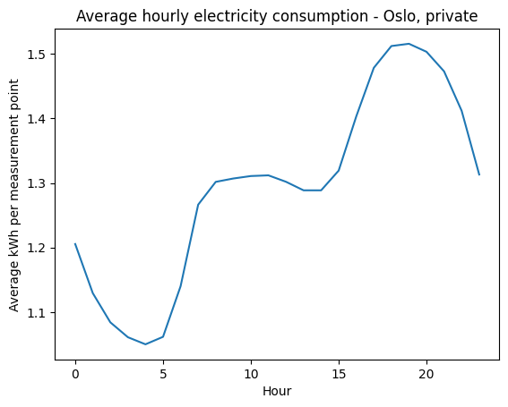

**Lagret tekstvisning:**

```text
<Figure size 640x480 with 1 Axes>
```

---

### Celle 18 – code

Kjøringsteller: `15`.

**Kode:**

```python
from sklearn.linear_model import LinearRegression
import numpy as np

X = hourly_avg.index.values.reshape(-1, 1)
y = hourly_avg.values

linear_model = LinearRegression()
linear_model.fit(X, y)

y_pred = linear_model.predict(X)
```

*Ingen lagrede resultater i denne cellen.*

---

### Celle 19 – code

Kjøringsteller: `16`.

**Kode:**

```python
plt.scatter(X, y, label="Observed")
plt.plot(X, y_pred, label="Linear regression")

plt.xlabel("Hour")
plt.ylabel("Average kWh per measurement point")
plt.title("Linear regression - Oslo private consumption")
plt.legend()
plt.show()
```

**Lagret resultat 1 – display_data:**

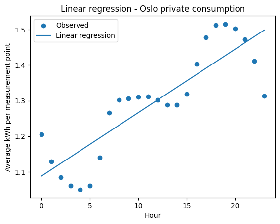

**Lagret tekstvisning:**

```text
<Figure size 640x480 with 1 Axes>
```

---

### Celle 20 – code

Kjøringsteller: `17`.

**Kode:**

```python
from sklearn.preprocessing import PolynomialFeatures

poly = PolynomialFeatures(degree=2, include_bias=False)

X_poly = poly.fit_transform(X)

poly_model = LinearRegression()
poly_model.fit(X_poly, y)

y_poly_pred = poly_model.predict(X_poly)
```

*Ingen lagrede resultater i denne cellen.*

---

### Celle 21 – code

Kjøringsteller: `18`.

**Kode:**

```python
plt.scatter(X, y, label="Observed")
plt.plot(X, y_poly_pred, label="Polynomial degree 2")

plt.xlabel("Hour")
plt.ylabel("Average kWh per measurement point")
plt.title("Polynomial regression - degree 2")
plt.legend()
plt.show()
```

**Lagret resultat 1 – display_data:**

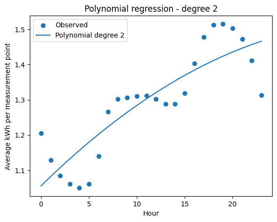

**Lagret tekstvisning:**

```text
<Figure size 640x480 with 1 Axes>
```

---

### Celle 22 – code

Kjøringsteller: `19`.

**Kode:**

```python
poly = PolynomialFeatures(degree=3, include_bias=False)

X_poly = poly.fit_transform(X)

poly_model = LinearRegression()
poly_model.fit(X_poly, y)

y_poly_pred = poly_model.predict(X_poly)
```

*Ingen lagrede resultater i denne cellen.*

---

### Celle 23 – code

Kjøringsteller: `20`.

**Kode:**

```python
plt.scatter(X, y, label="Observed")
plt.plot(X, y_poly_pred, label="Polynomial degree 3")

plt.xlabel("Hour")
plt.ylabel("Average kWh per measurement point")
plt.title("Polynomial regression - degree 3")
plt.legend()
plt.show()
```

**Lagret resultat 1 – display_data:**

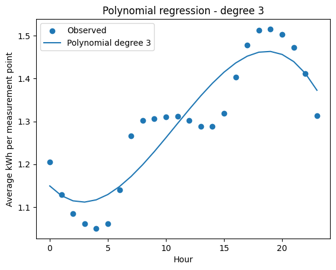

**Lagret tekstvisning:**

```text
<Figure size 640x480 with 1 Axes>
```

---

### Celle 24 – code

Kjøringsteller: `21`.

**Kode:**

```python
from sklearn.metrics import mean_squared_error

# Degree 2
poly2 = PolynomialFeatures(degree=2, include_bias=False)
X_poly2 = poly2.fit_transform(X)

poly2_model = LinearRegression()
poly2_model.fit(X_poly2, y)

y_poly2_pred = poly2_model.predict(X_poly2)

# Degree 3
poly3 = PolynomialFeatures(degree=3, include_bias=False)
X_poly3 = poly3.fit_transform(X)

poly3_model = LinearRegression()
poly3_model.fit(X_poly3, y)

y_poly3_pred = poly3_model.predict(X_poly3)

mse_linear = mean_squared_error(y, y_pred)
mse_poly2 = mean_squared_error(y, y_poly2_pred)
mse_poly3 = mean_squared_error(y, y_poly3_pred)

print("Linear:", mse_linear)
print("Degree 2:", mse_poly2)
print("Degree 3:", mse_poly3)
```

**Lagret resultat 1 – stream:**

Strøm: `stdout`.

```text
Linear: 0.0057847988650815835
Degree 2: 0.005517240529407758
Degree 3: 0.0034516416998503657

```

---


<a id="notatbok-01"></a>

## 01_data_overview.ipynb

Kilde: [åpne notatboken](../../notebooks/01_data_overview.ipynb).

SHA-256 av kildefilen: `68db59e215e6c909e2a6d960099df5010f3d3f6747d7bb6aaf8b31ef09a5159e`.

### Celle 1 – code

Kjøringsteller: `22`.

**Kode:**

```python
import pandas as pd
```

*Ingen lagrede resultater i denne cellen.*

---

### Celle 2 – code

Kjøringsteller: `24`.

**Kode:**

```python
df = pd.read_csv(
    "../data/consumption_processed.csv",
    sep=";",
    decimal=","
)
```

*Ingen lagrede resultater i denne cellen.*

---

### Celle 3 – code

Kjøringsteller: `25`.

**Kode:**

```python
# Manglende verdier per kolonne
print(df.isna().sum())

# Antall identiske rader
print("Duplikater:", df.duplicated().sum())

# Duplikater av samme måling
print("Dupliserte målinger:", df.duplicated(
    subset=["STARTTID", "KOMMUNENUMMER", "FORBRUKSGRUPPE"]
).sum())

```

**Lagret resultat 1 – stream:**

Strøm: `stdout`.

```text
STARTTID            0
SLUTTID             0
KOMMUNE             0
KOMMUNENUMMER       0
FORBRUKSGRUPPE      0
VOLUM_KWH           0
ANTALL_MÅLEPUNKT    0
YEAR                0
MONTH               0
DAY                 0
HOUR                0
DAY_OF_WEEK         0
dtype: int64
Duplikater: 0
Dupliserte målinger: 0

```

---

### Celle 4 – code

Kjøringsteller: `26`.

**Kode:**

```python
# Negative strømforbruk
print(df[df["VOLUM_KWH"] < 0])

# Statistikk for strømforbruk
print(df["VOLUM_KWH"].describe())

# Strømforbruk per målepunkt
df["KWH_PER_PUNKT"] = df["VOLUM_KWH"] / df["ANTALL_MÅLEPUNKT"]

print(df["KWH_PER_PUNKT"].describe())

```

**Lagret resultat 1 – stream:**

Strøm: `stdout`.

```text
                           STARTTID                    SLUTTID KOMMUNE  \
316       2022-02-01 00:00:00+01:00  2022-02-01 01:00:00+01:00  Hemnes   
1390      2022-02-01 01:00:00+01:00  2022-02-01 02:00:00+01:00  Hemnes   
2464      2022-02-01 02:00:00+01:00  2022-02-01 03:00:00+01:00  Hemnes   
3538      2022-02-01 03:00:00+01:00  2022-02-01 04:00:00+01:00  Hemnes   
4612      2022-02-01 04:00:00+01:00  2022-02-01 05:00:00+01:00  Hemnes   
...                             ...                        ...     ...   
18358768  2024-01-14 05:00:00+01:00  2024-01-14 06:00:00+01:00   Tokke   
18359842  2024-01-14 06:00:00+01:00  2024-01-14 07:00:00+01:00   Tokke   
18360916  2024-01-14 07:00:00+01:00  2024-01-14 08:00:00+01:00   Tokke   
18377026  2024-01-14 22:00:00+01:00  2024-01-14 23:00:00+01:00   Tokke   
18378100  2024-01-14 23:00:00+01:00  2024-01-15 00:00:00+01:00   Tokke   

          KOMMUNENUMMER FORBRUKSGRUPPE  VOLUM_KWH  ANTALL_MÅLEPUNKT  YEAR  \
316                1832       Industri  -1586.195               117  2022   
1390               1832       Industri  -1507.037               117  2022   
2464               1832       Industri  -1684.891               117  2022   
3538               1832       Industri  -1845.514               117  2022   
4612               1832       Industri  -1773.302               117  2022   
...                 ...            ...        ...               ...   ...   
18358768           4034       Industri    -24.532               156  2024   
18359842           4034       Industri    -36.001               156  2024   
18360916           4034       Industri    -74.041               156  2024   
18377026           4034       Industri    -31.794               156  2024   
18378100           4034       Industri    -47.434               156  2024   

          MONTH  DAY  HOUR  DAY_OF_WEEK  
316           2    1     0            1  
1390          2    1     1            1  
2464          2    1     2            1  
3538          2    1     3            1  
4612          2    1     4            1  
...         ...  ...   ...          ...  
18358768      1   14     5            6  
18359842      1   14     6            6  
18360916      1   14     7            6  
18377026      1   14    22            6  
18378100      1   14    23            6  

[3347 rows x 12 columns]
count    3.995173e+07
mean     1.391078e+04
std      4.658252e+04
min     -2.137582e+03
25%      1.326167e+03
50%      3.283141e+03
75%      8.817522e+03
max      1.256062e+07
Name: VOLUM_KWH, dtype: float64
count    3.995173e+07
mean     3.410688e+01
std      2.415090e+02
min     -1.826993e+01
25%      1.994321e+00
50%      5.215508e+00
75%      1.096897e+01
max      2.035757e+04
Name: KWH_PER_PUNKT, dtype: float64

```

---

### Celle 5 – code

Kjøringsteller: `27`.

**Kode:**

```python
# Manglende eller ugyldige målepunkter
print(df[df["ANTALL_MÅLEPUNKT"] <= 0])

# Statistikk
print(df["ANTALL_MÅLEPUNKT"].describe())
```

**Lagret resultat 1 – stream:**

Strøm: `stdout`.

```text
Empty DataFrame
Columns: [STARTTID, SLUTTID, KOMMUNE, KOMMUNENUMMER, FORBRUKSGRUPPE, VOLUM_KWH, ANTALL_MÅLEPUNKT, YEAR, MONTH, DAY, HOUR, DAY_OF_WEEK, KWH_PER_PUNKT]
Index: []
count    3.995173e+07
mean     3.132711e+03
std      1.341891e+04
min      5.000000e+00
25%      1.880000e+02
50%      5.130000e+02
75%      2.192000e+03
max      3.573210e+05
Name: ANTALL_MÅLEPUNKT, dtype: float64

```

---

### Celle 6 – code

Kjøringsteller: `28`.

**Kode:**

```python
# Vis de 10 høyeste verdiene per målepunkt
print(df.nlargest(10, "KWH_PER_PUNKT")[
    ["KOMMUNE", "FORBRUKSGRUPPE", "VOLUM_KWH",
     "ANTALL_MÅLEPUNKT", "KWH_PER_PUNKT"]
])

```

**Lagret resultat 1 – stream:**

Strøm: `stdout`.

```text
          KOMMUNE FORBRUKSGRUPPE     VOLUM_KWH  ANTALL_MÅLEPUNKT  \
39535651  Orkland       Industri  1.256062e+07               617   
39531355  Orkland       Industri  1.256051e+07               617   
39532429  Orkland       Industri  1.256029e+07               617   
39533503  Orkland       Industri  1.256028e+07               617   
39534577  Orkland       Industri  1.256007e+07               617   
39536725  Orkland       Industri  1.255976e+07               617   
39538873  Orkland       Industri  1.255869e+07               617   
39537799  Orkland       Industri  1.255639e+07               617   
5462329     Årdal       Industri  4.019446e+05                58   
5455885     Årdal       Industri  3.990492e+05                58   

          KWH_PER_PUNKT  
39535651   20357.567287  
39531355   20357.398575  
39532429   20357.031937  
39533503   20357.017574  
39534577   20356.680486  
39536725   20356.170355  
39538873   20354.443776  
39537799   20350.705313  
5462329     6930.080052  
5455885     6880.157862  

```

---

### Celle 7 – code

Kjøringsteller: `29`.

**Kode:**

```python
# Negative målinger per forbruksgruppe
print(df[df["VOLUM_KWH"] < 0]["FORBRUKSGRUPPE"].value_counts())

# Negative målinger per kommune
print(df[df["VOLUM_KWH"] < 0]["KOMMUNE"].value_counts())

```

**Lagret resultat 1 – stream:**

Strøm: `stdout`.

```text
FORBRUKSGRUPPE
Industri      3186
Forretning     137
Privat          24
Name: count, dtype: int64
KOMMUNE
Tokke                 3153
Storfjord               89
Hábmer                  33
Leka                    32
Hemnes                  24
Ukjent tilhørighet      15
Oppdal                   1
Name: count, dtype: int64

```

---

### Celle 8 – code

Kjøringsteller: `30`.

**Kode:**

```python
print(df.nlargest(10, "VOLUM_KWH")[
    ["STARTTID", "KOMMUNE", "VOLUM_KWH"]
])

```

**Lagret resultat 1 – stream:**

Strøm: `stdout`.

```text
                           STARTTID  KOMMUNE     VOLUM_KWH
39535651  2026-04-14 20:00:00+02:00  Orkland  1.256062e+07
39531355  2026-04-14 16:00:00+02:00  Orkland  1.256051e+07
39532429  2026-04-14 17:00:00+02:00  Orkland  1.256029e+07
39533503  2026-04-14 18:00:00+02:00  Orkland  1.256028e+07
39534577  2026-04-14 19:00:00+02:00  Orkland  1.256007e+07
39536725  2026-04-14 21:00:00+02:00  Orkland  1.255976e+07
39538873  2026-04-14 23:00:00+02:00  Orkland  1.255869e+07
39537799  2026-04-14 22:00:00+02:00  Orkland  1.255639e+07
18192059  2024-01-07 18:00:00+01:00     Oslo  1.110606e+06
18190985  2024-01-07 17:00:00+01:00     Oslo  1.109595e+06

```

---

### Celle 9 – code

Kjøringsteller: `31`.

**Kode:**

```python
negative = df[df["VOLUM_KWH"] < 0]

print(negative.groupby(["KOMMUNE", "YEAR"]).size())
```

**Lagret resultat 1 – stream:**

Strøm: `stdout`.

```text
KOMMUNE             YEAR
Hemnes              2022      24
Hábmer              2023      33
Leka                2022      32
Oppdal              2022       1
Storfjord           2022      89
Tokke               2022    3116
                    2024      37
Ukjent tilhørighet  2023      15
dtype: int64

```

---

### Celle 10 – code

Kjøringsteller: `32`.

**Kode:**

```python
orkland = df[
    (df["KOMMUNE"] == "Orkland") &
    (df["FORBRUKSGRUPPE"] == "Industri")
]

orkland.plot(x="STARTTID", y="VOLUM_KWH", figsize=(12, 4))
```

**Lagret resultat 1 – execute_result:**

**Lagret tekstvisning:**

```text
<Axes: xlabel='STARTTID'>
```

**Lagret resultat 2 – display_data:**

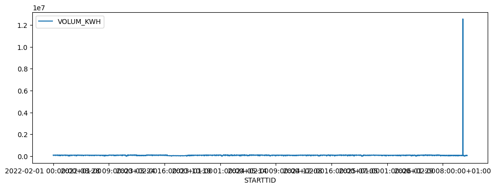

**Lagret tekstvisning:**

```text
<Figure size 1200x400 with 1 Axes>
```

---

### Celle 11 – code

Kjøringsteller: `33`.

**Kode:**

```python
tokke = df[
    (df["KOMMUNE"] == "Tokke") &
    (df["FORBRUKSGRUPPE"] == "Industri")
]

tokke.plot(x="STARTTID", y="VOLUM_KWH", figsize=(12, 4))
```

**Lagret resultat 1 – execute_result:**

**Lagret tekstvisning:**

```text
<Axes: xlabel='STARTTID'>
```

**Lagret resultat 2 – display_data:**

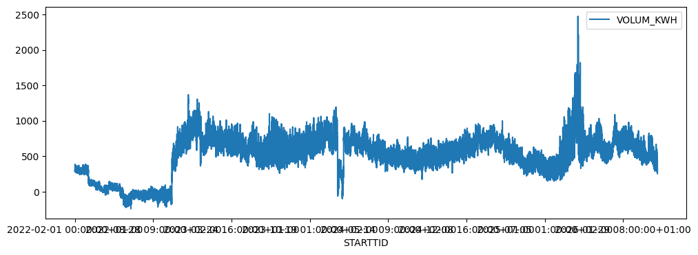

**Lagret tekstvisning:**

```text
<Figure size 1200x400 with 1 Axes>
```

---

### Celle 12 – code

Kjøringsteller: `34`.

**Kode:**

```python
# Finn mistenkelige verdier i Orkland
feil = (
    (df["KOMMUNE"] == "Orkland") &
    (df["FORBRUKSGRUPPE"] == "Industri") &
    (df["VOLUM_KWH"] > 10_000_000)
)

print("Mulige feil:", feil.sum())

```

**Lagret resultat 1 – stream:**

Strøm: `stdout`.

```text
Mulige feil: 8

```

---

### Celle 13 – code

Kjøringsteller: `35`.

**Kode:**

```python
tokke.plot(
    x="STARTTID",
    y="ANTALL_MÅLEPUNKT",
    figsize=(12, 4)
)

```

**Lagret resultat 1 – execute_result:**

**Lagret tekstvisning:**

```text
<Axes: xlabel='STARTTID'>
```

**Lagret resultat 2 – display_data:**

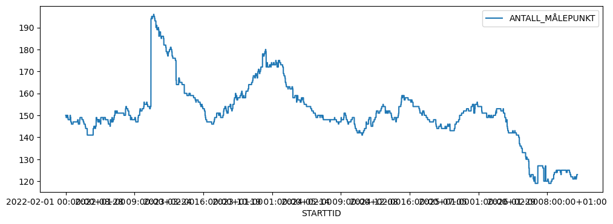

**Lagret tekstvisning:**

```text
<Figure size 1200x400 with 1 Axes>
```

---

### Celle 14 – code

Kjøringsteller: `36`.

**Kode:**

```python
df = df[~(
    (df["KOMMUNE"] == "Orkland") &
    (df["FORBRUKSGRUPPE"] == "Industri") &
    (df["VOLUM_KWH"] > 10_000_000)
)].copy()

```

*Ingen lagrede resultater i denne cellen.*

---

### Celle 15 – markdown

Eight observations from Orkland on April 14, 2026, were removed due to exceptionally high electricity consumption values of approximately 12.56 million kWh per hour. These values differed substantially from the municipality's normal consumption pattern and were treated as likely data errors.

Negative consumption values were retained because their cause could not be determined with certainty.

---

### Celle 16 – code

Kjøringsteller: `38`.

**Kode:**

```python
# Konverter tidspunktene til UTC
tid = pd.to_datetime(df["STARTTID"], utc=True)

# Konverter deretter til norsk tid
norsk_tid = tid.dt.tz_convert("Europe/Oslo")

print(norsk_tid.head())

```

**Lagret resultat 1 – stream:**

Strøm: `stdout`.

```text
0   2022-02-01 00:00:00+01:00
1   2022-02-01 00:00:00+01:00
2   2022-02-01 00:00:00+01:00
3   2022-02-01 00:00:00+01:00
4   2022-02-01 00:00:00+01:00
Name: STARTTID, dtype: datetime64[ns, Europe/Oslo]

```

---

### Celle 17 – code

Kjøringsteller: `39`.

**Kode:**

```python

# Unike timer per dag
timer = pd.DataFrame({"tid": norsk_tid.drop_duplicates()})
timer["dato"] = timer["tid"].dt.date

# Tell timer per dag
timer_per_dag = timer.groupby("dato").size()

# Vis dager med 23 eller 25 timer
print(timer_per_dag[timer_per_dag.isin([23, 25])])

```

**Lagret resultat 1 – stream:**

Strøm: `stdout`.

```text
dato
2022-03-27    23
2022-10-30    25
2023-03-26    23
2023-10-29    25
2024-03-31    23
2024-10-27    25
2025-03-30    23
2025-10-26    25
2026-03-29    23
dtype: int64

```

---

### Celle 18 – markdown

Kommune endringer

---

### Celle 19 – code

Kjøringsteller: `40`.

**Kode:**

```python

# Kommuner som har hatt flere kommunenummer
kommuner = df.groupby("KOMMUNE")["KOMMUNENUMMER"].nunique()

print(kommuner[kommuner > 1])

```

**Lagret resultat 1 – stream:**

Strøm: `stdout`.

```text
KOMMUNE
Herøy    2
Våler    2
Name: KOMMUNENUMMER, dtype: int64

```

---

### Celle 20 – code

Kjøringsteller: `41`.

**Kode:**

```python

# Kommunenummer som har hatt flere navn
nummer = df.groupby("KOMMUNENUMMER")["KOMMUNE"].nunique()

print(nummer[nummer > 1])

```

**Lagret resultat 1 – stream:**

Strøm: `stdout`.

```text
Series([], Name: KOMMUNE, dtype: int64)

```

---

### Celle 21 – code

Kjøringsteller: `42`.

**Kode:**

```python

# Antall forskjellige kommunenumre per år
print(df.groupby("YEAR")["KOMMUNENUMMER"].nunique())

```

**Lagret resultat 1 – stream:**

Strøm: `stdout`.

```text
YEAR
2022    358
2023    358
2024    358
2025    358
2026    358
Name: KOMMUNENUMMER, dtype: int64

```

---

### Celle 22 – code

Kjøringsteller: `43`.

**Kode:**

```python

# Kommunenumre i 2022 og 2026
kommune_2022 = set(df[df["YEAR"] == 2022]["KOMMUNENUMMER"])
kommune_2026 = set(df[df["YEAR"] == 2026]["KOMMUNENUMMER"])

print("Forsvunnet:", kommune_2022 - kommune_2026)
print("Nye:", kommune_2026 - kommune_2022)

```

**Lagret resultat 1 – stream:**

Strøm: `stdout`.

```text
Forsvunnet: set()
Nye: set()

```

---

### Celle 23 – code

Kjøringsteller: `44`.

**Kode:**

```python

# Sjekk om alle år har de samme kommunenumrene
kommuner_2022 = set(df[df["YEAR"] == 2022]["KOMMUNENUMMER"])

for år in df["YEAR"].unique():
    kommuner = set(df[df["YEAR"] == år]["KOMMUNENUMMER"])
    print(år, kommuner == kommuner_2022)

```

**Lagret resultat 1 – stream:**

Strøm: `stdout`.

```text
2022 True
2023 True
2024 True
2025 True
2026 True

```

---

### Celle 24 – markdown

## Data Quality Assessment

The dataset contains approximately 40 million hourly electricity consumption records from 2022 to 2026. Several data quality checks were performed before analysis.

- **Missing values and duplicates:** No missing values or duplicate records were identified.
- **Outliers:** Eight extreme observations in Orkland on April 14, 2026, were removed. These showed unusually high consumption of approximately 12.56 million kWh per hour.
- **Negative consumption:** 3,347 negative values were identified, mainly in industrial consumption in Tokke. These were retained because they may represent actual measurements or differences in reporting.
- **Metering points:** No zero or negative metering point counts were found.
- **Missing hours:** No missing hourly timestamps were identified.
- **Daylight saving time:** The dataset correctly contains 23 hours during the spring transition and 25 hours during the autumn transition.
- **Municipalities:** The same 358 municipality codes were present throughout 2022–2026. Herøy and Våler each refer to two different municipalities with the same name. Municipality codes will therefore be used as identifiers. Historical boundary changes were not independently verified.

**Conclusion:** The dataset appears suitable for further analysis after removing the eight extreme observations. Negative consumption values and potential changes in municipality boundaries remain limitations that should be considered when interpreting the results.

---


<a id="notatbok-02"></a>

## 02_analysis.ipynb

Kilde: [åpne notatboken](../../notebooks/02_analysis.ipynb).

SHA-256 av kildefilen: `edd1ef0758176e0d3ab632f790eba24d302e8f6b9827fc91f05b3df2865d4105`.

### Celle 1 – code

Kjøringsteller: `ikke angitt`.

**Kode:**

```python
import pandas as pd
import matplotlib.pyplot as plt
import seaborn as sns
import numpy as np
```

*Ingen lagrede resultater i denne cellen.*

---

### Celle 2 – code

Kjøringsteller: `3`.

**Kode:**

```python
df = pd.read_csv(
    "../data/consumption_processed.csv",
    sep=";",
    decimal=","
)
```

*Ingen lagrede resultater i denne cellen.*

---

### Celle 3 – code

Kjøringsteller: `7`.

**Kode:**

```python
# Exclude non-positive values for logarithmic visualization
plot_df = df[df["VOLUM_KWH"] > 0]

groups = ["INDUSTRI", "PRIVAT", "FORRETNING"]

fig, axes = plt.subplots(1, 3, figsize=(16, 4))

for ax, group in zip(axes, groups):
    subset = plot_df[
        plot_df["FORBRUKSGRUPPE"].str.upper() == group
    ]

    sns.histplot(
        data=subset,
        x="VOLUM_KWH",
        bins=50,
        log_scale=True,
        ax=ax
    )

    ax.set_title(group.title())
    ax.set_xlabel("Consumption (kWh)")
    ax.set_ylabel("Count")

plt.tight_layout()
plt.show()

```

**Lagret resultat 1 – display_data:**

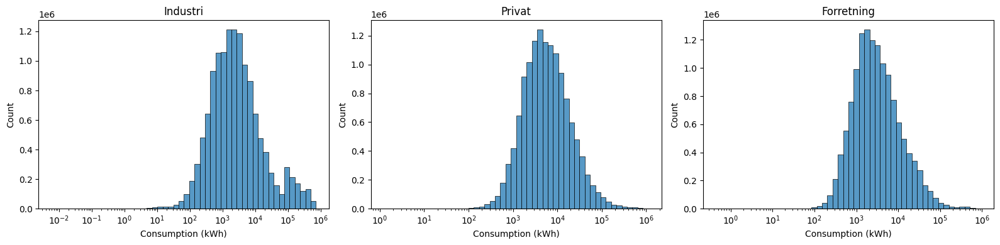

**Lagret tekstvisning:**

```text
<Figure size 1600x400 with 3 Axes>
```

---

### Celle 4 – code

Kjøringsteller: `8`.

**Kode:**

```python
group_stats = (
    df.groupby("FORBRUKSGRUPPE")["VOLUM_KWH"]
    .agg(
        count="count",
        mean="mean",
        median="median",
        std="std",
        min="min",
        max="max"
    )
)

display(group_stats.round(2))
```

**Lagret resultat 1 – display_data:**

**Lagret HTML-visning:**

<div>
<style scoped>
    .dataframe tbody tr th:only-of-type {
        vertical-align: middle;
    }

    .dataframe tbody tr th {
        vertical-align: top;
    }

    .dataframe thead th {
        text-align: right;
    }
</style>
<table border="1" class="dataframe">
  <thead>
    <tr style="text-align: right;">
      <th></th>
      <th>count</th>
      <th>mean</th>
      <th>median</th>
      <th>std</th>
      <th>min</th>
      <th>max</th>
    </tr>
    <tr>
      <th>FORBRUKSGRUPPE</th>
      <th></th>
      <th></th>
      <th></th>
      <th></th>
      <th></th>
      <th></th>
    </tr>
  </thead>
  <tbody>
    <tr>
      <th>Forretning</th>
      <td>13317242</td>
      <td>8507.83</td>
      <td>2680.89</td>
      <td>26822.89</td>
      <td>-984.40</td>
      <td>923674.44</td>
    </tr>
    <tr>
      <th>Industri</th>
      <td>13317234</td>
      <td>20105.72</td>
      <td>2204.84</td>
      <td>67062.69</td>
      <td>-2137.58</td>
      <td>716742.48</td>
    </tr>
    <tr>
      <th>Privat</th>
      <td>13317242</td>
      <td>13111.25</td>
      <td>5281.04</td>
      <td>33617.94</td>
      <td>-476.95</td>
      <td>1110606.30</td>
    </tr>
  </tbody>
</table>
</div>

**Lagret tekstvisning:**

```text
                   count      mean   median       std      min         max
FORBRUKSGRUPPE                                                            
Forretning      13317242   8507.83  2680.89  26822.89  -984.40   923674.44
Industri        13317234  20105.72  2204.84  67062.69 -2137.58   716742.48
Privat          13317242  13111.25  5281.04  33617.94  -476.95  1110606.30
```

---

### Celle 5 – code

Kjøringsteller: `9`.

**Kode:**

```python
# Monthly average hourly consumption by group
monthly = (
    df.groupby(
        ["YEAR", "MONTH", "FORBRUKSGRUPPE"]
    )["VOLUM_KWH"]
    .mean()
    .reset_index()
)

# Create date column
monthly["DATE"] = pd.to_datetime(
    monthly[["YEAR", "MONTH"]].assign(DAY=1)
)

plt.figure(figsize=(13, 5))

sns.lineplot(
    data=monthly,
    x="DATE",
    y="VOLUM_KWH",
    hue="FORBRUKSGRUPPE",
    marker="o"
)

plt.title("Average hourly electricity consumption by month")
plt.xlabel("Month")
plt.ylabel("Average consumption (kWh)")
plt.grid(alpha=0.3)
plt.tight_layout()
plt.show()

```

**Lagret resultat 1 – display_data:**

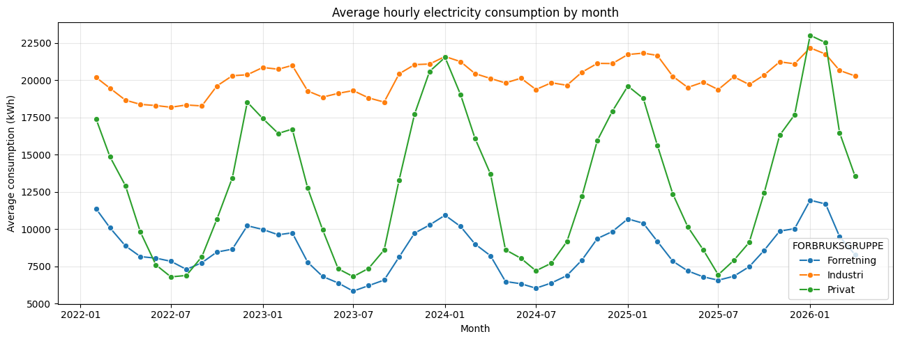

**Lagret tekstvisning:**

```text
<Figure size 1300x500 with 1 Axes>
```

---

### Celle 6 – code

Kjøringsteller: `10`.

**Kode:**

```python
hourly = (
    df.groupby(["HOUR", "FORBRUKSGRUPPE"])["VOLUM_KWH"]
    .mean()
    .reset_index()
)

plt.figure(figsize=(12, 5))

sns.lineplot(
    data=hourly,
    x="HOUR",
    y="VOLUM_KWH",
    hue="FORBRUKSGRUPPE",
    marker="o"
)

plt.title("Average electricity consumption by hour")
plt.xlabel("Hour of day")
plt.ylabel("Average consumption (kWh)")
plt.xticks(range(24))
plt.grid(alpha=0.3)
plt.tight_layout()
plt.show()
```

**Lagret resultat 1 – display_data:**

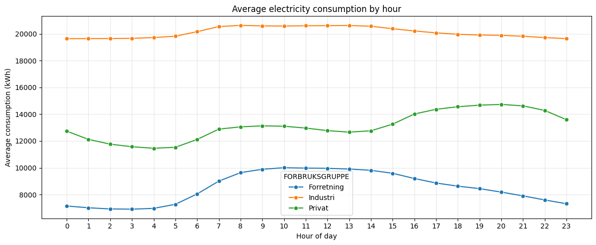

**Lagret tekstvisning:**

```text
<Figure size 1200x500 with 1 Axes>
```

---

### Celle 7 – code

Kjøringsteller: `11`.

**Kode:**

```python
weekday = (
    df.groupby(["DAY_OF_WEEK", "FORBRUKSGRUPPE"])["VOLUM_KWH"]
    .mean()
    .reset_index()
)

plt.figure(figsize=(11, 5))

sns.lineplot(
    data=weekday,
    x="DAY_OF_WEEK",
    y="VOLUM_KWH",
    hue="FORBRUKSGRUPPE",
    marker="o"
)

plt.title("Average electricity consumption by day of week")
plt.xlabel("Day of week")
plt.ylabel("Average consumption (kWh)")
plt.xticks(
    range(7),
    ["Mon", "Tue", "Wed", "Thu", "Fri", "Sat", "Sun"]
)
plt.grid(alpha=0.3)
plt.tight_layout()
plt.show()
```

**Lagret resultat 1 – display_data:**

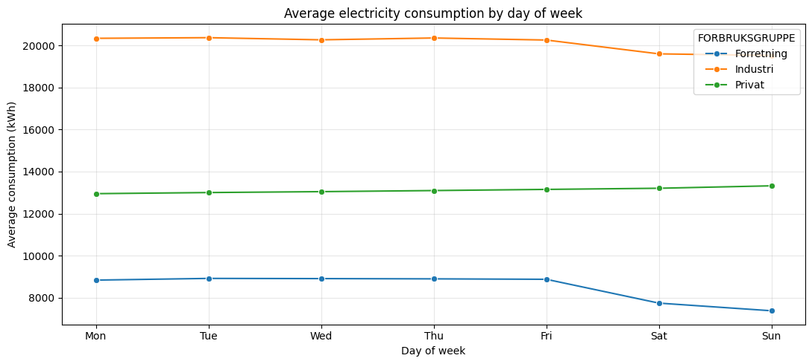

**Lagret tekstvisning:**

```text
<Figure size 1100x500 with 1 Axes>
```

---

### Celle 8 – markdown


### EDA: Electricity Consumption Patterns

**Distribution of consumption**
- Electricity consumption is strongly right-skewed across all three consumption groups.
- Industry has the highest mean consumption and largest variance, while private consumption has the highest median.
- The large differences between mean and median indicate that high-consumption observations strongly influence the averages.

**Temporal patterns**
- **Monthly:** Strong seasonal variation, especially for private consumption, with higher consumption during winter and lower consumption during summer.
- **Hourly:** Business consumption increases during working hours, while private consumption peaks in the evening. Industrial consumption remains relatively stable.
- **Weekly:** Business consumption drops noticeably during weekends. Industrial consumption decreases slightly, while private consumption increases slightly.

**Implications for modelling**
- `MONTH`, `HOUR`, `DAY_OF_WEEK` and `FORBRUKSGRUPPE` are potentially important predictors.
- Temporal patterns differ between consumption groups, suggesting possible interaction effects.
- Nonlinear models may capture these relationships better than simple linear regression.
- Differences in consumption scale and variability should be considered when evaluating model performance.

---

### Celle 9 – code

Kjøringsteller: `ikke angitt`.

**Kode:**

```python
df["KWH_PER_PUNKT"] = np.where(
    df["ANTALL_MÅLEPUNKT"] > 0,
    df["VOLUM_KWH"] / df["ANTALL_MÅLEPUNKT"],
    np.nan
)

df["KWH_PER_PUNKT"].describe()
```

**Lagret resultat 1 – execute_result:**

**Lagret tekstvisning:**

```text
count    3.995172e+07
mean     3.410281e+01
std      2.413377e+02
min     -1.826993e+01
25%      1.994321e+00
50%      5.215506e+00
75%      1.096896e+01
max      6.930080e+03
Name: KWH_PER_PUNKT, dtype: float64
```

---

### Celle 10 – code

Kjøringsteller: `15`.

**Kode:**

```python
# Median consumption per measurement point by municipality and group
municipality_stats = (
    df.groupby(["KOMMUNE", "FORBRUKSGRUPPE"])["KWH_PER_PUNKT"]
    .median()
    .reset_index()
)

# Select top 10 municipalities within each consumption group
top10 = (
    municipality_stats
    .sort_values("KWH_PER_PUNKT", ascending=False)
    .groupby("FORBRUKSGRUPPE")
    .head(10)
)

fig, axes = plt.subplots(1, 3, figsize=(17, 6))

groups = ["Industri", "Privat", "Forretning"]

for ax, group in zip(axes, groups):
    subset = (
        top10[top10["FORBRUKSGRUPPE"] == group]
        .sort_values("KWH_PER_PUNKT", ascending=False)
    )

    sns.barplot(
        data=subset,
        x="KWH_PER_PUNKT",
        y="KOMMUNE",
        ax=ax
    )

    ax.set_title(group)
    ax.set_xlabel("Median consumption per point (kWh)")
    ax.set_ylabel("")

plt.suptitle(
    "Top 10 municipalities by consumption per measurement point",
    fontsize=14
)
plt.tight_layout()
plt.show()
```

**Lagret resultat 1 – display_data:**

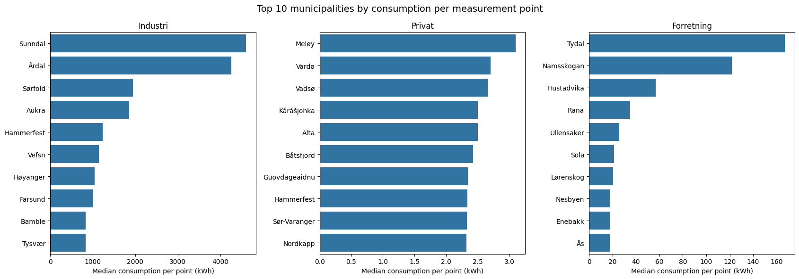

**Lagret tekstvisning:**

```text
<Figure size 1700x600 with 3 Axes>
```

---

### Celle 11 – code

Kjøringsteller: `16`.

**Kode:**

```python
municipality_points = (
    df.groupby(["KOMMUNE", "FORBRUKSGRUPPE"])
    .agg(
        median_kwh_per_point=("KWH_PER_PUNKT", "median"),
        median_measurement_points=("ANTALL_MÅLEPUNKT", "median")
    )
    .reset_index()
)

fig, axes = plt.subplots(1, 3, figsize=(16, 4))

for ax, group in zip(axes, ["Industri", "Privat", "Forretning"]):
    subset = municipality_points[
        municipality_points["FORBRUKSGRUPPE"] == group
    ]

    sns.scatterplot(
        data=subset,
        x="median_measurement_points",
        y="median_kwh_per_point",
        ax=ax,
        alpha=0.6
    )

    ax.set_title(group)
    ax.set_xlabel("Median number of measurement points")
    ax.set_ylabel("Median consumption per point (kWh)")
    ax.set_xscale("log")
    ax.set_yscale("log")

plt.tight_layout()
plt.show()
```

**Lagret resultat 1 – display_data:**

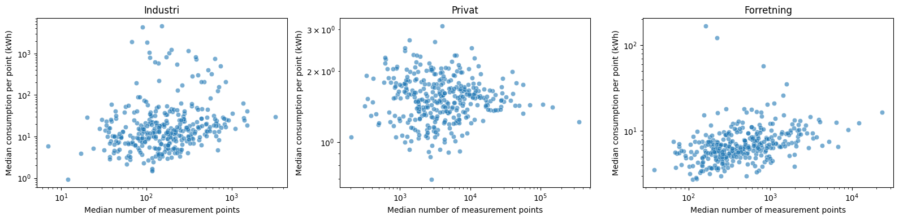

**Lagret tekstvisning:**

```text
<Figure size 1600x400 with 3 Axes>
```

---

### Celle 12 – code

Kjøringsteller: `17`.

**Kode:**

```python
municipalities = [
    "Oslo", "Bergen", "Stavanger", "Trondheim",
    "Tromsø", "Bodø", "Kristiansand",
    "Drammen", "Ålesund", "Alta",
    "Sunndal", "Årdal"
]

coverage = (
    df[df["KOMMUNE"].isin(municipalities)]
    .groupby(["KOMMUNE", "FORBRUKSGRUPPE"])
    .agg(
        observations=("VOLUM_KWH", "size"),
        first_date=("STARTTID", "min"),
        last_date=("STARTTID", "max"),
        median_points=("ANTALL_MÅLEPUNKT", "median")
    )
)

display(coverage)
```

**Lagret resultat 1 – display_data:**

**Lagret HTML-visning:**

<div>
<style scoped>
    .dataframe tbody tr th:only-of-type {
        vertical-align: middle;
    }

    .dataframe tbody tr th {
        vertical-align: top;
    }

    .dataframe thead th {
        text-align: right;
    }
</style>
<table border="1" class="dataframe">
  <thead>
    <tr style="text-align: right;">
      <th></th>
      <th></th>
      <th>observations</th>
      <th>first_date</th>
      <th>last_date</th>
      <th>median_points</th>
    </tr>
    <tr>
      <th>KOMMUNE</th>
      <th>FORBRUKSGRUPPE</th>
      <th></th>
      <th></th>
      <th></th>
      <th></th>
    </tr>
  </thead>
  <tbody>
    <tr>
      <th rowspan="3" valign="top">Alta</th>
      <th>Forretning</th>
      <td>37199</td>
      <td>2022-02-01 00:00:00+01:00</td>
      <td>2026-04-30 23:00:00+02:00</td>
      <td>1145.0</td>
    </tr>
    <tr>
      <th>Industri</th>
      <td>37199</td>
      <td>2022-02-01 00:00:00+01:00</td>
      <td>2026-04-30 23:00:00+02:00</td>
      <td>420.0</td>
    </tr>
    <tr>
      <th>Privat</th>
      <td>37199</td>
      <td>2022-02-01 00:00:00+01:00</td>
      <td>2026-04-30 23:00:00+02:00</td>
      <td>10493.0</td>
    </tr>
    <tr>
      <th rowspan="3" valign="top">Bergen</th>
      <th>Forretning</th>
      <td>37199</td>
      <td>2022-02-01 00:00:00+01:00</td>
      <td>2026-04-30 23:00:00+02:00</td>
      <td>12188.0</td>
    </tr>
    <tr>
      <th>Industri</th>
      <td>37199</td>
      <td>2022-02-01 00:00:00+01:00</td>
      <td>2026-04-30 23:00:00+02:00</td>
      <td>1517.0</td>
    </tr>
    <tr>
      <th>Privat</th>
      <td>37199</td>
      <td>2022-02-01 00:00:00+01:00</td>
      <td>2026-04-30 23:00:00+02:00</td>
      <td>148991.0</td>
    </tr>
    <tr>
      <th rowspan="3" valign="top">Bodø</th>
      <th>Forretning</th>
      <td>37199</td>
      <td>2022-02-01 00:00:00+01:00</td>
      <td>2026-04-30 23:00:00+02:00</td>
      <td>2741.0</td>
    </tr>
    <tr>
      <th>Industri</th>
      <td>37199</td>
      <td>2022-02-01 00:00:00+01:00</td>
      <td>2026-04-30 23:00:00+02:00</td>
      <td>532.0</td>
    </tr>
    <tr>
      <th>Privat</th>
      <td>37199</td>
      <td>2022-02-01 00:00:00+01:00</td>
      <td>2026-04-30 23:00:00+02:00</td>
      <td>28743.0</td>
    </tr>
    <tr>
      <th rowspan="3" valign="top">Drammen</th>
      <th>Forretning</th>
      <td>37199</td>
      <td>2022-02-01 00:00:00+01:00</td>
      <td>2026-04-30 23:00:00+02:00</td>
      <td>5237.0</td>
    </tr>
    <tr>
      <th>Industri</th>
      <td>37199</td>
      <td>2022-02-01 00:00:00+01:00</td>
      <td>2026-04-30 23:00:00+02:00</td>
      <td>787.0</td>
    </tr>
    <tr>
      <th>Privat</th>
      <td>37199</td>
      <td>2022-02-01 00:00:00+01:00</td>
      <td>2026-04-30 23:00:00+02:00</td>
      <td>49544.0</td>
    </tr>
    <tr>
      <th rowspan="3" valign="top">Kristiansand</th>
      <th>Forretning</th>
      <td>37199</td>
      <td>2022-02-01 00:00:00+01:00</td>
      <td>2026-04-30 23:00:00+02:00</td>
      <td>6808.0</td>
    </tr>
    <tr>
      <th>Industri</th>
      <td>37199</td>
      <td>2022-02-01 00:00:00+01:00</td>
      <td>2026-04-30 23:00:00+02:00</td>
      <td>1355.0</td>
    </tr>
    <tr>
      <th>Privat</th>
      <td>37199</td>
      <td>2022-02-01 00:00:00+01:00</td>
      <td>2026-04-30 23:00:00+02:00</td>
      <td>56914.0</td>
    </tr>
    <tr>
      <th rowspan="3" valign="top">Oslo</th>
      <th>Forretning</th>
      <td>37199</td>
      <td>2022-02-01 00:00:00+01:00</td>
      <td>2026-04-30 23:00:00+02:00</td>
      <td>23386.0</td>
    </tr>
    <tr>
      <th>Industri</th>
      <td>37199</td>
      <td>2022-02-01 00:00:00+01:00</td>
      <td>2026-04-30 23:00:00+02:00</td>
      <td>3266.0</td>
    </tr>
    <tr>
      <th>Privat</th>
      <td>37199</td>
      <td>2022-02-01 00:00:00+01:00</td>
      <td>2026-04-30 23:00:00+02:00</td>
      <td>351442.0</td>
    </tr>
    <tr>
      <th rowspan="3" valign="top">Stavanger</th>
      <th>Forretning</th>
      <td>37199</td>
      <td>2022-02-01 00:00:00+01:00</td>
      <td>2026-04-30 23:00:00+02:00</td>
      <td>6487.0</td>
    </tr>
    <tr>
      <th>Industri</th>
      <td>37199</td>
      <td>2022-02-01 00:00:00+01:00</td>
      <td>2026-04-30 23:00:00+02:00</td>
      <td>1401.0</td>
    </tr>
    <tr>
      <th>Privat</th>
      <td>37199</td>
      <td>2022-02-01 00:00:00+01:00</td>
      <td>2026-04-30 23:00:00+02:00</td>
      <td>69955.0</td>
    </tr>
    <tr>
      <th rowspan="3" valign="top">Sunndal</th>
      <th>Forretning</th>
      <td>37199</td>
      <td>2022-02-01 00:00:00+01:00</td>
      <td>2026-04-30 23:00:00+02:00</td>
      <td>533.0</td>
    </tr>
    <tr>
      <th>Industri</th>
      <td>37199</td>
      <td>2022-02-01 00:00:00+01:00</td>
      <td>2026-04-30 23:00:00+02:00</td>
      <td>152.0</td>
    </tr>
    <tr>
      <th>Privat</th>
      <td>37199</td>
      <td>2022-02-01 00:00:00+01:00</td>
      <td>2026-04-30 23:00:00+02:00</td>
      <td>4373.0</td>
    </tr>
    <tr>
      <th rowspan="3" valign="top">Tromsø</th>
      <th>Forretning</th>
      <td>37199</td>
      <td>2022-02-01 00:00:00+01:00</td>
      <td>2026-04-30 23:00:00+02:00</td>
      <td>4084.0</td>
    </tr>
    <tr>
      <th>Industri</th>
      <td>37199</td>
      <td>2022-02-01 00:00:00+01:00</td>
      <td>2026-04-30 23:00:00+02:00</td>
      <td>753.0</td>
    </tr>
    <tr>
      <th>Privat</th>
      <td>37199</td>
      <td>2022-02-01 00:00:00+01:00</td>
      <td>2026-04-30 23:00:00+02:00</td>
      <td>39978.0</td>
    </tr>
    <tr>
      <th rowspan="3" valign="top">Trondheim</th>
      <th>Forretning</th>
      <td>37199</td>
      <td>2022-02-01 00:00:00+01:00</td>
      <td>2026-04-30 23:00:00+02:00</td>
      <td>9061.0</td>
    </tr>
    <tr>
      <th>Industri</th>
      <td>37199</td>
      <td>2022-02-01 00:00:00+01:00</td>
      <td>2026-04-30 23:00:00+02:00</td>
      <td>1521.0</td>
    </tr>
    <tr>
      <th>Privat</th>
      <td>37199</td>
      <td>2022-02-01 00:00:00+01:00</td>
      <td>2026-04-30 23:00:00+02:00</td>
      <td>109023.0</td>
    </tr>
    <tr>
      <th rowspan="3" valign="top">Ålesund</th>
      <th>Forretning</th>
      <td>37199</td>
      <td>2022-02-01 00:00:00+01:00</td>
      <td>2026-04-30 23:00:00+02:00</td>
      <td>3715.0</td>
    </tr>
    <tr>
      <th>Industri</th>
      <td>37199</td>
      <td>2022-02-01 00:00:00+01:00</td>
      <td>2026-04-30 23:00:00+02:00</td>
      <td>910.0</td>
    </tr>
    <tr>
      <th>Privat</th>
      <td>37199</td>
      <td>2022-02-01 00:00:00+01:00</td>
      <td>2026-04-30 23:00:00+02:00</td>
      <td>28567.0</td>
    </tr>
    <tr>
      <th rowspan="3" valign="top">Årdal</th>
      <th>Forretning</th>
      <td>37199</td>
      <td>2022-02-01 00:00:00+01:00</td>
      <td>2026-04-30 23:00:00+02:00</td>
      <td>341.0</td>
    </tr>
    <tr>
      <th>Industri</th>
      <td>37199</td>
      <td>2022-02-01 00:00:00+01:00</td>
      <td>2026-04-30 23:00:00+02:00</td>
      <td>90.0</td>
    </tr>
    <tr>
      <th>Privat</th>
      <td>37199</td>
      <td>2022-02-01 00:00:00+01:00</td>
      <td>2026-04-30 23:00:00+02:00</td>
      <td>3187.0</td>
    </tr>
  </tbody>
</table>
</div>

**Lagret tekstvisning:**

```text
                             observations                 first_date  \
KOMMUNE      FORBRUKSGRUPPE                                            
Alta         Forretning             37199  2022-02-01 00:00:00+01:00   
             Industri               37199  2022-02-01 00:00:00+01:00   
             Privat                 37199  2022-02-01 00:00:00+01:00   
Bergen       Forretning             37199  2022-02-01 00:00:00+01:00   
             Industri               37199  2022-02-01 00:00:00+01:00   
             Privat                 37199  2022-02-01 00:00:00+01:00   
Bodø         Forretning             37199  2022-02-01 00:00:00+01:00   
             Industri               37199  2022-02-01 00:00:00+01:00   
             Privat                 37199  2022-02-01 00:00:00+01:00   
Drammen      Forretning             37199  2022-02-01 00:00:00+01:00   
             Industri               37199  2022-02-01 00:00:00+01:00   
             Privat                 37199  2022-02-01 00:00:00+01:00   
Kristiansand Forretning             37199  2022-02-01 00:00:00+01:00   
             Industri               37199  2022-02-01 00:00:00+01:00   
             Privat                 37199  2022-02-01 00:00:00+01:00   
Oslo         Forretning             37199  2022-02-01 00:00:00+01:00   
             Industri               37199  2022-02-01 00:00:00+01:00   
             Privat                 37199  2022-02-01 00:00:00+01:00   
Stavanger    Forretning             37199  2022-02-01 00:00:00+01:00   
             Industri               37199  2022-02-01 00:00:00+01:00   
             Privat                 37199  2022-02-01 00:00:00+01:00   
Sunndal      Forretning             37199  2022-02-01 00:00:00+01:00   
             Industri               37199  2022-02-01 00:00:00+01:00   
             Privat                 37199  2022-02-01 00:00:00+01:00   
Tromsø       Forretning             37199  2022-02-01 00:00:00+01:00   
             Industri               37199  2022-02-01 00:00:00+01:00   
             Privat                 37199  2022-02-01 00:00:00+01:00   
Trondheim    Forretning             37199  2022-02-01 00:00:00+01:00   
             Industri               37199  2022-02-01 00:00:00+01:00   
             Privat                 37199  2022-02-01 00:00:00+01:00   
Ålesund      Forretning             37199  2022-02-01 00:00:00+01:00   
             Industri               37199  2022-02-01 00:00:00+01:00   
             Privat                 37199  2022-02-01 00:00:00+01:00   
Årdal        Forretning             37199  2022-02-01 00:00:00+01:00   
             Industri               37199  2022-02-01 00:00:00+01:00   
             Privat                 37199  2022-02-01 00:00:00+01:00   

                                             last_date  median_points  
KOMMUNE      FORBRUKSGRUPPE                                            
Alta         Forretning      2026-04-30 23:00:00+02:00         1145.0  
             Industri        2026-04-30 23:00:00+02:00          420.0  
             Privat          2026-04-30 23:00:00+02:00        10493.0  
Bergen       Forretning      2026-04-30 23:00:00+02:00        12188.0  
             Industri        2026-04-30 23:00:00+02:00         1517.0  
             Privat          2026-04-30 23:00:00+02:00       148991.0  
Bodø         Forretning      2026-04-30 23:00:00+02:00         2741.0  
             Industri        2026-04-30 23:00:00+02:00          532.0  
             Privat          2026-04-30 23:00:00+02:00        28743.0  
Drammen      Forretning      2026-04-30 23:00:00+02:00         5237.0  
             Industri        2026-04-30 23:00:00+02:00          787.0  
             Privat          2026-04-30 23:00:00+02:00        49544.0  
Kristiansand Forretning      2026-04-30 23:00:00+02:00         6808.0  
             Industri        2026-04-30 23:00:00+02:00         1355.0  
             Privat          2026-04-30 23:00:00+02:00        56914.0  
Oslo         Forretning      2026-04-30 23:00:00+02:00        23386.0  
             Industri        2026-04-30 23:00:00+02:00         3266.0  
             Privat          2026-04-30 23:00:00+02:00       351442.0  
Stavanger    Forretning      2026-04-30 23:00:00+02:00         6487.0  
             Industri        2026-04-30 23:00:00+02:00         1401.0  
             Privat          2026-04-30 23:00:00+02:00        69955.0  
Sunndal      Forretning      2026-04-30 23:00:00+02:00          533.0  
             Industri        2026-04-30 23:00:00+02:00          152.0  
             Privat          2026-04-30 23:00:00+02:00         4373.0  
Tromsø       Forretning      2026-04-30 23:00:00+02:00         4084.0  
             Industri        2026-04-30 23:00:00+02:00          753.0  
             Privat          2026-04-30 23:00:00+02:00        39978.0  
Trondheim    Forretning      2026-04-30 23:00:00+02:00         9061.0  
             Industri        2026-04-30 23:00:00+02:00         1521.0  
             Privat          2026-04-30 23:00:00+02:00       109023.0  
Ålesund      Forretning      2026-04-30 23:00:00+02:00         3715.0  
             Industri        2026-04-30 23:00:00+02:00          910.0  
             Privat          2026-04-30 23:00:00+02:00        28567.0  
Årdal        Forretning      2026-04-30 23:00:00+02:00          341.0  
             Industri        2026-04-30 23:00:00+02:00           90.0  
             Privat          2026-04-30 23:00:00+02:00         3187.0  
```

---

### Celle 13 – markdown


### 6. Geographical Analysis: Electricity Consumption by Municipality

**Key findings**
- Electricity consumption per measurement point varies significantly between municipalities, particularly within the industrial sector.
- Industrial municipalities such as Sunndal and Årdal have exceptionally high consumption per measurement point.
- Private consumption is more consistent across municipalities, while business consumption shows moderate variation with some outliers.
- No clear overall relationship was observed between the number of measurement points and consumption per point.

**Municipality selection**
To reduce computational complexity while maintaining geographical diversity, 10 municipalities were selected:

- **Urban municipalities:** Oslo, Bergen, Stavanger, Trondheim, Kristiansand, Tromsø, Bodø and Alta.
- **Industrial municipalities:** Sunndal and Årdal.

The selection includes municipalities from different regions of Norway, with varying numbers of measurement points and consumption patterns.

**Dataset preparation**
- All selected municipalities contain 37,199 observations per consumption group.
- The dataset covers February 2022 to April 2026.
- The filtered dataset contains 1,115,970 observations across three consumption groups.
- The selected data is saved as `consumption_selected.csv`.

**Implications for modelling**
- `VOLUM_KWH` remains the target variable.
- `KOMMUNE`, `FORBRUKSGRUPPE` and `ANTALL_MÅLEPUNKT` are potential predictors.
- `KWH_PER_PUNKT` is used only for exploratory analysis to avoid data leakage.
- The municipality selection is purposive rather than statistically representative of Norway.
- Model performance should be evaluated across both municipalities and consumption groups, not only using overall prediction error.

---
